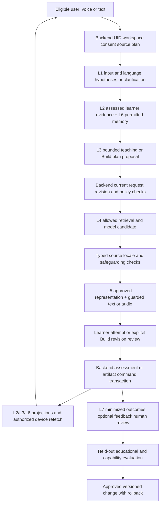

# Visionary education launch: final implementation handoff

17 October 2026 · D-090 · [Research and primary sources](../../research/EDUCATION_AGI_RESEARCH_2026_10_17.md) · [source checklist](BACKEND_LAUNCH_CHECKLIST.md) · [Jira tracking](tracking/JIRA_SYNC.md) · [VATS ownership](VATS_IMPLEMENTATION.md) · [separate Build architecture](build/README.md).

D-090 reconciles the [lifelong vision audit](VISION_ALIGNMENT_REVIEW.md) through the [delivery contract](../../integration/LIFELONG_EDUCATION_CONTRACT.md). Three additional work-ready tasks cover equitable access/promise consistency (SCOPE-09/[KAN-158](https://visionary-team.atlassian.net/browse/KAN-158)), durable stage/curriculum transitions (LEARN-14/[KAN-159](https://visionary-team.atlassian.net/browse/KAN-159)) and teacher personal learning/coaching (ROLE-10/[KAN-160](https://visionary-team.atlassian.net/browse/KAN-160)). Existing guardian/admission, parent guidance, memory and acceptance tasks carry explicit matching criteria. Current scope is 145 tasks/15 epics and 163 native dependencies; no new runtime feature or completion. D-088 research and five added education tasks below retain their original scope.

This is the current implementation baseline after the founder's India/voice/anytime and connected lifelong learning direction. Earlier reviews retain their dated evidence. It organizes work to deliver and evaluate a useful product; it does not certify AGI, universal audience/language support, production capacity or a deployed feature.

## Product outcome

An eligible user can ask or speak naturally, establish a goal, learn in manageable steps, attempt a meaningful check, receive appropriate remediation, create or teach something with the resulting knowledge, save the result and continue later on another authorized device. The UI exposes clear progress and optional short feedback without confusing implementation text. The model cannot grant mastery, permissions, grades, purchases, sharing or publication.

Human-style communication means natural AI conversation with clear mic/turn/stop state, short responses, correction and text alternatives. It does not impersonate a human or introduce a live-human scheduling/marketplace feature. Existing frontend journeys, five roles, categories, source/language behavior, Firebase UID auth/onboarding, Free/test billing/invoices and user records are preserved. Current unsupported admission—including minors—remains blocked until its existing policy/consent work is accepted. Existing UI locale support is not a declaration that voice, content or assessment is qualified in that locale.

There are three independent evidence lanes: (1) reliable connected software, (2) learner/teacher/professional outcomes, and (3) wider cognitive/generalization capability. The research supports deliberate pedagogy and independent evaluation rather than equating fluent answers, engagement or task counts with learning or AGI. See the linked research for sources and limits.

## The connected VATS loop



L6 context is read before generation; L2/L3 iterate after assessed checks; L5 is conditional; L7 is asynchronous after durable evidence. Offline attempts remain pending until the backend reauthorizes and assesses them. Conversation, speech recognition and a BKT probability are not scored receipts. AIRA coordinates the seven VATS capabilities.

## Build was included—and its remaining Stage3 gap is now explicit

The [Build delivery design](build/DELIVERY_AND_EVALUATION.md) already specifies five stages. Its existing eight launch tasks and three later tasks are in Jira. They are open work, not completed runtime features. This review adds one precise Stage3 task and links voice to the same private, revisioned project workflow.

| Stage | Existing task coverage | Current delivery decision |
| --- | --- | --- |
| 1. Durable documents | BUILD-01/KAN-75, BUILD-02/KAN-76, BUILD-05/KAN-79, SYNC/FILE/DATA gates | Private projects, immutable revisions, conflict/recovery, explicit export and two-device save/read-back |
| 2. Bounded AI assistance | BUILD-03/KAN-77, BUILD-04/KAN-78, BUILD-07/KAN-81, BUILD-08/KAN-82, AI-14/KAN-143 | Source-linked guided brief or blank creation; owned conversation/run; typed proposal against fixed base; explicit apply/reject/undo; self-review stays distinct from assessment |
| 3. Trusted interactive learning artifacts | BUILD-09/KAN-154 with AI-16/KAN-150 | New explicit task for schema/renderer admission, bounded parameters, validated assets and accessible preview; no arbitrary generated code |
| 4. Optional code and HTML | LATER-01/KAN-132 and LATER-02/KAN-133 | Qualified isolated execution and separate browser origin; containment, cleanup, egress and cost tests before enabling |
| 5. Optional public releases/app data | LATER-03/KAN-134 | Exact immutable release approval, capability-scoped data, revocation and reviewed public/private boundary |

BUILD-06/KAN-80 covers exact-revision sharing/classroom copies and consent-bound summaries across stages. Natural speech may request a project edit; it does not implicitly accept, share, submit, buy or deploy. Confirm the exact resulting revision for consequential operations. The current ArtifactStudio remains the frontend journey; no replacement editor, source purge, automatic draft migration or plan change is introduced.

## Five added work-ready tasks

| Source / Jira | Implement | Acceptance evidence |
| --- | --- | --- |
| LEARN-13 / [KAN-153](https://visionary-team.atlassian.net/browse/KAN-153) | Rights-aware downloaded lesson/activity packs, pinned source/criteria/renderer manifests, original-base pending answers/drafts and safe reconnect | Offline availability/lease/integrity, account switch and missing assets; replay one command on reconnect without false mastery, duplicate assessment or lost work. Already downloaded bytes have explicit revocation limitations. Generation remains online unless separately qualified. |
| BUILD-09 / [KAN-154](https://visionary-team.atlassian.net/browse/KAN-154) | Allowlisted declarative activity schemas and trusted accessible preview tied to project/proposal revisions | Malformed/deep/oversized/unknown payloads and injection rejected; no arbitrary code/network/hidden answers; stale proposal rejected; keyboard/mobile/fallback and save/share/export boundaries pass. |
| AI-17 / [KAN-155](https://visionary-team.atlassian.net/browse/KAN-155) | Natural two-way voice tutoring and voice-guided Learn/Teach/Build using the same authorized AIRA session | Explicit mic state; interim/final transcript; turn/chunk sequencing; short guarded audio; stop/interruption actually cancels old work/audio; uncertain math readback/correction; captions/text; revocation/reconnect and cost limits on actual devices. |
| AI-18 / [KAN-156](https://visionary-team.atlassian.net/browse/KAN-156) | India speech and pedagogical-meaning qualification matrix, reviewed held-out cases and candidate route comparisons | Licensed/consented data and split/leakage checks; released accents/noise/code switching/scripts; critical numbers/signs/units, intelligibility, clarification, latency and cost; record unsupported slices and review thresholds before enabling. No speaker identification or voice cloning. |
| ACCEPT-08 / [KAN-157](https://visionary-team.atlassian.net/browse/KAN-157) | Controlled educational-outcome protocol and eligible private pilot in staging/research conditions | Qualified baseline/assisted and unassisted novel tasks, delayed retention, teach-back/Build quality, teacher usefulness, accessibility and voice/offline recovery. Declare eligibility, evidence rationale, thresholds/stops and uncertainty. No automatic causal/superiority/AGI claim, unattended live experiments or model promotion. |

Each task preserves the shared eleven-layer acceptance: frontend/facade, versioned API, current authority, owning datastore, jobs/outbox, cache behavior, observation/recovery, ML/output validation, usage, operations and measured user outcome. No task is complete merely because a UI mock, model response or unit test exists. New voice/offline/Build demand also extends existing RELEASE-01/02/03/04 capacity/cost scenarios; it is not silently covered by the prior text-only assumptions.

## Voice and Indian-language interaction contract to implement

```text
Explicit mic start → authorized media session + consent/purpose version
  → bounded speech chunks → ASR candidate → final/corrected utterance
  → current L1/L2/L6 context → bounded AIRA teaching/Build turn
  → validated response chunk → approved TTS/audio sequence + caption
  → learner speaks / types / interrupts / stops
      ├─ stop old playback and generation with a turn fence
      ├─ late chunks are discarded, never replayed into a new turn
      └─ preserve the learning/project checkpoint and reconcile usage once
```

Interim recognition never scores an answer or executes a command. Wrong transcription is distinguishable from a learner misconception. Clarify a doubtful minus sign, decimal, unit, name or code expression; allow text correction. A provider's unvalidated audio output cannot bypass the same content/source/safety controls as text. The reviewed implementation must choose a safe guarded chunking/latency tradeoff, then measure first-useful-audio, final turn, interruption acknowledgment and recovery against preapproved released-device targets. No universal200ms or human-equivalent accuracy promise is adopted.

Keep interface, spoken input, authored source, output language and script identity independent. English/Hindi/Bengali already appear in current product/model planning; they are candidate evaluation slices, not a new declaration that their voice coverage works. SCOPE-02 explicitly accepts the first released matrix and expansion rules. Indian accents, mixed-language technical vocabulary, Romanized input and classroom/background noise need their own reviewed cases. No assumption of all22 scheduled languages, every accent or every modality follows from an upstream model card. Human/teacher reviewers verify pedagogical meaning as well as recognition metrics.

## Offline and continuity contract to implement

“Anywhere” includes degraded connectivity, not an invented local model. Offer explicit supported pack download/ready/stale/unavailable states and retain original-base drafts/answers locally with correct account partitioning. A pack needs rights, immutable source/renderer versions, integrity and a reviewed offline-use lease; cached content is not current membership or assessment authority. Session/admission/lease boundaries govern offline access. Already viewed/downloaded bytes cannot promise instantaneous remote revocation. Do not change global retention or purge original learner records.

On reconnect: reauthorize UID/workspace/source/criteria, recover the current command/result, apply eligible pending evidence once, expose any conflict or outdated source and refetch current projections. Never silently convert a local pass flag to assessed mastery. Test duplicate/reordered uploads, expired lease/session, a changed account, removed source, two-device edits and reconnection storms. Keep generation's online requirement explicit and saving/recovery independent of provider availability.

## Parallel implementation after the contract gate

| Chunk | Backend/API/data lane | ML/evaluation lane | Frontend/Build lane | Integration exit |
| --- | --- | --- | --- | --- |
| 0. Scope/contracts | SCOPE-01–09; review UID/store/action/source, admission, equitable access and OpenAPI/revision/event contracts | Define held-out task/locale/source/pedagogy evaluation cases; provider review criteria | Inventory every current control; reconcile public/internal coverage promises and retain honest states | Shared schemas, fixtures, benefit/support matrix and authority rules accepted; start with SCOPE-01/KAN-28 |
| 1. Durable foundation | DATA/PLAT/JOB/FILE/CONTENT foundations with migrations, owned receipts/outbox and policy | Approved corpus/graph mapping and offline model/metric qualification using only permitted data | Versioned service adapters and conflict/recovery UX; no pretend server saves | One concept/check/project record can be committed/retried/refetched under real authority |
| 2. Assessed teaching and documents | LEARN-01/02/08/09/10; BUILD-01–07; current source/criteria/usage admission | AI-01–16 per dependencies; calibrated policy, current context, output guard and scoped memory | Short teaching/check flow; immutable Build proposal diff/accept/reject; explicit export/share | First text learning→check→private artifact→second-device journey passes real adapter tests |
| 3. India voice, activities and offline | AI-17 session/turn/cancel; LEARN-13 pack/replay; BUILD-09 typed manifests | AI-18 qualification, ASR/TTS adapters, guarded short turns, scene/language alignment | Mic/caption/correction/stop; trusted activity renderer and accessible fallback; offline status/recovery | New voice/activity/offline outcomes and cancellation/revocation/meaning tests pass for released slices |
| 4. Role and measured outcomes | Complete ROLE/BILL/PRIV/notification/support and ACCEPT gates | AI-13 capability evidence; L7 reviewed outcomes and ACCEPT-08 educational pilot | Teacher/guardian/professional/organization flows; optional simple feedback | Real purpose isolation, assessed outcomes, usability and honest unavailable states accepted |
| 5. Controlled hosting and growth | RELEASE-01–08: quotas, load/soak, recovery, security, live configuration and support | Actual provider/model/version quality, cost and failure recovery under selected traffic | Real devices/networks and monitored limited cohort | Accepted release evidence and rollback; grow gradually toward100k MAU rather than declaring untested capacity |

These lanes describe separable responsibilities, not assumed staffing or authorization to bypass prerequisites. No subagents, parallel backend/ML feature implementation, provider calls or deployment were started by this research pass. With a solo founder, keep a small active queue and integrate one vertical result at a time. Preparatory ML evaluation can proceed beside backend work only with approved data/configuration; model output is not product authority. Changes sharing a contract/store/renderer need one owning change sequence and a frozen fixture/version to avoid incompatible parallel edits. No calendar dates or assignees are invented.

## Done and launch evidence

Before closing a task, retain its exact change, test/environment/result, schema/source/model versions and recovery/rollback evidence. Actual UI→API→store/job/model→authorized result matters. Required negative cases include wrong UID/workspace/role/source, changed consent, stale revisions, repeated commands/events, account switch, cancellation, poor network, provider outage and restarted workers. Prove two-device resume. Layer7 feedback remains optional, short and purpose-scoped; feedback is a review signal, not a training label or automatic promotion.

Education acceptance measures independent learning, retained/transferable skills, reviewer-checked artifact/teach-back quality and teacher usefulness. System acceptance measures reliable commit/recovery, latency, cost and support. Broad cognitive evidence measures unfamiliar tasks, corrections, permitted memory/tools and generalization under held-out conditions. Current seven-layer/unit-test coverage cannot merge these lanes into an AGI score.

Final scope: 145 source tasks (12 historical local Done, 127 open launch, 6 Later) plus 15 epics. D-088's five and D-090's three new tasks reuse existing parent epics. The current task map and native dependencies govern execution; older numerical Jira positions are dated checkpoints. All original requirements and current product journeys are retained. LEARN-14 connects actual stage/source transitions before lifecycle acceptance; ROLE-10 adds private teacher learning before role/pilot acceptance. Verified child admission is a prerequisite for any released school cohort, and SCOPE-09 must resolve current access/continuity promises before entitlement acceptance. Public live billing, institutional/commercial/legal approvals, native clients and full language/model capabilities retain their explicit gates.
