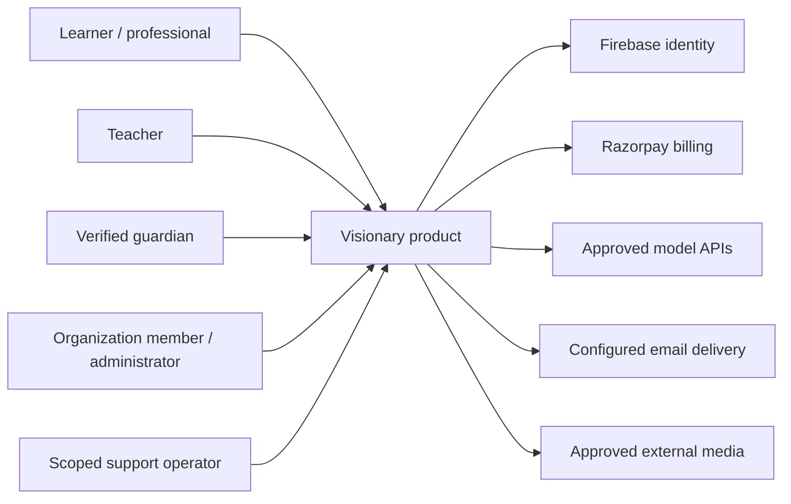
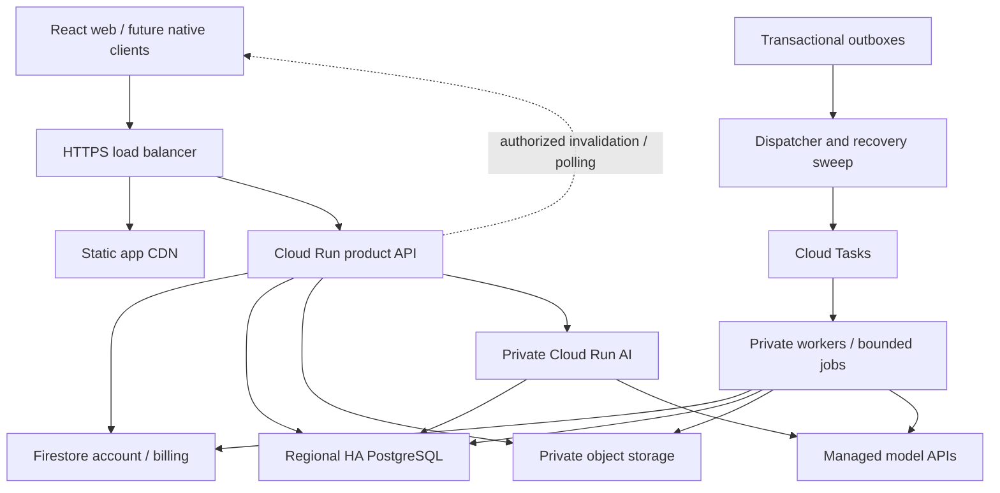

# High-level design

For a compact review of deployment, data and async boundaries, start with the [platform map](../diagrams/PLATFORM_ARCHITECTURE.md) and [numbered request paths](../diagrams/REQUEST_PATHS.md). The [review rationale](../VISUAL_REVIEW.md) maps the complete specifications and unresolved implementation work.

Scope: end-to-end education product for100,000 MAU. This elaborates [D-075](../discussions/system-design.md); target components require implementation and acceptance. See [tree](SYSTEM_TREE.md) for every product category and [operations](../discussions/launch-operations.md) for workload/recovery objectives.

## C4 context: actors and trust

The same UID can hold different memberships. Teachers do not automatically read every learner, guardians see granted summaries, organizations see their workspaces/approved aggregates, and support operators receive scoped access with an audited reason. Identity, payment benefits, membership and consent remain distinct.

## C4 containers: actual deployment boundaries

Outboxes live in their owning database. An API/worker writes an outbox in the same transaction as its domain change, then dispatches asynchronously; this is not a transaction spanning Firestore, SQL and Cloud Tasks. Raw media moves through authorized object/provider URLs rather than being buffered in Node/Go API memory.

## Module ownership and deployment rationale

| Module boundary | Authority and critical rule | Deployment choice |
| --- | --- | --- |
| Account | Verified identity, device/session, profile/setup | Current API; no model/SQL startup dependency |
| Billing | Provider-verified entitlement and owner invoice | API + separately limited reconciliation worker |
| Workspace/consent | Active membership, role action, purpose and revocation | Product module, SQL transaction authority |
| Catalog/publication | Immutable source/version/license and released visibility | Product module + async ingestion |
| Learning/progress | Attempts, criteria, delayed review, evidence-policy version | Product module + rebuildable projections |
| Artifacts/classroom | Private draft, submitted snapshot, returned feedback/revision | Product module; explicit state machine |
| Reports/connections | Permitted summary, expiry, cohort suppression and sharing | Policy-bound queries/projections |
| AI application | Approved context/actions, usage reservation and output acceptance | API orchestrates private AI; providers optional |
| Media/privacy/notifications | Private storage grants and durable jobs | Bounded workers with separate identities |

Begin with a modular API because many user commands need a single consistent relational transaction, shared policy and predictable deployment. AI is a separate runtime because provider waits, token costs and concurrency differ from profile/billing. Heavy ingestion is separated because untrusted parsing and long CPU/memory work need isolation. Do not reproduce Khan's historically published service count, YouTube's custom hardware or an unverified Classroom topology.

## Critical journeys

| Journey | Synchronous work | Durable follow-up / recovery |
| --- | --- | --- |
| Auth -> setup | Verify token, establish device session, persist UID account/setup | Idempotent personal-workspace provisioning; retry pending state |
| Pricing -> checkout | Recover intent after auth, reserve checkout, provider operation | Webhook/reconcile; immutable invoice; other device refetch |
| Learn -> Ask | Authorize published version, reserve usage, retrieve/generate/validate | Persist accepted run/evidence references; refund/reconcile reservation on failure |
| Practice -> progress | Validate attempt/revision/criteria, write evidence | Policy-versioned projection/review schedule; replay from evidence |
| Build -> class submission | Freeze project and assignment revision, verify enrollment | Teacher return/new learner revision; no mutation of submitted snapshot |
| Teacher publication | Validate source rights/review/version | Scan/embedding/evaluation -> atomic release pointer |
| Parent/employer view | Verify scoped link/share and current purpose | Summary snapshots/expiry; no inheritance from paid Family membership |
| Delete/export | Verify requester and scope, create job | Domain-specific cleanup/export, tombstones and completion verification |

## Consistency and availability

Use strong transactions for commands within one store, idempotent workflow transitions across stores, and eventual projections for dashboard recommendations/notifications. Return committed revisions immediately. A second device learns of updates via authorized foreground polling initially; later SSE accelerates invalidation. The cache/event is never proof of permission. Conflicts preserve drafts instead of silently overwriting.

Core auth/account/test billing can remain available during SQL or model failure where their own dependencies remain healthy. Learning saves cannot claim success during SQL failure. New paid inference cannot proceed when entitlement/reservation authority is unavailable. Uploaded/private source eligibility and consent are rechecked before output delivery. No stale fallback may invent Free, paid access, a source citation or learning success.

Single primary GCP region initially, with regional HA SQL and explicitly configured backup/PITR. Global CDN improves asset delivery; it does not make Firestore/SQL writes active-active worldwide. Cross-region recovery has explicit manual RTO/RPO targets and requires a restore drill. A second cloud is not an automatic disaster-recovery solution unless identity/data/queues/secrets and replay are actually portable and tested.

## Discovery, media and learning quality

Use two logical stages for recommendations: collect eligible candidates from current curriculum, prerequisites and due review; rank them using learning need, source quality, language, recency and explicit goals. Start with explainable rules. Watching time and clicks are product signals, not proof of proficiency. Version the policy and show a reason such as a due review. Learned ranking requires labeled outcomes and evaluation; do not optimize education solely for time spent.

Prefer approved external embeds for suitable public videos, subject to current provider requirements and product privacy/age policy. Owned content uses private upload, bounded scan/transcode and adaptive renditions; public licensed assets may use CDN while private media requires protected delivery. Do not download/rehost third-party videos as a cost optimization. Large video/voice/3D workloads have separate budgets and should not quietly enter a text-only AI cost estimate.

## Scaling decisions and triggers

Plan for20,000 DAU,36M non-AI API requests/month and2.4M AI turns/month under the existing assumptions. Distinguish the12-hour population activity window from per-user foreground time. A20-minute foreground assumption can spend40 requests on30-second polling and20 on other core operations; longer sessions require recalculation or pushed invalidation. Batch dashboard reads and debounce cursor/draft persistence; do not write on every keystroke or playback tick.

Load-test synchronous class starts, cold caches, provider429/outage, database reconnect and queue backlog. Tune container concurrency/pools jointly; reject excess work with a typed retry rather than exhausting database/provider connections. Split retrieval storage if it disrupts transactions; add Redis, replicas, vector infrastructure or service extraction only after measured bottlenecks. Keep the no-model/core-availability boundary intact.
