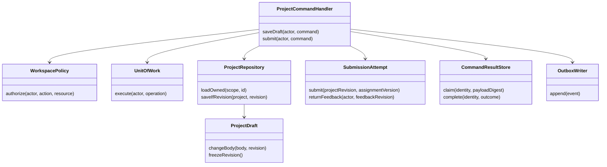

# Object-oriented design and dependency ownership

This is the target **OOP/object design** requested by the founder. It specifies responsibilities and invariants, not generated production classes. Existing React facades/functions can implement the contracts without converting every function to a class. NestJS composition and ML adapters follow the same ownership rules.

## Aggregates and value objects

| Object | Owns / methods | Must not own |
| --- | --- | --- |
| `PersonId` | Opaque verified Firebase UID value | Display-name/email matching or a new generated identity |
| `ActorContext` | Verified UID/device, membership, workspace, policy revision, purpose, deadline | Raw tokens/cookies, browser-claimed permission |
| `WorkspaceMembership` | `activate`, `suspend`, `revoke`, `canActAt`; version/expiry | Global role permission or Family billing |
| `ConsentGrant` / `ShareGrant` | Subject/recipient, explicit scope, purpose, expiry and `revoke` | Unbounded guardian/employer access |
| `SourceVersion` / `Publication` | Immutable checksum/rights/language/version; reviewed release/withdrawal | Mutable learner uploads masquerading as published curriculum |
| `LearningAttempt` | Fixed questions/criteria/source; `answer(expectedRevision)`, `complete` | Whole account/profile, model confidence as a score |
| `EvidenceEvent` / `ProgressPolicy` | Immutable outcome facts; versioned deterministic projection | Video consumption as proof of mastery |
| `ProjectDraft` / `ProjectRevision` | Mutable owned head and immutable frozen snapshot | Automatic sharing of future edits |
| `AssignmentVersion` / `SubmissionAttempt` | Fixed task/rubric; submit/return/resubmit with explicit actors | Mutation of an old submitted revision |
| `Conversation` / `AiRun` | Owned history/context; run lifecycle, accepted final reply | Cross-workspace memory or direct permission grants |
| `UsageReservation` | Bounded authorized token/cost reservation; settle/release once | A cached unlimited paid entitlement |
| `Money` / `InvoiceSnapshot` | Currency + integer minor units; issue-time identity/items/period/adjustment references | Floating-point equality or deriving old invoice from current profile |
| `AsyncJob` / `OutboxEvent` | Durable identity/state/lease/checkpoint and versioned dispatch | Sole state in a background goroutine |

Avoid a `User` object that loads every device, invoice, conversation and project. One UID joins purpose-bound aggregates; each is paginated and independently authorized. An `AccountOverview` is a read projection with per-section timestamps/revisions, not a transactionally consistent giant aggregate.

## Class/dependency diagram



The transaction adapter supplies repositories/result/outbox on the **same transaction**. Separate interfaces do not imply separate network services. Domain objects do not import NestJS, Firebase Admin, SQL drivers, Razorpay or model SDKs. Controllers translate validated HTTP DTOs into commands; application handlers compose policy and transaction; adapters implement ports. This keeps one source of each invariant and permits fake providers in meaningful tests.

## Ports and adapters

| Port | Current / target adapter | Test boundary |
| --- | --- | --- |
| `IdentityVerifier`, `SessionRepository` | Current Firebase Admin / Firestore | Real emulator or verified token fixture; wrong project/session/UID |
| `BillingRepository`, `PaymentProvider` | Current Firestore / Razorpay test | Transactional repository, fake provider, hosted test replay |
| `MembershipRepository`, `ConsentRepository`, `UnitOfWork` | Target PostgreSQL | Integration database with constraints/RLS/pool scope reset |
| `ContentRepository`, `PublicationPolicy` | Target versioned SQL/object manifests | Wrong release/license/locale/visibility; withdrawal |
| `ModelProvider`, `Retriever`, `AiOutputValidator` | Target managed provider / pgvector / product validator | Deterministic protocol fixture plus separately budgeted real model evaluation |
| `ObjectStore`, `TaskPublisher`, `Clock`, `IdGenerator` | Target GCS / Tasks / injected clock/ID | Crash/retry/cancellation/lease/replay, signed-object scope |
| Frontend `TeachingAdapter`, `MentorModelAdapter`, content adapter | Existing interfaces; target validated HTTPS transport | Account epoch, deadline, malformed reply, source/action validation |

Prefer composition to role inheritance. A person is not permanently a subclass `TeacherUser` or `ParentUser`; membership and consent are values checked in context. Different payment providers implement a provider port, rather than subclassing account behavior. Domain events carry IDs/revisions and explicit schema versions, not serialized entire objects or SDK types.

## Example application contract (illustrative TypeScript)

```ts
type Scope = Readonly<{ uid: string; workspaceId: string; policyRevision: number }>;
type SaveDraft = Readonly<{
  commandId: string; projectId: string; expectedRevision: number; body: string;
}>;
type SavedDraft = Readonly<{ projectId: string; revision: number; committedAt: string }>;

interface ProjectRepository {
  loadOwned(scope: Scope, projectId: string): Promise<ProjectDraft>;
  saveIfRevision(scope: Scope, value: ProjectDraft, expected: number): Promise<void>;
}
interface DraftCommandHandler {
  execute(actor: ActorContext, command: SaveDraft): Promise<SavedDraft>;
}
```

`ProjectDraft` and `ActorContext` above refer to the specified domain objects; this snippet is not a compile-ready source file. The concrete handler must perform [the full command transaction](LOW_LEVEL_DESIGN.md#atomic-command-algorithm), including authorization, result digest and outbox. An interface alone does not provide those guarantees.

## Invariants and useful tests

- Same UID can act in multiple contexts; a revoked membership cannot read/write through a previously allowed role or reused database connection.
- A draft change requires the current owner/revision; a submitted snapshot remains byte-identical after later draft edits.
- Completing an attempt twice produces one evidence outcome; changing criteria/source requires a new attempt/version, not retroactive rewriting.
- Replaying the same command returns its original outcome; a different payload with the same identity conflicts; no duplicate payment/submission side effect.
- Two finalizers cannot settle one usage reservation twice; failed/cancelled runs have a recoverable terminal outcome and actual cost accounting.
- `Money` rejects mismatched currencies/fractional minor units; invoice identity/history remains stable when the account name changes.

Test invariants through service/transaction/protocol boundaries rather than testing getters or mirroring each method. Keep component locks/environments and upstream patch provenance independent.
