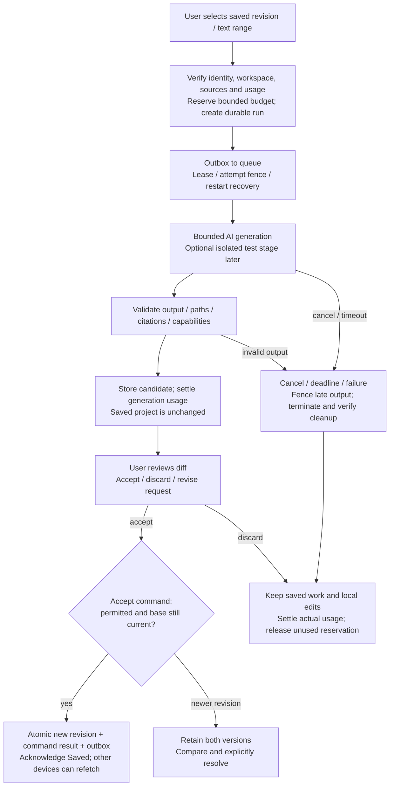

# Build generation and save lifecycle

Target flow; ordinary manual saves use the same conditional revision commit without a model run. [Contracts and state machines](../build/DATA_AND_CONTRACTS.md).

Revoked permission blocks acceptance/delivery rather than exposing a comparison the user can no longer read. Cancellation remains Stopping until termination/cleanup is confirmed. Retry uses the same command/run identity; a generation job becoming proposal-ready does not mean the user accepted its changes. Sharing, submission and deployment require separate commands after saving.
