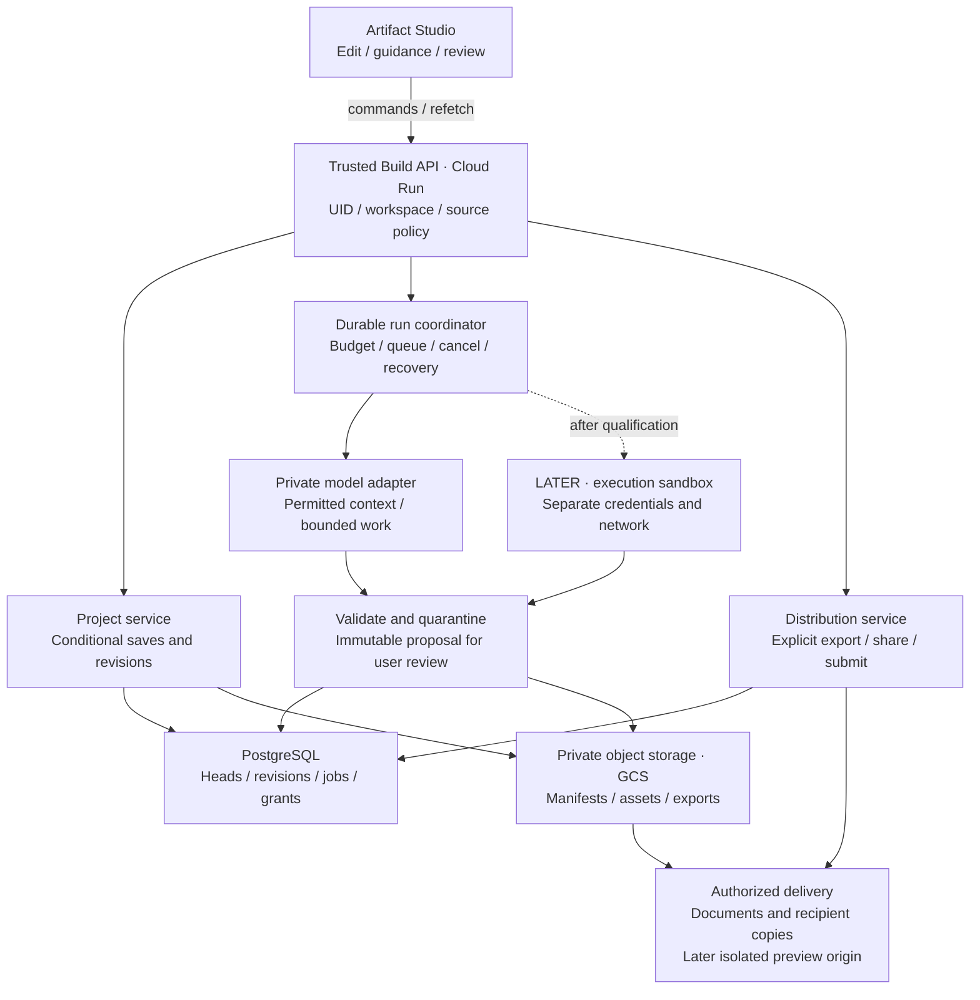

# Build system architecture

All server components below are **targets**, not deployed services. The current Build screen is a local document editor. The shared UID/account/billing foundation is shown in the [overall diagram](SYSTEM_OVERVIEW.md); this view expands Build. [Full design](../build/README.md).

The coordinator persists resumable state; the editor observes authorized events or polls and refetches. Generation creates a proposal, never an automatic publication/submission. The separate [lifecycle diagram](BUILD_LIFECYCLE.md) shows explicit acceptance and conflict handling. Execution is deferred until containment tests pass; Learn/Teach and payments never run inside this sandbox.
