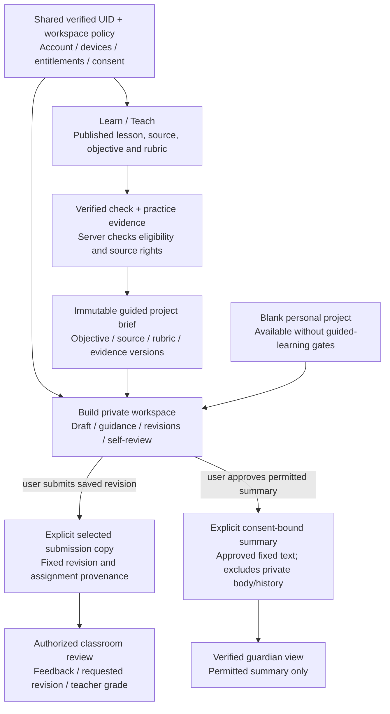

# Learn/Teach and Build: shared identity, separate authority

Target integration preserving current education/privacy rules. [Boundary details](../build/SYSTEM_DESIGN.md#learnteach-integration).

Project completion and AI checks remain application/self-review evidence until assessment; they do not award mastery. Classroom review does not grant access to the private project conversation or later edits. Family payment does not grant guardian visibility. Professional personal projects and employer workspaces keep the same explicit-sharing boundary.
