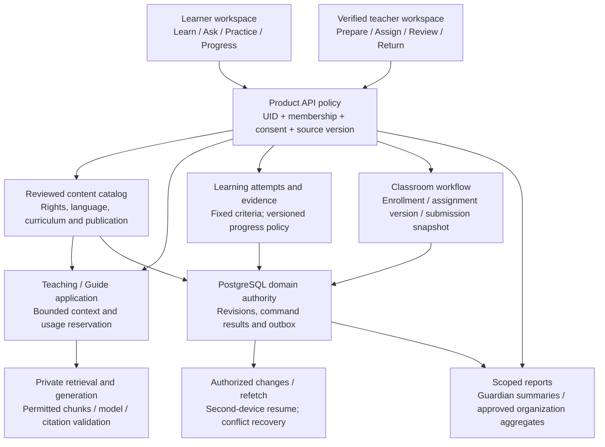

# Learn and Teach architecture

Target learning/classroom system from the existing blueprint. Browser previews currently implement many journeys; production domain APIs, source publication and ML connection remain target work.

Explanation and consumption are separate from assessed evidence. AI feedback stays proposed until the relevant policy/teacher accepts it. Guardian access never follows automatically from a Family payment. Shared Build projects enter a classroom through an explicitly selected immutable submission revision, not by exposing the private draft or conversation.
