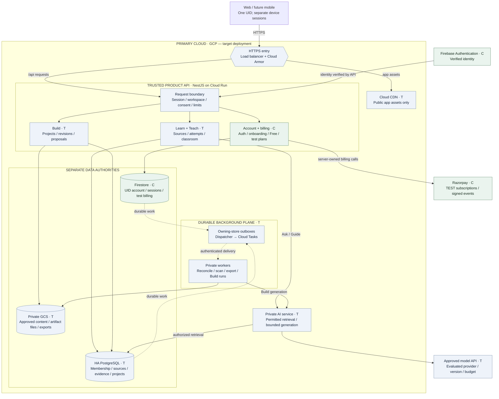

# Visionary platform architecture — review view

Review the [compact SVG](rendered/platform_architecture.svg) or [PNG](rendered/platform_architecture.png). Its original [layout source](source/platform_architecture.svg) is generated by [this script](../../../scripts/architecture-review-layout.mjs). The Mermaid below is a logical companion; the exported review map uses the fixed native layout so group labels and routes remain readable.

16 October 2026 · D-079. This is the proposed hosted topology for 100,000 MAU. **C** means implemented locally; **T** means target. Hosting, SQL domains, private AI and workers are not deployed. Boxes inside the product API are modules in one deployment, not a microservice per feature.

Solid arrows show request/data dependencies; dashed arrows show durable asynchronous scheduling. Responses follow the caller's authorized channel. Logical dependencies are not firewall/IAM grants. Workers have narrowly scoped repositories/credentials; the queue never grants account or project access. Billing reconciliation writes only its owning Firestore authority; Build/learning workers write the corresponding SQL records. Outboxes are committed with their store's domain mutation, never in a cross-store transaction.

Private downloads and large uploads use a separate authorized data path; they do not travel through the model. See [request paths](REQUEST_PATHS.md), [resilience and scale](RESILIENCE_AND_SCALE.md), [communication contracts](../blueprint/COMMUNICATION.md), [Build execution boundary](BUILD_SYSTEM.md) and the [review rationale](../VISUAL_REVIEW.md). Optional generated-code execution is deliberately outside this trusted platform view and remains gated in the Build design.
