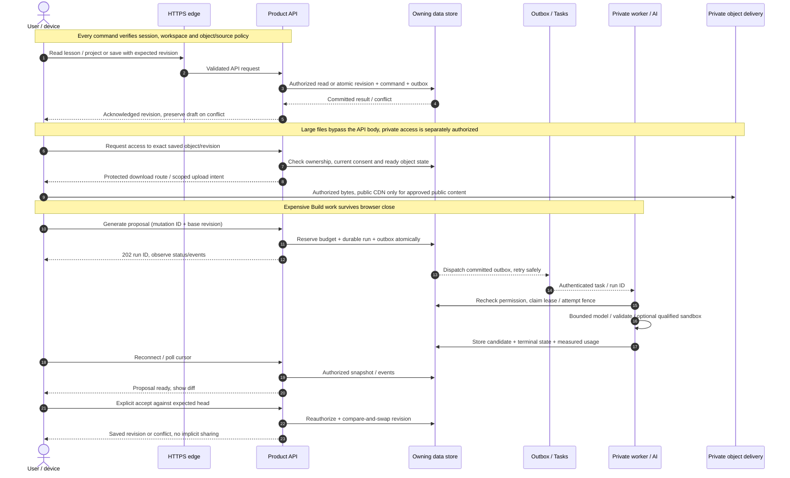

# Visionary request and data paths

D-079 · target contracts; existing auth/account/test-billing routes retain their current names. Numbered paths explain the platform without mixing API commands, file delivery and asynchronous generation into one request.

Each transaction above uses its own authoritative store: account/payment commands use Firestore; future projects/evidence use SQL. A cached event cannot authorize a read. A short-lived signed URL has a residual validity window; use an authenticated gateway for content requiring immediate revocation. Upload intents target quarantine and require completion/scan before attachment. Ordinary save/read does not wait for a queue, model or sandbox. Full endpoint/state behavior remains in [shared communication](../blueprint/COMMUNICATION.md) and [Build contracts](../build/DATA_AND_CONTRACTS.md).
