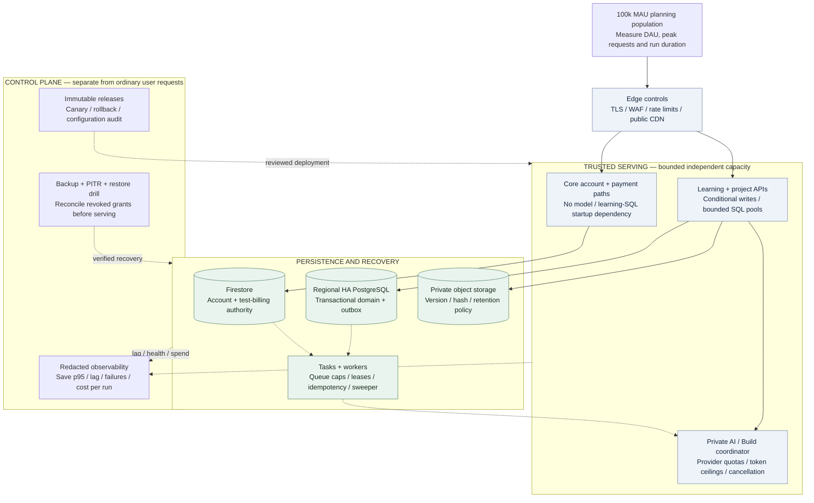

# Visionary scaling and failure boundaries

Review the [compact SVG](rendered/resilience_and_scale.svg) or [PNG](rendered/resilience_and_scale.png). The [native layout](source/resilience_and_scale.svg) is generated by [the layout script](../../../scripts/architecture-review-layout.mjs); the Mermaid below preserves the logical dependency view.

D-079 · proposed controls, not capacity-test results. Optional cache/service splits are triggered by measurements. A regional HA database does not constitute cross-region disaster recovery.

Solid arrows are request/data dependencies; dashed arrows are asynchronous work or operational control, as labeled. These are logical capacity/failure boundaries, not a claim of separate microservices for every box. Core and domain modules can initially share a Cloud Run deployment: isolate handlers, timeouts and pools, with service-wide admission caps; that protects dependency availability but not against process-wide CPU/memory exhaustion. Extract core billing/account serving into an independently sized deployment if measured contention threatens its error budget. Private AI/workers are separate deployments from the start; code execution is a further isolated plane.

## Measurable growth decisions

| Signal | First response | Larger change only after evidence |
| --- | --- | --- |
| SQL pool waits / transaction p95 | Bound total instance × pool count; optimize tenant-scoped indexes and queries | Read replica for eligible stale reads or a measured data/service split; no day-one sharding |
| Repeated approved-content reads | Batch, immutable asset CDN and permission/version-scoped in-process caching | Managed Redis only after a quantified hit-rate/cost/security case; never cache authorization as truth |
| Queue age / lease expiry | Per-workload dispatch caps, backpressure, worker scaling and recovery sweep | Separate worker pools/queues for measured CPU, IO or fairness needs |
| Model 429, long tails or spend | Reserve budget, cap context/attempts, circuit break and preserve editing | Evaluated model routing/failover within the same run budget; no replay of external side effects |
| Build execution concurrency | Keep execution disabled until qualified; size runs × duration × resource limits | Independent sandbox fleet only for an approved execution launch |
| Private file delivery / owned-media cost | Direct authorized object delivery, bounded retention and measured egress | Reviewed protected CDN/renditions; do not rehost third-party media |
| Regional failure / corrupted restore | Operate the tested recovery runbook with explicit RPO/RTO | Cross-region recovery capability after restore/revocation/replay drills; multi-cloud is not automatic recovery |

Use the [shared workload and cost model](../blueprint/CLOUD_AND_COST.md), [Build demand scenarios](../build/DELIVERY_AND_EVALUATION.md) and [operational release gates](../discussions/launch-operations.md). MAU is neither requests per second nor simultaneous execution slots. Scale compute, database connections, provider limits and spend together.
