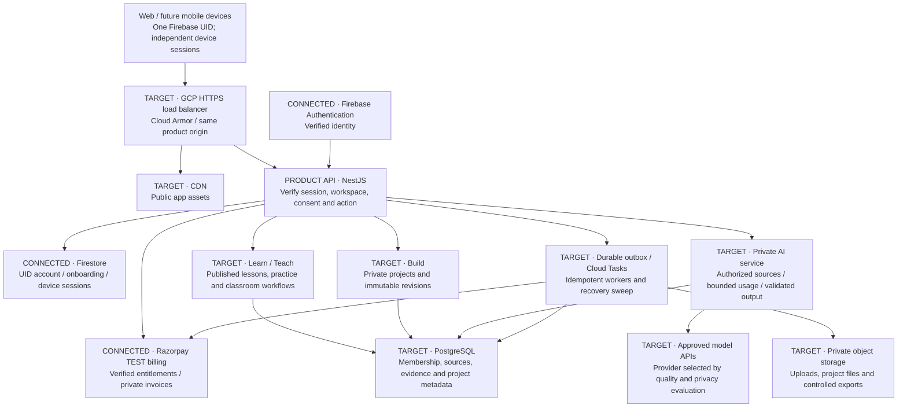

# Visionary system overview

16 October 2026 · D-078 · review diagram for the 100,000-MAU architecture.

**Connected locally**: Firebase identity, account/onboarding/device sessions and Razorpay test billing. **Target**: hosted GCP infrastructure, relational learning/permissions, AI serving and the Build runtime. A diagram describes the design; it does not deploy these services.

The shared foundation serves both tracks. [Learn/Teach](LEARN_TEACH.md) owns curriculum, learning evidence and classroom policy. [Build](BUILD_SYSTEM.md) owns creation, revisions and later reviewed execution/publication, specified after its dedicated reference study. The product API verifies and manages device sessions. Firestore and SQL have separate transactional authorities. No model or browser can grant membership, paid access or publication.

Detailed existing blueprint: [system tree](../blueprint/SYSTEM_TREE.md), [communication](../blueprint/COMMUNICATION.md), [cloud/cost](../blueprint/CLOUD_AND_COST.md).
