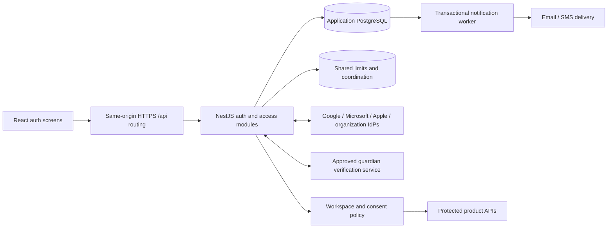

# Authentication system design — discussion draft

**Superseded identity recommendation:** the founder selected Firebase Authentication on 14 October 2026. Read the [current Firebase design](firebase-auth-system-design.md) for identity, provider, session, abuse-limit and device-sync proposals. This initial draft retains source findings and acceptance context; owned password hashes/Passport federation are not the selected production approach. D-059 records the change.

Date: 14 October 2026. Status: proposed architecture; implementation has not started. The founder requested design and setup planning before implementation, and confirmed all visible sign-in providers, children and adults, India first, and all three organization connection families discussed: Google Workspace, Microsoft Entra ID and SAML. These scope choices do not approve the technical recommendations below.

Read with [product domains](../PRODUCT_DOMAINS.md), [the product contract](../../visionary/VISIONARY_MASTER_v2.2.md), [integration gaps](../../../integration/CONTRACT_GAPS.md) and [source provenance](../../../integration/upstream-lock.json). This is an engineering proposal for Visionary, informed by public standards and observed source. It does not describe Google's or Apple's private infrastructure.

## 1. Outcome and release boundary

An eligible person can register, prove control of a sign-in method, complete the appropriate consent and onboarding steps, sign in on another device, recover access, change credentials, manage sessions and sign out. Every protected request has a server-verified actor and authorized workspace. A deleted, suspended or revoked account/session cannot continue using an old credential.

The requested complete scope includes email/password with email verification, Google, Microsoft, Apple, organization SSO, and the visible mobile/account-ID recovery journeys. Phone/SMS is a separate credential integration with abuse and delivery costs. A child does not need a personal email address or phone: guardian-managed learner profiles must have separate person/workspace IDs, with child credentials enabled only through the approved child-account process. The guardian's session remains the guardian's identity.

Authentication establishes the actor. Authorization establishes what that actor may access. Neither a chosen frontend role nor successful SSO establishes organization membership, parent authority, access to learning history or permission to use ML. Auth completion includes these access boundaries; it does not imply that every learning feature has acquired server persistence.

## 2. Current implementation and specific gaps

| Area | Observed source | Work required |
| --- | --- | --- |
| Frontend session | `AuthContext.jsx` calls asynchronous `appClient.auth.me()` without awaiting it; it can treat a Promise as a signed-in account | Explicit checking/anonymous/authenticated/restricted/unavailable states; await and reject obsolete responses |
| Frontend credentials | `appClient.js` uses browser-local users, password hashes, sessions and reset tokens; `verifyOtp` ignores the supplied code | Replace auth calls with a real HTTP adapter; local data cannot prove identity |
| Login/register | Email existence is checked through `entities.User.filter` | Preserve email-first screens while removing the public account-directory/existence lookup |
| Recovery | Browser-local reset request returns a reset token; ForgotUserId only waits and displays success | Delivered single-use recovery challenges and meaningful service-error states |
| Social/mobile/org | Social handler swallows errors; mobile and organization forms say coming soon | Real configured flows, visible cancellation/failure/retry; verified end-to-end provider coverage |
| NestJS baseline | Register, OTP, resend, password login, Google, me, profile, password change and deletion request exist | Reuse and harden the implementation; add missing contracts and guard every entry point |
| OTP | Random six-digit codes, bcrypt hashing, expiry, attempts and cooldown already exist | Separate purpose-bound challenges; atomic consumption/attempt budgets and race-safe resend/delivery |
| Sessions | Seven-day JWT cookie and response token; logout only clears the cookie | Durable session revocation, expiry policy, device list, logout-all and credential-change invalidation |
| Deleted accounts | Login rejects deleted users, but JWT strategy accepts any existing user | Check account/session eligibility on every protected request; deletion revokes immediately |
| Passwords | bcrypt cost 10; register accepts six characters and up to 128 characters | Agreed stronger policy, modern KDF and explicit legacy verification; no silent bcrypt truncation |
| Google | Profile-based OAuth strategy; no configured state/nonce protection shown; creation matches googleId but can collide with an existing email | Verified OIDC claims, correlated callbacks and explicit identity linking |
| Onboarding/access | Imported User has category fields for three roles; frontend has five roles and local relationships/workspaces | Separate account, person, role profiles, memberships and consent; transactional onboarding |
| Runtime | Google and OpenAI clients are constructed eagerly; Vite has no `/api` proxy; backend defaults refer to old frontend port 3000 | Auth must boot independently of ML; same-origin routing and environment validation |

These are source findings. This design review has not exercised SMTP/SMS, a live database or real provider callbacks. Historical builds and frontend tests did not establish real authentication.

## 3. Recommended architecture and alternatives

Retain React/Vite, the imported NestJS application and Prisma/PostgreSQL. Start with a modular backend and a notification worker, with multiple API replicas possible without local session state. Use Redis for shared abuse limits and queue coordination; PostgreSQL remains the authority for accounts, sessions, memberships and consent. No cloud vendor, Kubernetes deployment or traffic capacity is selected in this discussion.

Auth must work while ML is unavailable or unconfigured. A later ML call receives a backend-authorized context and a separate service credential; browser sessions, passwords and identity-provider tokens never become RAG credentials.

| Decision | Recommendation | Tradeoff / alternative |
| --- | --- | --- |
| Identity ownership | Harden the organization-owned NestJS implementation with maintained protocol/WebAuthn libraries | Owning recovery, abuse controls, federation and incident response is ongoing work. A managed identity broker is a valid alternative if reducing that work outweighs vendor cost/dependency; keep Person/workspace policy in Visionary either way |
| Browser sessions | Opaque random token in HttpOnly cookie, backed by a PostgreSQL session record | Database lookup per request buys direct revocation. JWT with session/introspection state can work, but a standalone long-lived JWT cannot satisfy immediate revocation |
| Browser/API origin | One HTTPS product origin; reverse proxy `/api` to NestJS | Fits the frontend's current `connect-src 'self'` policy and simplifies cookies. Separate API origin requires a separately reviewed CORS/cookie/deployment design |
| Provider integration | Server-side authorization-code flows, maintained OIDC/SAML libraries | Avoid building token/XML validation ourselves; provider registrations, keys and test tenants are still necessary |
| Workspace selection | Server stores an authorized default; each request names its intended workspace, which the server validates | Tabs may use different authorized workspaces. A navigation selection is not an authorization grant |

The proposed browser cookie is `__Host-visionary_session`, with Secure, HttpOnly, SameSite=Lax, Path=/ and no Domain in HTTPS environments. JavaScript receives account/session metadata, not the credential. CSRF tokens and source-origin checks protect ordinary state-changing requests, including login/logout. Cookie attributes are defense in depth, not a complete CSRF defense. See [OWASP sessions](https://cheatsheetseries.owasp.org/cheatsheets/Session_Management_Cheat_Sheet.html) and [CSRF guidance](https://cheatsheetseries.owasp.org/cheatsheets/Cross-Site_Request_Forgery_Prevention_Cheat_Sheet.html).

Provider callbacks have their own narrowly scoped validation, rather than disabling CSRF checks globally. Apple and SAML can return cross-site POSTs: use a short-lived Secure HttpOnly SameSite=None transaction cookie, bound to a server-stored one-time state/request record. The regular session cookie remains Lax. A callback must match the initiating browser/transaction, expected provider and validated response; a state value alone must not become a portable login link. Test cookie behavior on actual Safari/Chrome/Edge. HTTP loopback email tests use a distinct development cookie; Apple/SAML callback tests require a registered HTTPS test origin.

## 4. Identity, sessions and permissions data

Logical tables below are proposed; exact Prisma models/migrations follow agreement. Preserve existing User IDs and foreign keys. Do not replace the imported schema with unrelated duplicate account tables.

| Record | Purpose and constraints |
| --- | --- |
| Account (existing User, evolved) | Login principal; pending/active/suspended/deletion_requested/deleted state, credential/security version and trusted timestamps |
| Person | Product identity with stable ID, age classification, jurisdiction/assurance evidence reference and preferences; managed child may initially have no login account |
| VerifiedContact | Email/recovery email/phone, normalized lookup value, verification time and purpose; proof required before use for login/recovery; define uniqueness separately for shared guardian contacts |
| PasswordCredential | Versioned Argon2id hash and changedAt; legacy bcrypt compatibility where actual server records exist; never import browser hashes |
| ExternalIdentity | Account + provider/connection + issuer + subject; unique within that issuer/connection; display email is not identity |
| AuthSession | Unique hash of a 256-bit random token, account, created/last-used/absolute expiry, revokedAt, authentication methods, last step-up time and bounded device label |
| AuthChallenge / AuthTransaction | Purpose, target/binding, hash or keyed digest, expiresAt, attempts, consumedAt, generation, browser binding; OAuth state/nonce/PKCE and SAML request correlation expire independently |
| RoleProfile / Workspace | Five existing roles; separate context and personal/org space; validated defaults and revisioned onboarding |
| Organization / Membership / SsoConnection | Tenant identity, explicit active memberships/capabilities, connection trust/allowed tenants, invite/JIT policy and credential references |
| GuardianRelationship / VerificationEvidence / ConsentGrant | Separate adult assurance, relationship approval, exact processing/report scopes, notice version, expiry and revocation; payer membership grants no guardian access |
| Authenticator / RecoveryCode | WebAuthn keys, approved step-up factors and single-use hashed recovery codes; enrollment/recovery are audited |
| AuditEvent / NotificationOutbox | Durable security transitions and reliable delivery; restricted access and approved retention |

Phone-only and provider-only accounts require an agreed migration away from mandatory email/name assumptions. Keep pending/unverified contacts distinct from verified canonical contacts. Proposed email lookup policy is trim plus case-insensitive comparison, preserve original display spelling and detect collisions; do not strip Gmail dots/plus aliases or merge providers by email. Normalize phones to E.164 with explicit region input and re-verification for changes.

The server derives account/person from the session. Client workspace IDs are selectors, not proof. Membership state, capabilities, object ownership, relationship scopes, consent and current policy revisions govern every list/get/write/export. Self-selecting a teacher or organization profile never grants access to another person's records or an existing tenant. Organization bootstrap grants an owner only for a newly created organization through a reviewed, audited flow.

Adopt a shared session/access guard across all protected controllers, not just `/auth/me`. Explicit public-route exceptions cover approved login/eligibility/callback/health/catalog operations; public data remains a deliberate policy. Retire legacy browser JWT acceptance at cutover, including Bearer fallback in chat/documents/jobs/subjects/onboarding. Any temporary compatibility path must consult the same session/account authority and have an expiry; no parallel guard may bypass revocation. Native clients and service tokens require separate audience/credential contracts later.

## 5. Core flows

### Eligibility, registration and email verification

1. Start with an accessible age/eligibility choice before child email/password collection or social-provider redirects. Preserve the existing design language; move the necessary child gate earlier in the journey.
2. Adults enter email/password or choose a provider. Validate server-side, apply shared abuse limits and issue a purpose-bound challenge. Registration returns a consistent accepted response without exposing an account-existence directory. Existing account attempts must never overwrite credentials or enable account takeover.
3. Persist pending registration, challenge and delivery outbox atomically. Pending registrations expire. A resend creates a new generation and invalidates the previous code; it does not reset the cumulative attempt/abuse budget.
4. Verification atomically checks binding, expiry and attempts, consumes the current code and activates the appropriate account. Password activation must be bound to the intended registration transaction; if verification occurs in another browser, require re-entry of the intended password or restart rather than activating an attacker's pre-registered credential.
5. Create a fresh limited or normal session according to eligibility. `/me` supplies the authoritative next step: consent, onboarding, workspace selection or Home. An email-verification OTP is not an MFA factor or proof of age/guardianship.

### Login, session lifecycle and logout

Login validates a password/provider assertion and account state, then creates a fresh session token; rotate on authentication and privilege elevation. Store only its digest. Read account/session authority from the primary database, not a stale positive cache or read replica. Revocation is effective for newly authorized requests immediately after commit; cancellation events and rechecking authority before sensitive writes/streamed output address in-flight work. Already delivered information cannot be recalled.

Proposed initial policy values, to review with real usage:

| Control | Proposed starting policy |
| --- | --- |
| Ordinary session | 8-hour absolute lifetime, 30-minute inactivity timeout; server-enforced |
| Remember on a personal device | Optional for eligible adults only: 7-day absolute, 24-hour inactivity; shared-device/child journeys do not default to it |
| Sensitive operations | Authentication/step-up within 5 minutes for credential linking, guardian approvals, organization owner changes, exports and deletion |
| Email verification | 6 digits, 10 minutes, 60-second resend cooldown, maximum 5 failed attempts per challenge plus cumulative target/network limits |
| SMS verification | 6 digits, 5 minutes, 60-second cooldown, maximum 5 failed attempts plus cumulative delivery/spend limits |
| Password reset | 256-bit random single-use token, 15-minute expiry; only delivered to a previously verified recovery contact |
| Provider transaction | Single-use, browser-bound, 5-minute expiry; shorter replay windows where required |

These are proposed product settings, not claims that standards mandate those exact durations. Rate-limit thresholds require school/shared-network and load testing; use target + network + transaction budgets, controlled backoff and spend caps, rather than blocking a school solely because it shares an IP. Counters/consumption must be atomic across replicas.

Logout revokes the database session and clears the cookie. Logout-all, password reset, account suspension/deletion and credential compromise revoke applicable sessions and outstanding challenges in the same authoritative transition. Password change requires the existing password or appropriate strong reauthentication for provider-only accounts. After change, revoke other sessions and replace the current one. Do not imply logout removes browser history, local drafts or the provider's own session.

### Google, Microsoft, Apple and safe linking

Use authorization code and backend exchange, validating signature, trusted issuer, client audience, expiration, nonce and one-time state. Use PKCE where the provider supports it and exact registered callbacks. Return only an allowlisted local destination, never session tokens in the URL. Add the currently absent `/auth/callback` route; it reloads `/me` and ignores URL onboarding/role claims.

Google identity is the validated issuer/subject pair; require the appropriate verified-contact claim rather than assuming an email string proves ownership. Google documents `sub` as the stable identity key. See [Google OIDC](https://developers.google.com/identity/openid-connect/openid-connect).

Microsoft personal sign-in and organization Entra sign-in have separate audience/tenant policies. Validate tenant-specific issuer/claims using a maintained library; an email suffix or tenant claim alone grants no membership. See [Microsoft OIDC](https://learn.microsoft.com/en-us/entra/identity-platform/v2-protocols-oidc) and [claim validation](https://learn.microsoft.com/en-us/entra/identity-platform/claims-validation).

Apple needs a Services ID, approved domain/callback and server signing-key lifecycle. Handle POST callbacks, relay email, missing/repeated profile data and name sanitization. Do not assume Apple has PKCE parity with other providers; verify the selected documented flow. See [Apple authorization](https://developer.apple.com/documentation/signinwithapplerestapi/request-an-authorization-to-the-sign-in-with-apple-server.).

For an existing matching email, require fresh authentication to the existing account plus a successfully bound new-provider flow before linking. Never auto-link from an email match, accept a client-supplied provider ID, or silently create duplicate accounts. Do not allow unlinking the last usable sign-in/recovery method. Provider tokens remain server-side and are discarded when no ongoing provider API access is needed.

### Organization SSO

Support Google Workspace and Microsoft Entra OIDC connections, plus SAML connections for configured institutions. Each connection has an administrator-approved issuer/tenant, keys/metadata, callbacks, mappings, membership policy and lifecycle. All three connection families are release scope; supporting every institution still requires per-tenant configuration and verification.

Use an invite, organization slug or approved domain discovery to choose a connection. Never fetch arbitrary user-supplied metadata URLs; connection setup must control SSRF, private-address access, redirects and key trust. Bootstrap/configuration requires verified organization authority and strong reauthentication.

SSO authenticates a person; explicit membership/invite or approved least-privilege provisioning authorizes that tenant. Just-in-time provisioning defaults off. If enabled, grant only configured baseline membership, never owner/admin from arbitrary claims. A tenant may require its SSO assurance for work access even while the person uses email/Google for a personal workspace. Personal credentials and recovery must not bypass enforced organization SSO.

SAML uses maintained validation, trusted metadata/certificates, audience/destination/recipient and time checks, signed-content validation, request correlation and durable replay detection. Start with SP-initiated login; unsolicited IdP-initiated login requires a separate review. Verify certificate rollover and assertion wrapping defenses. See [OWASP SAML](https://cheatsheetseries.owasp.org/cheatsheets/SAML_Security_Cheat_Sheet.html).

Membership removal blocks work access while retaining independently permitted personal access. Define administrator deprovisioning now; add SCIM/directory event integration according to institutional requirements. Local session revocation cannot be assumed from an IdP logout; test configured single logout separately.

### Mobile, account recovery and stronger authentication

Phone sign-in uses a verified phone identity and purpose-bound SMS challenge. SIM replacement/recycled numbers and delivery fraud require conservative recovery policies; SMS alone cannot approve guardian verification, administrator privileges or bypass strong-auth recovery. Children use an approved guardian-managed path instead of being required to own a phone.

Forgot-password and account-ID discovery always give consistent accepted responses. Deliver recovery information only to an already verified contact; never return account lists/reset tokens to the requester. Infrastructure failure is a retryable service error, not a fabricated delivery success. OAuth-only accounts are guided to their provider and may add a password only after the defined authenticated verification flow. Possession of an arbitrary unverified recovery email is insufficient.

Consume reset tokens atomically with password replacement and revocation; two parallel resets cannot both succeed. Do not auto-login after reset. Strip reset secrets from the frontend address bar after capture, avoid analytics/third-party assets on recovery pages, and redact query strings/body secrets from edge and application logs. Use a configured origin for reset links, never an untrusted Host header. See [OWASP recovery](https://cheatsheetseries.owasp.org/cheatsheets/Forgot_Password_Cheat_Sheet.html).

Propose WebAuthn/passkeys as strong step-up for organization owners/admins and sensitive guardian actions, with accessible enrollment and tested recovery. Trusted enterprise assurance may satisfy a reviewed policy; provider branding does not imply MFA. Recovery codes are hashed, single-use and shown once. Lost-factor recovery must not downgrade to email/SMS alone or grant support staff an undocumented bypass.

For password-only authentication, propose at least 15 Unicode code points, maximum 128 code points with a bounded encoded size, spaces/Unicode and password-manager paste, compromised-password screening, and no arbitrary composition or routine expiry rules. This uses [NIST's current password guidance](https://pages.nist.gov/800-63-4/sp800-63b/authenticators/) as a design reference, without claiming NIST certification.

Propose Argon2id for new hashes, starting at the OWASP floor of 19 MiB/two iterations/one lane and benchmarking on the actual deployment runtime before setting production parameters. Version stored hashes; verify legacy server bcrypt records without silent truncation and rehash after legitimate authentication where safe. Browser SHA-256 password records are not migrated. See [OWASP password storage](https://cheatsheetseries.owasp.org/cheatsheets/Password_Storage_Cheat_Sheet.html).

## 6. India-first children and consent

India's Act defines a child as under 18. The final 2025 Rules provide adult identity/age checks for parental consent and conditional child-processing exemptions. The Act commencement notification and Rule 1 phase relevant provisions over eighteen months; as of this draft, do not describe every obligation as already commenced. Exact launch-date applicability, exemptions, retention and institutional responsibilities require legal review. References: [Act](https://www.meity.gov.in/static/uploads/2024/06/2bf1f0e9f04e6fb4f8fef35e82c42aa5.pdf), [final Rules](https://www.meity.gov.in/static/uploads/2025/11/53450e6e5dc0bfa85ebd78686cadad39.pdf), [commencement notification](https://www.meity.gov.in/static/uploads/2025/11/c56ceae6c383460ca69577428d36828b.pdf).

Engineering proposal: build the protective baseline now. A minor/unknown-age choice begins a guardian-first journey before child credential/profile collection or provider disclosure. A school login is not automatically an exemption. Only a reviewed institutional pathway may supply the documented authority for specified processing. Avoid treating a pending child User row as permission to collect child data.

An authenticated guardian completes adult identity/age assurance using an approved verification process, attests/establishes the relationship under the reviewed policy, sees an itemized purpose notice and approves explicit scopes. Store minimal evidence references/results and notice versions; separate relationship state from consent. Prefer an authorized token-based verification route where available; DigiLocker/other verification access and suitability must be validated before choosing a vendor. Do not presume credentials/API access exist, mandate Aadhaar by default, or store identity-document images in ordinary auth tables.

Then create/link the learner identity and permitted credentials transactionally. Email OTP, a credit-card payment, shared surname, self-declared adult role and a client consent boolean are insufficient assurance. Existing child profiles need the same reviewed activation check.

Consent is scoped and versioned: registration/service provision, permitted learning processing, guardian reports, organization sharing and optional model improvement are separate decisions. Revocation/expiry blocks affected reads, writes, exports and ML requests, invalidates policy-derived caches and stops pending delivery. Preserve a restricted path for consent/recovery and rights requests rather than hiding the person entirely. Child sharing defaults off; preserve the product's ad-free child experience. Do not infer mastery or a guardian relationship from model output.

Age correction and transition to adulthood require server-reviewed state changes; editing a frontend age field cannot bypass policy. Turning 18 does not automatically preserve guardian report access. Interface language (en/hi/bn) remains separate from source and output languages; notices and consent flows must be understandable and accessible.

India is the first configured jurisdiction. Later-country activation requires reviewed policies, notices, verification methods and provider tests; a country dropdown is not global compliance.

## 7. Proposed API and frontend contract

Version the DTO schema explicitly; preserve useful existing endpoint names. These routes are proposals, not available APIs. Every mutation uses validated DTOs, payload limits, authorization where relevant, CSRF or its specified protocol protection, shared abuse controls and redacted request IDs.

| Endpoint | Result / rule |
| --- | --- |
| `GET /api/auth/config` | Public configured methods and approved eligibility/notice versions; no secrets or account existence |
| `GET /api/auth/csrf` | Browser-bound pre-auth/session CSRF token, no-store |
| `POST /api/auth/register` | `202` accepted + opaque challenge context; no credential returned |
| `POST /api/auth/verify-otp`, `/resend-otp` | Purpose/binding/generation validated; cookie issued only after eligible verification |
| `POST /api/auth/login` | Account/session envelope + Set-Cookie; generic invalid-credential response |
| `GET /api/auth/me` | Authoritative account/person/permitted-workspace/next-step/session metadata; `401` anonymous, `503` unavailable |
| `POST /api/auth/logout`, `/logout-all` | Revoke authority; repeat-safe responses; clear cookie |
| `GET /api/auth/sessions`, `DELETE /api/auth/sessions/:id` | Own active sessions and own revocation; no token digests exposed |
| `POST /api/auth/forgot-password`, `/reset-password` | Accepted request; one-use token consumption, password update and revocation |
| `POST /api/auth/recover-identifier` | Generic acceptance; send to verified contact only |
| `POST /api/auth/phone/request`, `/phone/verify` | Purpose-bound SMS challenge; provider/spend/abuse policy enforced |
| `GET /api/auth/:provider/start`, provider-specific callback | Validated configured Google/Microsoft/Apple login; callback methods differ |
| `POST /api/auth/sso/discover`, configured SSO start/callback | Organization connection discovery and validated OIDC/SAML result |
| `POST /api/auth/identities/link`, unlink operation | Fresh reauthentication + bound provider proof; protect last usable method |
| Authenticator enrollment / step-up / recovery endpoints | Challenge-bound WebAuthn/factor lifecycle; exact routes specified with selected library |
| `PATCH /api/auth/profile`, `/password` | Field allowlist, conflict preconditions and required reauthentication; no role/consent assignment |
| `POST /api/onboarding/complete` | Validated role/context/eligibility; atomic Person/profile/workspace creation; idempotent transaction |
| `GET /api/workspaces`, default-selection / role-profile operations | Current permitted spaces; requested role creation follows eligibility/tenant policy |
| Guardian verification/invitation/consent endpoints | Own scoped transitions; provider evidence and approved legal policy are required |
| `POST /api/auth/delete-account` | Fresh strong proof, immediate access revocation, durable request; truthful retention/deletion state |

The `/me` DTO must include `schemaVersion`, `account`, `person`, `workspaces`, `defaultWorkspaceId`, `onboarding.state`, `eligibility.nextAction`, `authorizationRevision` and non-secret `session` expiry/authentication metadata. Person/workspace IDs come from the server; browser-selected role strings are not permissions. Distinguish auth session IDs from learning `Session` IDs in the existing domain model.

A narrow adapter maps existing `onboarding_complete`, `full_name`, `identity` and richer context fields to explicit canonical DTOs. Do not scatter camelCase/snake_case mapping throughout pages or flatten `professional` into `student` in server persistence. Public error responses have stable codes, requestId and retryability; validation is `400`, unauthenticated `401`, forbidden `403`, revision conflict `409`, abuse `429` with Retry-After, service failure `503`. Unowned object reads may return `404` to avoid disclosure.

Frontend integration must:

- Await session bootstrapping and distinguish anonymous from network/service failure. No protected content is revealed while identity is unresolved.
- Reject responses from obsolete account/workspace/auth generations; cancel requests and clear person/workspace-scoped caches at transitions. Broadcast only session-change hints; other tabs re-read the server.
- Submit credentials only over the approved transport; never persist passwords, OTPs, bearer/session tokens or authority in localStorage. Keep CSRF material in bounded memory.
- Use real `/me` for callback, reload and return-to decisions; sanitize local destinations and preserve drafts on failure.
- Display provider cancellation, unavailable configuration, expired code, resend cooldown, consent pending/revoked and recoverable network errors. Do not silently swallow social failures.
- Preserve screens, role navigation, source/privacy behavior and language preferences while introducing the necessary eligibility, consent and strong-auth states.
- Keep preview and live data modes explicit. Browser records do not become trusted users, memberships, consent or learning evidence. Do not delete/transfer them as part of auth cutover.

The existing `initializeLearningWorkspace` and local role bootstrap cannot remain the authority for live onboarding. Replace the account/workspace part with the server transaction and retain any browser learning records only in a clearly labeled preview/recovery boundary. Authenticated navigation alone must not advertise local linked-role records as production-authorized server data. Every later learning-data cutover is separately scoped and verified.

## 8. Setup, operations and growth

This section is a setup plan; no environment is provisioned by this document.

1. Review threat model, contracts, identity ownership, child assurance and provider trust. Select maintained OIDC/SAML/WebAuthn/Argon2 libraries with compatible locks and vulnerability review.
2. Start isolated application PostgreSQL and Redis using the existing local Compose configuration after Docker is available. Add a local email sink and SMS/verification test adapters that are impossible to activate in production. Use `DATABASE_URL` and `DIRECT_URL` for the application database only; never point auth at the retrieval database.
3. Validate public origin, proxy trust, DB, secrets, email sender, SMS region/sender configuration and provider registrations. Keep secrets in ignored local configuration; use the eventual reviewed secret store for deployments. All three consumer providers and representative Workspace/Entra/SAML test tenants are required before declaring complete scope.
4. Provide an HTTPS staging origin for Apple/SAML callbacks and WebAuthn relying-party checks. Real emails/SMS/provider tests use designated test accounts. Review Indian sender registration, templates, delivery/verification-provider access and jurisdictional retention before activation.
5. Run reviewed additive migrations on a disposable database, exercise backfill/collision handling and rollback/restore rehearsal, then enable local auth without any model key.
6. Add transactional notification delivery: DB commits queue intent, worker retries with bounded backoff and idempotent IDs, skips expired/replaced challenges and records actual delivery state. Challenge secrets in an outbox must be encrypted under a separate key and purged after delivery/expiry; logs never contain them.

The imported backend declares Node 20, which is now EOL according to [Node's release table](https://nodejs.org/en/about/previous-releases). The source-foundation runtime is not a production recommendation. Include a reviewed migration to a supported LTS runtime, with compatible NestJS/Prisma/native dependencies and reproducible locks, in auth setup before launch. Keep that upgrade separate from frontend/ML environments and record it as an intentional upstream patch.

CI must validate patch accounting, contract compatibility, backend auth tests with disposable DB/Redis/sinks, frontend regressions/types/lint/build and rendered auth journeys. Pull-request jobs use synthetic identities and local/mock provider keys; real-provider smoke tests belong to a restricted staging workflow. Review migrations/backfills and secret rotations before deployment, and rehearse rollback with old browser JWTs rejected. No real secrets enter frontend bundles or test artifacts.

Multiple API replicas share PostgreSQL and atomic Redis limits; no sticky sessions or per-process-only OTP budgets. Session and membership decisions initially use authoritative database reads. Introduce caches only with explicit revocation/version guarantees. Redis loss blocks credential/challenge issuance where shared limits cannot be enforced; PostgreSQL loss blocks protected requests. Email/SMS failure preserves a retryable state without falsely activating an account. Optional provider failure must not crash independent auth methods.

Before serving traffic after a database restore, revoke restored sessions and outstanding auth challenges and reconcile consent/membership revocations made after the backup. Keep affected access restricted until authority is reconciled; a restored historical grant must not silently become current permission.

Track sign-in/verification success, server latency, abuse-limit rejection, challenge delivery lag/failure, callback validation errors, session revocation and denied tenant/consent access. Do not log passwords, codes, reset URLs, cookies, provider assertions/tokens, child profiles or full email/phone identifiers. Security audit records are access-controlled and their retention must be reviewed alongside India obligations; deletion mail must not promise the imported unimplemented seven-day purge.

Capacity starts from measured peak concurrent logins, KDF cost, delivery volume and DB/Redis contention. Benchmarks on the target runtime determine replicas, connection pools and limits. Availability/latency SLOs, RPO/RTO, cloud region and budget remain decisions for the wider scale/cloud discussion; do not claim capacity from repository README numbers.

## 9. Implementation packages and source ownership

After agreement, implement in small reviewable increments using existing component conventions:

| Area | Planned ownership |
| --- | --- |
| Frontend | `frontend/src/api/` auth adapter; `lib/AuthContext.jsx` and return-to helpers; existing `components/auth/`, auth pages and services; regressions in `frontend/tests/` and rendered checks in `frontend/scripts/` |
| Backend | Existing `backend/upstream/backend/src/auth/` for credentials/providers/sessions; clear identity/workspaces/access/consent modules under its `src/`; email/notification worker; Prisma models/migrations and backend tests in the same package |
| Contract | Versioned auth/workspace/consent schemas under `integration/contracts/`, with compatibility mappings and cross-component scenarios |
| Infrastructure | Local sinks/test infrastructure under `infrastructure/local/`; deployment configuration only after the later cloud review |
| Provenance | Add an intentional-patch ledger/diffs and extend source verification before changing pinned backend files; retain original upstream hashes and record reviewed post-patch hashes |
| ML / REA | No authentication runtime implementation here; later backend-to-ML service identity has its own audience and scope contract |

The current import verifier deliberately rejects changed upstream bytes. Implementation must introduce reviewed patch accounting first; disabling verification or silently replacing baseline hashes is not acceptable. No source reorganization is needed merely to begin auth.

Implementation order is a dependency sequence, not reduced release scope:

1. Accepted design/contracts + patch accounting + isolated setup + independent auth startup.
2. Durable identity/challenge/session models, email registration/login/recovery, CSRF, abuse controls and security audit/outbox.
3. Frontend async session integration and real onboarding/workspace authority; multi-tab/account isolation.
4. Google, Microsoft, Apple, Workspace/Entra/SAML connectors, safe linking, mobile/recovery and strong authentication.
5. Approved India guardian verification/consent process and all child/institution access boundaries.
6. Full acceptance, restore/revocation rehearsals and launch review. All requested methods and child safety gates must pass before calling the full auth scope complete.

## 10. Meaningful acceptance tests

| Layer | Required evidence |
| --- | --- |
| Backend service + real disposable DB | Challenge expiry/replay/resend, atomic attempts, concurrent verification/reset, duplicate registration and contact collisions, password upgrade, deleted/suspended session rejection, logout/all revocation and transactional notification behavior |
| Contract | Request/response schemas, five roles, canonical IDs and mapping, restricted/onboarding states, safe field allowlists and conflict semantics |
| Browser end-to-end | Register -> real sink OTP -> onboarding -> Home -> reload; wrong/expired code; recovery/password change; second device; logout; delayed `/me` after account switch/logout; inaccessible service; provider denial/callback; phone verification and account-ID recovery |
| Federation | Invalid issuer/audience/nonce/state, callback/browser mix-up/replay, identity-link takeover, Microsoft cross-tenant access, Apple POST/relay/repeat-login, SAML bad signature/wrapping/audience/expiry/replay and key rollover; real registered staging connectors |
| Access and children | Each role/workspace boundary, personal vs institution separation, invite/deprovisioning, unsupported self-role escalation, payer != guardian, wrong/unverified guardian, scoped consent expiry/revocation during request/export/stream, adult transition and unknown age |
| Abuse/security | Credential stuffing, enumeration/body/status/timing leakage, login/logout CSRF, session fixation, token/log exposure, reset Host/open redirects, SMS bombing/spend caps, shared-IP behavior and distributed limits |
| Failure/operations | DB/Redis/provider/mail outages, concurrent API replicas, outbox duplicate/retry behavior, backup/restore with expired and revoked sessions, secret/key rotation and fail-closed configuration |
| UX/accessibility | Keyboard/autofill/password-manager use, screen-reader errors and OTP input, narrow/shared-device screens, en/hi/bn notices/recovery, Safari/Chrome/Edge callback-cookie behavior |

Completion means executable evidence for these risks and configured providers, not just compilation or a mocked happy path. Run backend checks and root frontend checks when runtime implementation begins. This planning-only change needs documentation/provenance verification, not a claimed auth test pass.

## 11. Decisions remaining for the discussion

Confirmed by founder: all visible providers; children and adults; India first; organization Google Workspace, Entra and SAML connection families. Global expansion remains a later policy rollout.

Proposed for agreement: owned NestJS identity with maintained protocol libraries; opaque server sessions; same-origin API; account/person/workspace separation; early guardian-first child gate; explicit linking/membership policy; strong step-up for privileged actions.

Before dependent implementation: choose owned identity versus a managed federation/identity broker, approve session/password/strong-auth policy and child onboarding adjustments, identify legal/privacy reviewer and approved guardian-assurance method, establish organization ownership/provisioning rules, and obtain designated provider/test-tenant configuration. Cloud/SMS/email/verification vendors, production origin and secret setup can follow the agreed contracts. Missing provider or legal assurance must remain an explicit release gate, never a mocked production success.
