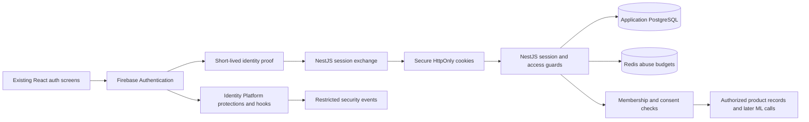

# Firebase authentication system design

D-063 implementation update: [the current auth/profile contract](../../../integration/FIREBASE_AUTH_CONTRACT.md) records the connected local Firebase adapter, standalone NestJS session app and UID-scoped profile/onboarding transactions in the verified Mumbai named Firestore database. The founder chooses built-in verification links and retained data without TTL deletion. Deployed rules deny client access. The config API reports FIREBASE_AUTH (contradicting the earlier upgrade report). Broader enrollment, provider, child-consent, business-data and deployment proposals below remain unimplemented; Firestore is selected for this account/session slice, not an automatic migration of the product schema.

Date: 14 October 2026. Firebase Authentication is the founder-selected identity provider. Existing project ID supplied: `visionary-fd6d2`. D-060: the founder reports it is a production project not integrated with this product, supplies the public Web app config and reports Email/Password, Phone, Google and Apple enabled; the backend is local with GCP hosting planned later. D-061: the founder reports Blaze billing and an empty Users list; the Admin snippet still contains a template credential path. SDKs and a lazy frontend foundation are installed; see [setup evidence and console handoff](../../../integration/FIREBASE_SETUP.md). Console state has not been independently inspected; Identity Platform upgrade, server credentials and provider/domain configuration details remain unverified. Remaining technical/privacy settings below are proposals, not implemented features.

D-062 update: the actual external credential-file path is supplied/configured, a lazy backend Admin provider is registered, and a bounded live read-only Auth check succeeds with an empty Users list. The founder confirms Identity Platform enabled. Billing/provider settings remain owner-reported; callback/domain policy and the actual session/enrollment/authorization implementation remain pending. No accounts are created or changed by the check.

This document supersedes the owned-password/provider recommendations in the [initial auth discussion](auth-system-design.md). Retain its observed source gaps, five-role access boundaries, India-first child safeguards and acceptance risks. Read with the [product domain map](../PRODUCT_DOMAINS.md), [product contract](../../visionary/VISIONARY_MASTER_v2.2.md) and [integration gaps](../../../integration/CONTRACT_GAPS.md).

## 1. Responsibilities and architecture

| Component | Owns |
| --- | --- |
| Firebase Authentication | Credential storage, password sign-in, phone verification, configured federated sign-in, Firebase identity and credential lifecycle |
| Identity Platform features | Required SAML/generic OIDC integrations; reviewed MFA, blocking functions, abuse protections and activity logging |
| NestJS backend | Trusted session exchange, per-device revocation, registration eligibility/custom email-code proof, Visionary account mapping, workspace/membership/consent authorization, security events and product API access |
| Application PostgreSQL | Visionary accounts/people, role profiles, workspaces, memberships, consent, device sessions, registration intents, security audit and durable product records |
| Redis | Atomic distributed abuse budgets, short-lived coordination and policy-controlled throttling; not the identity or consent authority |
| React/Vite | Existing auth visual design, Firebase Web SDK integration, loading/errors, server-owned account/workspace state and explicit sync/recovery states |

Passwords are managed by Firebase; do not build another NestJS password database, migrate browser hashes or keep the imported bcrypt/JWT strategy as a second production authority. Choosing Firebase Auth does not choose Firestore, Firebase Hosting, Firebase ML or the cloud hosting vendor for every component. Product data remains behind the reviewed NestJS/application-database contract.

SAML and generic OIDC require Firebase Authentication with Identity Platform. Plan an upgrade if the existing project lacks it, with billing/quotas reviewed before activation. Firebase SAML supports SP-initiated flows; unsolicited IdP-initiated SAML is not promised. References: [Firebase SAML](https://firebase.google.com/docs/auth/web/saml), [OIDC](https://firebase.google.com/docs/auth/web/openid-connect), [pricing](https://cloud.google.com/identity-platform/pricing).

## 2. Sign-up, sign-in and recovery journeys

### Eligibility before enrollment

Age/eligibility precedes child credential/profile collection and first-time provider redirects. Keep the approved guardian-first workflow: verified adult assurance, relationship policy, purpose notice and consent before child identity creation. Unknown or insufficient assurance remains restricted. Firebase login, Google branding and phone/email proof are not guardian verification.

Frontend eligibility alone is not enforcement: direct Firebase requests must not create a child account or enable processing outside the approved enrollment path. Before launch, prove a server-controlled enrollment policy with Identity Platform controls and blocking hooks for every enabled method. For known child enrollment, authoritative approval must exist before Firebase creation. Do not assume a browser age flag or an arbitrary admission token automatically reaches a Firebase blocking event. The exact admission binding, first-time federated flow and age-assurance method are implementation design gates. Disable unused anonymous/custom-token pathways; privileged Admin operations require the same application checks explicitly.

India-first legal/privacy review, age evidence, child/institution exceptions and retention remain required. The previous draft's references to the final Indian Act/Rules and phased commencement still apply. Avoid collecting a child's identity first and asking for consent afterwards.

### Email/password and the existing six-digit code screen

Firebase's documented email verification sends a verification link; its phone sign-in uses SMS codes. A custom email code is not a built-in email/password Firebase OTP flow. References: [email verification](https://firebase.google.com/docs/auth/web/manage-users), [phone verification](https://firebase.google.com/docs/auth/web/phone-auth).

Recommendation to preserve the frontend journey:

1. Start a server-owned registration intent after eligibility approval. Submit the intended email, not a persisted password. Return a generic accepted response and an opaque, browser-bound challenge context.
2. Send a cryptographically random six-digit email code using the existing backend notification boundary. Store only a keyed digest/hash, expiry, generation and atomic attempt budget; send via an encrypted transactional outbox. Keep the chosen password only in the current form's memory, or ask for it again if the page reloads.
3. On completion, submit the code and intended password to the trusted backend over HTTPS. Verify challenge binding/eligibility, consume it once and enforce the configured password policy. Use Firebase Admin to create the intended account with verified email only after valid proof. Never change an existing user's password or verification status from a duplicate registration request.
4. Firebase creation and PostgreSQL persistence are not one transaction. Use a durable registration intent with a preassigned UID, state machine and idempotent reconciliation for partial success. Retrying must recover the same new identity; it must not delete/overwrite an existing account by email.
5. Sign in through the normal Firebase password flow, exchange the verified ID token for the product session and load `/api/auth/me`. No custom Firebase token shortcut is necessary for ordinary registration.

Prevent public unmanaged email/password creation from bypassing this code/eligibility path using the selected Identity Platform creation controls. Admin creation may not execute the same client hooks/policy, so server checks are mandatory. Verify this behavior against direct REST/SDK requests in staging before considering the email-code flow complete.

The alternative is Firebase's verification-link journey with adjusted UI. That is simpler operationally but changes the existing code-entry interaction; it is not silently substituted in this proposal.

### Sign-in and providers

Email/password sign-in uses Firebase's SDK and configured password policy; NestJS never compares a second password hash. Retain the current email-first/password screens while removing `entities.User.filter` and public account-existence checks. Display consistent invalid-credential errors and distinct retryable service errors. Enable email enumeration protection and verify account-linking behavior with it enabled. [Firebase password authentication](https://firebase.google.com/docs/auth/web/password-auth), [enumeration protection](https://docs.cloud.google.com/identity-platform/docs/admin/email-enumeration-protection).

Google, Microsoft and Apple use their supported Firebase providers, configured domains/callbacks and credentials. Organization SSO uses reviewed Workspace/Entra connections and configured SAML/OIDC provider IDs. Successful provider sign-in proves identity, not organization membership or administrator authority. Enforce connection/tenant and authentication-method requirements for workspaces; personal sign-in cannot bypass an organization's required SSO.

Firebase manages federation protocol exchange; replace the imported Passport provider callback authority during cutover. Application linking, membership and consent policy remain server-owned. Verify Apple relay/return-login behavior, Microsoft personal versus tenant policies, provider cancellation and Safari/Chrome/Edge storage restrictions. References: [Apple](https://firebase.google.com/docs/auth/web/apple), [Microsoft](https://firebase.google.com/docs/auth/web/microsoft-oauth), [redirect setup](https://firebase.google.com/docs/auth/web/redirect-best-practices).

For mobile sign-in, configure Firebase phone auth/reCAPTCHA with an India SMS allowlist initially, fictional numbers for automated tests, explicit delivery failures and spend controls. Google documents its use/storage of phone numbers for abuse prevention; disclose that processing and obtain the appropriate consent. Phone possession alone is not strong guardian/admin assurance.

### Recovery and credential changes

Password reset uses Firebase action links/codes and an approved action handler in the existing ResetPassword page. The old local `resetToken` response cannot remain. Apply generic acceptance, delivery throttles, sanitized return destinations and secret-free logs. Account-ID recovery is a separate product service delivering information only to previously verified recovery contacts; Firebase does not supply an arbitrary user-directory endpoint for this screen.

Credential changes/linking require fresh Firebase reauthentication and application policy checks. Refresh verified claims after verification/contact changes. Reset, compromise, account disable/delete and logout-all invalidate both product sessions and the applicable Firebase refresh/session authority; otherwise an SDK credential could mint another session. Reconciliation must cover changes performed directly through Firebase as well as application endpoints.

Use Firebase-supported TOTP MFA as an initial strong-auth option for privileged users with verified email and supported primary methods. Phone-only primary sign-in is not supported for Firebase TOTP MFA; require a supported stronger method before granting sensitive authority. Passkeys/WebAuthn would be a separately reviewed extension or upstream enterprise assurance, not an assumed built-in Firebase feature. Lost-factor recovery must not silently downgrade to SMS/email. [TOTP prerequisites](https://firebase.google.com/docs/auth/web/totp-mfa).

## 3. Browser-to-server sessions

Proposed handshake:

1. Frontend performs Firebase authentication using short-lived SDK state; do not persist product credentials in localStorage. Redirect workflows use documented SDK state handling and must be tested; never add a hand-written refresh-token store.
2. Send the ID token once to `POST /api/auth/session` with pre-auth CSRF/source-origin protection, verified app attestation where configured and a bounded payload. Token verification checks revocation, configured project/tenant, subject, allowed provider and recent `auth_time` (proposed five minutes); application eligibility and account status must also pass.
3. Firebase Admin creates a Firebase session cookie. NestJS creates an independent random device-session handle and an authoritative PostgreSQL record binding its digest to the Firebase cookie fingerprint, project/tenant/UID and account.
4. Set two Secure HttpOnly SameSite=Lax host-only cookies: `__Host-visionary_auth` (Firebase cookie) and `__Host-visionary_session` (opaque device handle), with Path=/ and no Domain. Neither credential is returned in JSON or logged. Clear transient Firebase client sign-in state after exchange succeeds.
5. Every protected API requires both cookies: verify the Firebase cookie with revocation checking and match the active product session/account and cookie binding, then enforce workspace/consent/object policy. Neither cookie alone is sufficient. Client role/profile values and stale custom claims cannot override current database permissions.

Firebase documents ID-token exchange, recent-authentication checks, session-cookie verification and configurable cookie lifetimes from five minutes to two weeks. These session cookies are JWTs, not opaque credentials. The extra product session handle supplies individual device revocation and inactivity policy that a standalone Firebase cookie does not provide. [Firebase session cookies](https://firebase.google.com/docs/auth/admin/manage-cookies).

Proposed product policy remains eight hours absolute/30 minutes idle, with optional seven-day adult personal-device sessions and no default remembered child/shared-device session. The server enforces expiry. Do not represent these proposed values as Firebase defaults. Sensitive actions require recent reauthentication/MFA/approved tenant assurance.

Current-device logout revokes the product session and clears both cookies. Logout-all first revokes product sessions, then invokes Firebase account-wide revocation with durable retry on external failure. Account suspension/deletion restricts access immediately in the application; corresponding Firebase lifecycle action must be reconciled. A stolen pair cannot regain access through the legacy JWT/Bearer path: retire those guards across auth, onboarding, chat, documents, jobs and subjects together.

Revocation checking has network/latency/quota implications. Start without a stale positive revocation cache; measure before any bounded-cache optimization. If required authority cannot be checked, return unavailable and protect data. Database restores must revoke restored sessions/challenges and reconcile later consent/membership/identity changes before traffic resumes. [Firebase revocation](https://firebase.google.com/docs/auth/admin/manage-sessions).

## 4. Multi-device sync, account switching and identity linking

Map `(Firebase project, tenant namespace, UID)` to one canonical Visionary account/person. Email and IP are not account primary keys. Prefer one reviewed identity directory initially; Firebase multi-tenancy, if needed, introduces separate UID namespaces. Cross-tenant identities do not automatically represent the same person.

D-061 clarifies account reuse: first successful identity creation adds a Users entry, later sign-in reuses the UID, and logout preserves the account while revoking the session. Already-authenticated navigation comes from authoritative consent/onboarding state. Prevent duplicate registration through conflict handling and idempotent intents; do not delete or overwrite accounts merely because someone tries to register/sign in again. The console Users list is not an active-session list.

One authenticated account can have the existing five role profiles and several permitted personal/organization workspaces. On another device, the same verified identity loads the same server-owned profile, preferences and workspaces. Learning/progress/artifact sync comes from durable product APIs and revisions; Firebase Auth alone does not synchronize those records. Existing browser-local learning data remains preview/recovery data until its separately reviewed cutover.

Allow explicit linking of an additional provider to the current Firebase user after fresh proof. Never merge Visionary accounts using an email match, IP, device resemblance or a shared guardian contact. Provider credentials already belonging to another UID require an explicit, conflict-aware transfer/merge procedure with proof of both accounts and data/consent review. Verify Firebase's automatic provider/email behavior and its documented SDK linking issue under the chosen settings; do not promise an SDK call works without staging evidence. [Firebase account linking](https://firebase.google.com/docs/auth/web/account-linking).

Account switching signs out/replaces the current session, reauthenticates the chosen account, cancels pending requests and clears account/workspace caches. A browser profile shares cookies across tabs: initially support one active account per product origin in that profile, with different workspaces possible per tab. Separate profiles/devices have independent sessions. Simultaneous independent accounts in one profile would require a separate design.

Account chooser metadata, if remembered, is optional and non-secret on a personal device; shared-device mode omits it. Do not store tokens with remembered account cards. Session-change broadcasts are hints to re-read `/me`, not trusted identity. Reject stale responses after switching/logging out and partition all data/query keys by person/workspace/source revision.

## 5. Abuse protection and proposed limits

Protection has three enforcement surfaces: Firebase/Identity Platform APIs, Visionary APIs and the public edge. Firebase SDK/REST traffic can bypass NestJS, so a Nest rate limiter cannot guarantee limits on every password attempt or SMS send. Client cooldowns improve UX only. Layer configured Firebase quotas, reCAPTCHA Enterprise email/password and SMS defenses, reviewed App Check, blocking hooks, distributed app limits and later reviewed edge protection. References: [provider quotas](https://firebase.google.com/docs/auth/limits), [reCAPTCHA integration](https://docs.cloud.google.com/identity-platform/docs/recaptcha-enterprise), [SMS defense](https://docs.cloud.google.com/identity-platform/docs/recaptcha-tfp).

The documented Firebase account-creation quota is 100 accounts/hour/IP; it is a provider ceiling, not the desired product policy or an adjustable universal login-attempt setting. Shared school networks need representative testing and deliberate quota planning. Billing alerts are not hard spend caps.

| Operation | Proposed initial control | Enforcement boundary |
| --- | --- | --- |
| Custom email code send | 60-second resend cooldown, 3 sends/contact/30 minutes, 10/contact/day | Backend delivery/challenge service; combine with network/transaction budgets |
| Custom email code verification | 5 failed attempts/challenge; cumulative target budget across resends; code expires after 10 minutes | Atomic backend challenge/Redis operations; resending cannot clear the failure history |
| Registration/identifier-recovery requests | Target + source-network token buckets, progressive delay/challenge and generic responses | Owned endpoints; exact school-network thresholds follow load/false-positive tests |
| Session exchange | 10/minute/verified UID, additional source-network and transaction budgets | NestJS; does not substitute for Firebase credential-attempt controls |
| SMS sends | Desired 60-second cooldown, 3/phone/30 minutes and daily target/project delivery budget | Provider configuration/available send hooks plus app UX; prove direct-API coverage before claiming a hard cap |
| Password sign-in | Provider throttling, reCAPTCHA risk policy, enumeration protection and post-auth session admission | Firebase/Identity Platform; no invented configurable five-attempt Firebase lockout |
| Suspicious session | Strong reauthentication/MFA or restriction based on several signals | Server policy; IP change alone is insufficient |

These are discussion defaults, not configured settings. Exhausting a budget yields `429`/Retry-After where we own the response; Firebase errors map to clear cooldown/retry UX. Use temporary, bounded restrictions rather than permanent account locks attackers can induce. Do not block a school/family solely because several users share one IP. Redis loss must not create a fail-open credential/delivery path.

Blocking functions can validate successful creation/sign-in and selected email/SMS sends, using authoritative event context. They must complete within the documented seven seconds; use bounded policy/limit calls with explicit failure behavior. Invalid-password requests do not reach a post-credential `beforeSignIn` decision. Anonymous/custom-token flows do not trigger these hooks; keep them disabled or explicitly governed. Scope/test each send-hook/provider path instead of assuming universal coverage. [Blocking functions](https://firebase.google.com/docs/auth/extend-with-blocking-functions).

App Check is attestation, not user authentication or complete DDoS protection; Firebase Authentication support is currently documented as Preview. Assess SDK/provider/tenant coverage and accessibility/false positives before enforcement. Custom NestJS APIs verify their own App Check tokens where required; turning it on for a Firebase service does not automatically protect NestJS. [App Check](https://firebase.google.com/docs/app-check).

## 6. Security signals and privacy

Collect a defined security event at registration/sign-in/session exchange/credential change/revocation, with a documented purpose and retention class. This gives device/security history without promising the same private telemetry as Google or Apple.

| Signal | Trusted source / limitation | Use |
| --- | --- | --- |
| IP address | Firebase authoritative auth-event context or backend socket/trusted proxy chain; normalize IPv4/IPv6 and strip client-forged forwarding headers | Abuse budgets, investigation and suspicious-session context |
| Browser/OS/app version | Bounded, sanitized user-agent/app metadata; spoofable, not identity proof | Readable device list and troubleshooting |
| Product device-session ID | Random server-issued ID; identifies a session, not a physical hardware device | Per-device/session revoke and support correlation |
| Coarse region | Optional IP-derived country/region with confidence; VPN/carrier networks make it uncertain | Risk context; never exact location or a basis for merging accounts |
| Identity/method/time | Verified project/tenant/UID, provider, trusted auth time, app account ID, event/request ID, outcome and reason category | Security history, reauthentication and audit |
| Abuse/attestation result | Verified token/provider result and bounded counters; avoid retaining raw challenge material | Challenge/retry decisions and control monitoring |

Blocking-event context includes IP/user-agent, but `/auth/me`/Firebase UserRecord should not be treated as a historical IP database. Provider activity logging is an additional configured source; validate its real event fields and failure coverage before claiming all attempts are captured. Before-sign-in hooks run after credential validation. Never accept client-submitted failure counts, IPs or risk claims as authoritative. [Activity logging](https://docs.cloud.google.com/identity-platform/docs/activity-logging).

Proposed records: `AuthIdentity`, `AuthDeviceSession`, `RegistrationIntent`, `EmailVerificationChallenge`, `AuthSecurityEvent`, `AuthLimitBucket`, plus the existing proposed Person/workspace/membership/guardian/consent records. Keep raw IP/enrichment in an encrypted, access-controlled security store if required; operational logs use bounded event IDs and keyed target/network pseudonyms. Rate-counter TTL, security-event retention, restricted raw-IP retention and legally required logs need an approved India retention matrix before production. Pseudonymization does not make the data anonymous.

Collect profile/contact/role/preferences from explicit user input or documented provider claims, with purpose and consent. An IP does not reveal a reliable name, household, guardian relationship or learning needs. Browser auth cannot provide MAC addresses, IMEI, arbitrary browsing history or precise GPS by default; do not add covert hardware/cross-site fingerprinting to imitate another product. Never log passwords, OTPs, cookies, ID/refresh tokens, reset links or provider assertions.

Security signals are separate from learning analytics, model inputs, advertising and optional model-improvement consent. Minimize child telemetry; security logs do not authorize child behavioral profiling or hidden monitoring. Guardian/institution access remains scoped even when devices/IPs match. Device/history/export/delete screens must describe the actual data and retained obligations accurately.

## 7. Setup plan for the existing project

1. Confirm whether `visionary-fd6d2` is development/staging/production and has real users. With authorized access, inventory its upgrade/billing, providers, tenants, domains, policy, quotas/logging and existing account behavior read-only first. Do not bulk-disable, delete, revoke or migrate those users as a setup shortcut.
2. Use the Auth Emulator with a distinct `demo-visionary-local` identity for local development and isolated application DB/Redis/email sink. Both frontend and Admin SDK must use that emulator/project; production must reject emulator configuration and unsigned emulator tokens. Local emulator results do not certify real provider/SMS/blocking-hook behavior.
3. Prepare the Firebase Web SDK in the frontend package and Admin SDK in the backend package, with independent locks and supported runtimes. Public Firebase web config is client configuration; service-account credentials/private keys remain server-only. Prefer workload identity/Application Default Credentials in deployment and narrow IAM. Existing project access has not been established by receiving its ID.
4. Review Identity Platform upgrade, provider registrations/test tenants, MFA, password policy, email enumeration protection, quotas, email/SMS region policies and reCAPTCHA/App Check rollout. India is the initial SMS region; no global SMS allowlist by default. Record costs and supported features before enabling paid production services.
5. Configure authorized domains and documented auth-helper routing for production redirects. The current frontend CSP `connect-src 'self'` will block Firebase SDK traffic; add reviewed exact Firebase/reCAPTCHA/helper origins for the selected flow, not a wildcard. Review popup COOP behavior or use tested redirects. Reserved Firebase helper paths must not receive the React SPA fallback.
6. Implement server-owned eligibility/registration-code/session/access modules and patch accounting before modifying pinned imports. Replace legacy auth guards/adapters together, preserving current page styles, five roles, source/privacy and language behavior. Do not start auth by requiring an ML key.
7. Reconcile existing Firebase users and application User records by verified UID mappings and explicit migration proof. Preserve existing User foreign keys. Browser-local users/hashes/consent are not imported as trusted identities. Do not silently attach an existing application account merely because a Firebase email matches.
8. Verify every requested provider, recovery path, guardian policy and device/revocation boundary against staging before production cutover. The current project may require an isolated test environment; use it only once its environment is known.

Firebase Admin and PostgreSQL changes need durable lifecycle intents, idempotent reconciliation and observable failures. A cloud API success followed by a DB failure must not create untracked authority; a DB restriction followed by a Firebase failure must not expose product records. Sync records use server IDs, ownership checks and revisions; auth itself does not authorize copying browser records or building every learning-data API in this step.

## 8. Acceptance and next implementation boundary

Required tests expand the [initial acceptance matrix](auth-system-design.md#10-meaningful-acceptance-tests):

- Existing visual signup/login -> real code proof -> Firebase identity -> session exchange -> eligible onboarding -> authorized Home -> reload/second device; meaningful outage/cooldown states.
- Direct Firebase REST/SDK bypass attempts, unmanaged signup, policy enforcement on privileged Admin operations, exhausted distributed budgets, direct SMS/email sends and shared-IP school/family behavior.
- Invalid/wrong-project/tenant/revoked ID tokens, old auth time, swapped cookie pairs, one-cookie requests, session fixation, logout/revoke-all, expired/idle sessions and Firebase lifecycle changes outside NestJS.
- Email-code replay/resend/concurrent completion and Firebase/DB partial-creation reconciliation without overwriting existing users.
- Google/Microsoft/Apple/Workspace/Entra/SAML callbacks, relay emails, tenant/SSO enforcement, link conflicts with enumeration protection, Firebase SDK known linking issue and strict-browser helper/CSP behavior.
- Multi-device same-account records, account switching with delayed responses, cross-account/cache leakage, tenant memberships, payer != guardian, child consent/admission bypass, expiry/revocation during writes/streams and rights/recovery access.
- TOTP enrollment/reauth/recovery prerequisites, phone-only privilege denial, provider/SMS outage and fraud/spend controls.
- Minimal IP/event extraction, forged proxy headers, redaction, retention controls, scoped device-history reads and child-security-data boundaries.
- Emulator isolation, deployed hook failures/timeouts, restricted activity-log access, secret/key rotation and DB restore/revocation reconciliation.

Selected: Firebase identity; existing production project; local backend/GCP later; all prior providers/roles/India-first scope. Supplied: public Web app config and reported Email/Password, Phone, Google and Apple provider enablement. Proposed: cookie-pair/device sessions, custom email OTP to preserve UI, limits, TOTP/enterprise assurance, event schema and retention policy. Pending: real-user inventory/server access, upgrade/billing inventory, production origin/test tenants, approved child assurance/admission binding and legal/security retention review.

The D-059 discussion was planning only. D-060 subsequently authorizes and installs SDKs/configuration foundations with recorded dependency/runtime patches. No production project/account operation, billing change, migration or cloud deployment is performed by that setup. Authentication and product-data sync remain integration work; Google's/Apple's proprietary account-sync or telemetry behavior is not claimed.
