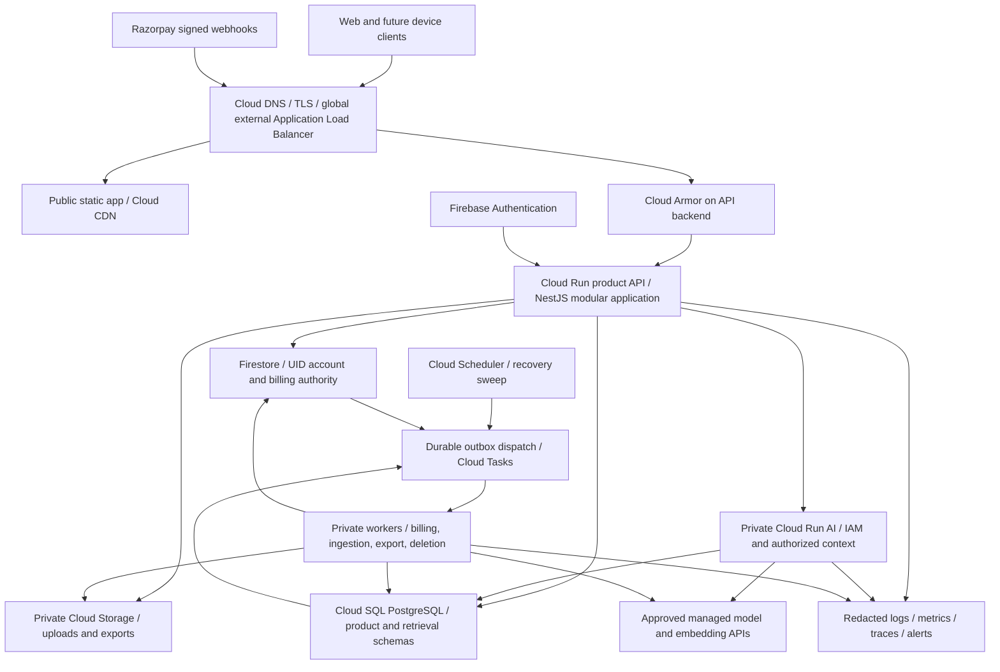
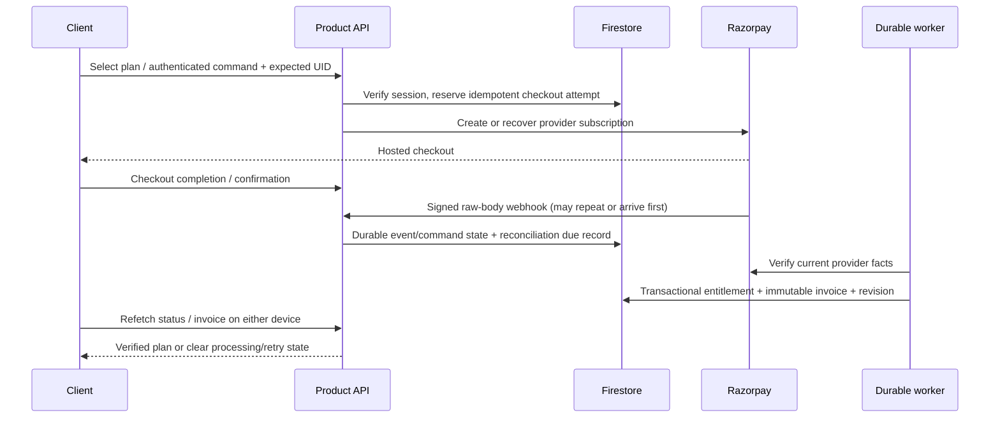

# Visionary system design

15 October 2026 · D-075 · founder-selected growth launch: **100,000 monthly active users**.

Visionary needs one account across devices, trustworthy education records, clear ownership for each role, reliable payments and useful AI grounded in permitted sources. Use a modular application backend, a separately scalable private AI runtime and durable workers on GCP. Keep Firebase identity and the working Firestore account/billing implementation. Add PostgreSQL for relational product domains as they become connected.

This is the launch architecture and implementation sequence. It is not a claim that cloud resources, cross-device learning, role authorization or production AI already exist. The design applies public engineering principles; it does not claim access to Google's or Apple's internal systems. Capacity, operational acceptance and model decisions are in [launch operations](launch-operations.md) and [ML strategy](ml-strategy.md). Source findings and retirement decisions are in [the audit](backend-ml-audit.md).

## What exists and what changes

| Area | Observed today | Launch design |
| --- | --- | --- |
| Identity/account | Connected Firebase verification, server sessions/device revocation, UID-owned Firestore profile/onboarding | Preserve; add workspace policy and hosted acceptance |
| Payment | Authenticated Razorpay **test** subscription, reconciliation, Free default, Family benefits, invoices | Preserve authority; durable worker delivery, operational monitoring; live enablement separate |
| Learning and linked roles | Rich browser-local previews; server transport interface, no complete server implementation | New relational domain modules, explicit migration and API contracts |
| ML | Pinned RAG source and old direct-provider agents; disconnected from product | Reuse evaluated internals behind a new authorized private boundary |
| Hosting | Local app; imported deployment references | Reviewed GCP infrastructure, staging, failure drills, then launch |

## Runtime topology



The outbox arrows represent application dispatch from durable records, not automatic cross-database atomic delivery. Firestore and SQL each have their own transactional outbox and recovery scan.

Start with three application deployment units: product API, AI runtime and workers. Use separate worker identities/queues for billing versus content/privacy jobs even if they share a reviewed codebase. Long ingestion uses Cloud Run Jobs with checkpoints. Do not deploy one service for every frontend page or every imported Go module. Separate a module further only after measurement shows independent scaling, security or release needs.

## Edge, networking and service identity

1. One canonical HTTPS product origin handles the app and `/api/**`. HTTP redirects to HTTPS. Managed certificates, restrictive TLS settings, HSTS after origin validation and DNS ownership are infrastructure concerns.
2. Route `/api/**` to the API's serverless NEG. Unknown API routes return JSON 404; they must never fall through to the SPA. Public hashed assets use a static backend bucket with Cloud CDN. Explicit app-route rewrites serve `index.html`; missing assets remain 404. HTML revalidates; content-hashed assets are immutable. Authenticated/API responses remain `no-store`, with CDN disabled on that backend. Never put student uploads or invoices in the public asset bucket.
3. API Cloud Run ingress is `internal-and-cloud-load-balancing`. A consumer-facing service permits platform-level invocation through the load balancer and authenticates users in the application; the load balancer does not mint a user IAM token. Test direct public `run.app` bypass rejection. Private AI/workers require IAM invocation with an audience-bound Google identity token and dedicated caller service account. Private ingress also requires compatible VPC routing between Cloud Run services. [Ingress documentation](https://docs.cloud.google.com/run/docs/securing/ingress)
4. Cloud Armor provides coarse abuse/WAF protection on API traffic. Application limits additionally bind to UID, device, workspace and paid usage. Trust forwarding headers only through the tested ingress chain; arbitrary client IP headers must not become security authority.
5. Use a regional VPC, private SQL/Redis endpoints and Cloud Run Direct VPC egress where supported by the selected configuration. Restrict egress paths and document model/payment/mail endpoints. NAT with a fixed outbound address is added only where a provider requires an allowlist. No public SQL endpoint or embedded service-account key.
6. Serverless NEGs use platform-specific health behavior; conventional load-balancer backend health checks are not supported. Use app probes, synthetics, revision canaries and documented service-health/outlier features where applicable. [NEG constraints](https://docs.cloud.google.com/load-balancing/docs/negs/serverless-neg-concepts)

Primary location is `asia-south1`, matching the verified named Firestore database `default` in the existing auth contract. Reconfirm actual project, database ID, location and provider region before provisioning; never silently create a second `(default)` database. Use separate dev/staging/production projects, provider test/live credentials, buckets and queues. Global edge delivery does not make the regional data tier globally active-active.

Deploy the reviewed Content Security Policy and security headers at the production serving layer; Vite development configuration does not install them on a bucket/load balancer. Allow only required Firebase/payment origins and test checkout/provider popups with the chosen framing/isolation policy. Restrict CORS to deliberate API consumers; same-origin browser calls need no wildcard credentialed CORS.

## Backend module and authority boundaries

| Module | Owns | Boundary |
| --- | --- | --- |
| Account | Firebase exchange/session, profile, onboarding, devices and preferences | Firebase UID is identity; profile role is not membership permission |
| Workspace policy | Personal/organization spaces, memberships, invitations, guardian consent and revocation | Server derives actor, active membership, scope and policy revision on every request |
| Catalog/publication | Curriculum taxonomy, source/version/license, language and reviewed release | Only eligible, published versions become learner-readable |
| Learning evidence | Lesson position, attempts, feedback, review schedule and reproducible progress | Attempts and revisions are durable; AI confidence never becomes mastery |
| Artifacts/classroom | Private projects, versioned submissions, assignments, return/revision lifecycle | Private work and a submitted snapshot have distinct visibility |
| Connections/reports | Guardian links, authorized summaries, employer shares and aggregates | No raw child chat/project or private employee history by default |
| AI application | Teaching/mentor requests, context construction, output checks and usage | Models propose; product policy validates and authorizes every action |
| Billing | Catalog/commands, provider mapping, reconciliation, invoices and effective entitlements | Verified provider state; client checkout callbacks cannot grant a plan |
| Privacy/audit/support | Export/deletion orchestration, scoped administrative review and audit | Explicit retention, purpose and operator authorization; no universal user dump |

Keep modules in the existing NestJS product runtime as they are implemented. Infrastructure adapters isolate Firestore, SQL, storage, queues and providers. Controllers do not bypass policy repositories, and ML has no Firebase Admin, billing or membership-write authority. Optional model failure must not stop account or billing startup.

## One person, one permanent ID

Use the **verified Firebase UID** for every person-owned record and every device. Names such as Rahul are display fields. Do not merge by email, phone, name, IP or payment customer ID. A person can have several role contexts and workspace memberships without creating several identities. Recovery/identity-linking must verify ownership explicitly.

Retain [D-072 account storage](../../../integration/USER_ACCOUNT_STORAGE.md):

```text
Firebase Authentication: credentials and verified provider identity
visionary_accounts/{uid}: identity, profile, onboarding, preferences, storageVersion
  devices/{deviceSessionHash}: browser-session metadata and revocation history
  authEvents/{eventId}: bounded security event records
  billing/test: base plan, subscription snapshot, revision and reconciliation state
    invoices/{invoiceId}: immutable issue-time customer/service/amount snapshot
    commands/{commandId}: idempotent command and outcome
Operational collections: session verification, provider lookups, webhook dedup,
                        UID billing due queue, invitations and abuse budgets
```

This is an organized hierarchy, not one ever-growing document. Store large histories in paginated child records. Keep credentials in Firebase, provider secrets in Secret Manager and files in object storage. Do not append every lesson, device heartbeat or invoice to the account root. Independent history growth must not serialize every operation on one UID document. Use scattered IDs, deliberate indexes and load-tested write rates. [Firestore scaling guidance](https://docs.cloud.google.com/firestore/native/docs/understand-reads-writes-scale)

### Relational product records

Introduce a **new reviewed product schema**, not the old Prisma migrations. SQL `persons.uid TEXT PRIMARY KEY` is an exact Firebase UID reference, not a second generated person identifier. It contains minimal identity linkage/provisioning state; Firestore remains profile authority. Other entities use opaque generated IDs plus explicit `owner_uid`/workspace scope. No cross-database foreign key or distributed ACID claim.

| Tables (logical target, not applied DDL) | Important relationships and constraints |
| --- | --- |
| `persons`, `workspaces`, `memberships` | Unique UID; personal workspace provisioning key; unique workspace/person membership; role/status/revision/expiry |
| `guardian_links`, `consent_grants`, `share_grants` | Verified parties, permitted fields/actions, purpose, expiry, revocation and policy revision |
| `sources`, `source_versions`, `publications`, `content_nodes` | License/provenance, curriculum and locale; immutable version/checksum; release eligibility |
| `classes`, `enrollments`, `assignments` | Teacher/organization ownership; fixed assignment/source versions; explicit learner enrollment |
| `attempts`, `attempt_events`, `review_schedules` | Actor UID, concept/source versions, authored criteria, attempt/revision and evidence type |
| `projects`, `project_revisions`, `submissions`, `feedback` | Private owner; immutable submitted revision; teacher return and later learner revision |
| `conversations`, `turns`, `ai_runs`, `usage_reservations` | UID/workspace/session, allowed context/source set, model/prompt version, lifecycle and usage settlement |
| `report_snapshots`, `audit_events`, `outbox`, `command_results` | Authorized summary period, scoped actor/reason, unique event/command identity and dispatch outcome |
| Retrieval schema: `ingestion_jobs`, `chunks`, `embeddings`, `index_releases` | Source/version/visibility/checksum, embedding model/dimension; published release pointer |

Every protected get/list/update/export includes scope predicates, not just an opaque ID lookup. Use indexes on `(workspace_id, owner_uid, updated_at, id)` or actual access patterns, membership lookup and due jobs; paginate with stable cursors. Validate constraints and request lengths. Immutable revisions/events support audit, while derived dashboards are rebuildable projections.

Use PostgreSQL row-level security as defense in depth for protected domain tables with a non-owner, non-bypass runtime role. Establish transaction-local actor/workspace from verified server policy; never reuse session-scoped settings across pooled tenants. Explicit application authorization still handles consent, role actions and source publication. Separate migration, app, retrieval-reader and ingestion-writer roles.

Cloud SQL PostgreSQL with pgvector is the first retrieval store. Begin with separately permissioned product/retrieval schemas in one regional HA instance; cap ingestion resources. If retrieval affects transactional latency, move its schema to a separate instance before increasing workload. Cloud SQL supports pgvector; verify the extension/version against the selected PostgreSQL release. AlloyDB or a separate vector service requires comparative benchmarks and a demonstrated need. [Supported extensions](https://docs.cloud.google.com/sql/docs/postgres/extensions)

### Crossing the two databases

On first product provisioning, write the UID-owned account and a durable provisioning event in a Firestore transaction. An idempotent SQL transaction upserts `persons`, creates exactly one personal workspace and commits a command result. Mark provisioning complete only after acknowledgment. Recover retries through a dispatcher/sweeper. Existing accounts receive a versioned backfill; browser-local role/organization assertions never become membership grants. Return a recoverable setup-pending state while SQL provisioning is unavailable; billing/account access remains usable.

Keep each business invariant in one database. Membership and consent changes commit together in SQL. Billing entitlement state commits in Firestore. For paid metered AI, create a bounded Firestore reservation against verified current entitlement, then a SQL run keyed to that reservation. Failed SQL creation releases or expires the reservation; completion settles once; crash recovery reconciles pending reservations. SQL entitlement projections may support display but never grant paid use. A reservation is a bounded authorization snapshot, not an unlimited stale subscription copy.

The owner account overview composes paginated summaries with separate revisions/timestamps from each authority. It can show partial/unavailable sections rather than pretending the two databases were read atomically. Operations staff use audited role-scoped tools; the single UID makes authorized tracing possible without exposing all history to every operator.

## Request and cross-device synchronization

Browser -> Firebase sign-in -> server verifies ID token -> secure server cookie/device session -> UID-owned account -> validated onboarding -> server-authorized workspace -> domain API. Retain expected-UID, origin/CSRF and stale-account-response checks. Authenticate and authorize again after asynchronous work before committing sensitive output or delivering a completed model response.

Domain command envelope (to implement): operation, opaque request/idempotency key, target IDs, expected revision, allowed input and UI locale. UID, roles, entitlements and permitted sources come from the server. Responses have outcome, schema version, request ID, resource revision, server timestamp and a typed recoverable error. Use 401 for expired identity, 403 for denied/revoked access, 409 for stale revision, 429 with retry timing for bounded capacity and 503 for unavailable dependencies.

Each successful mutation commits the new revision, command result and domain outbox event together. A retry with the same UID/workspace/operation/key and identical payload returns the original result; a different payload with that key conflicts. Use unique constraints for submissions and provider references. Request IDs are tracing identifiers, not substitutes for idempotency keys.

For launch, refresh server summaries on navigation, window focus and after writes; a bounded cursor-based changes endpoint supports a foreground poll (proposed 30 seconds with jitter, paused when hidden/offline). Read-after-write returns the committed record. Later add authenticated SSE invalidation when measured fan-out justifies it. Invalidations instruct clients to refetch; they never grant access or carry another member's private data. No sticky load-balancer sessions are required.

Edits carry expected revisions. Two devices editing the same draft receive a conflict with preserved local text and a choice to review/merge; do not overwrite silently with last-write-wins. Submission/assessment commands require an online acknowledgment. Offline drafts stay visibly unsynced; signing out removes account-bound transient state and late responses are rejected. Do not automatically upload all historical browser preview records; provide a deliberate owner-confirmed, allowlisted import with stable keys and preserved originals.

Revocation increments policy revision. Worker/AI completion rechecks membership, source and consent; access denial stops rendering even if an invalidation was missed. A short in-flight stream cannot promise instantaneous revocation: check policy at start, at bounded delivery checkpoints and before completion, cancel on invalidation and measure the maximum exposure window. Never share cache entries across permissions merely because wording matches.

## Authenticated payment and invoice flow



Anonymous plan selection preserves purchase intent and routes through authentication/onboarding before a checkout command is accepted. First verified sign-in creates Free without provider calls. Browser return URL, popup completion and a signed payment ID alone are not the complete recurring-subscription entitlement policy. Reconciliation must apply the existing verified period/refund/cancel/Family rules. Payer invoices remain private to the payer, even when benefits are shared.

Preserve existing test subscription and invoice identifiers and immutable customer/amount/service-period snapshots. Monthly and annual totals come from the server catalog. Invoices expose simple customer-facing facts first; internal references remain available when needed. Live tax/supplier details, supported payment methods, commercial policy and live keys require a separate reviewed activation. They are not inferred from a Google invoice example.

Test purchases never become live entitlements through a mode switch. Future live billing needs a separate namespace/provider environment, environment-qualified lookup/dedup keys and explicit activation/migration policy while retaining the person's existing UID. Preserve historical test invoices as test records. Merchant provider IDs and plans must not be reused across environments, and a live service must reject test webhook/checkout data.

Move scheduling to durable per-account work before growth launch. In the same Firestore transaction as a billing change, record a unique revision-bound task intent. A dispatcher creates a named Cloud Task; a periodic sweep repairs interrupted dispatch. Workers validate OIDC caller/audience, acquire a bounded UID lease, reconcile once and settle the event/revision transactionally. Cloud Tasks can execute duplicates and does not guarantee order: record-level idempotency and provider-state reconciliation remain necessary. [Task delivery caveats](https://docs.cloud.google.com/tasks/docs/common-pitfalls)

The current 20-account/one-minute test reconciliation scan is a recovery mechanism for low local test volume, not the growth scheduler. Replace it with due-time partitions, stable pagination, bounded dispatch and queue-age alerts. Keep a low-rate recovery sweep; never repeatedly process the first page while later accounts starve. Test payment-success, failure, refund, cancellation, expiration, duplicate and out-of-order events. Actual Razorpay webhook registration happens after a public HTTPS endpoint exists; hosting alone cannot register the merchant integration.

## Private content, learning and AI flow

Upload authorization -> server-generated object ID -> private quarantine object -> validated size/type/checksum -> scanning/parser sandbox -> permitted source/license review -> chunk/embedding job -> evaluation -> atomic publication pointer. Keep raw/private objects out of public URLs. Signed upload/download URLs are short-lived bearer capabilities; issue only after current policy and constrain object/method/lifetime. Already issued URLs remain usable until expiry, so choose short lifetimes and document revocation limits. [Signed URL behavior](https://docs.cloud.google.com/storage/docs/access-control/signed-urls)

Ask/Guide: verify identity/session -> verify workspace/source/membership -> reserve bounded usage -> obtain permitted source versions -> retrieve with visibility predicates -> generate through private model adapter -> validate citations, language, safety, schema and allowed actions -> recheck policy -> persist final result/settle usage -> deliver. A source text is untrusted input and cannot issue tool instructions. AI never directly writes grades, sends invitations, purchases plans or publishes content.

Practice: author/version criteria -> learner attempt revision -> deterministic scoring where possible -> clearly identified reviewed/provisional feedback -> separate evidence event -> reproducible progress projection. Classroom submission freezes one revision. Parent reports read approved summaries with scope/expiry; employer/organization analytics apply cohort suppression and purpose limits. See [the product domain map](../PRODUCT_DOMAINS.md).

## Consistency, failures and recovery

| Failure | Required user/system behavior |
| --- | --- |
| Session expiry/account switch | Reject stale response, preserve eligible draft, reauthenticate to the saved destination |
| Model unavailable/over budget | Keep catalog/auth/payment usable; show retry or authored material; no fabricated answer |
| Revoked membership/source | Deny read/write/cache/completion, cancel pending job and remove inaccessible displayed content |
| SQL unavailable | Account/test billing can remain available; retain local draft; fail learning save clearly |
| Firestore unavailable | Do not grant a new paid reservation or checkout; do not synthesize Free over unknown billing |
| Provider timeout after creation | Mark command unresolved, recover from durable provider linkage and reconciliation; no blind duplicate purchase |
| Worker crash or duplicate delivery | Lease expiry and idempotent replay; acknowledge only after durable outcome |
| Queue overload | Bound dispatch, prioritize billing, show processing, alert on age; no infinite foreground spinner |
| Two devices edit | Revision conflict, preserve both recoverable versions |
| Deployment rollback | Backward-compatible data/events; rollback code, preserve committed invoices/commands |

No cache is a durable source of identity, billing, membership or learning evidence. Redis is optional acceleration; omit it initially unless shared rate/usage/cache measurements justify it. Never keep the only revocation record or conversation history in evictable Redis. Payments use no speculative cached grants. An AI circuit breaker cannot break the account service.

## Privacy and governance

The founder's desire to understand a user is served by an organized UID and purpose-bound records, not unrestricted collection. Record validated account/setup, necessary sessions, billing, explicit learning actions, source provenance and audited access. Exclude raw credentials, device fingerprinting, precise location and unnecessary personal data from logs/models. Distinguish operational support from optional analytics. Redact logs and avoid UID/email/high-cardinality prompts in metric labels.

Guardian consent/admission and organization membership need complete server workflows before those linked-role features launch. A selected parent/teacher role is not proof. Exports authorize the subject and exclude another person's private records; deletion is a durable domain-by-domain workflow with tombstones, provider/content cleanup and verified completion. Financial record retention exceptions and child/privacy policies require approved policy before live release; do not invent a legal duration. Backup expiry and re-deletion on restore belong to the deletion plan.

## Implementation order and cutover gates

1. **This change:** audit and classify legacy source; make root dev/start commands choose current product runtime; enforce module separation with tests. Preserve baseline and current records. No cloud mutation.
2. **Policy/data foundation:** versioned SQL schema, workspace/consent repositories, outbox/command contracts, UID provisioning and migration tests. Publish OpenAPI/JSON schemas under `integration/contracts/` with source/language/revision/error contracts. Do not expose old controllers.
3. **One connected learning slice:** authorized published concept -> Ask -> check/practice -> project revision -> save -> second device. Test wrong UID/workspace/source, cancellation, conflict and recovery. Meet English/Hindi/Bengali coverage for the released slice; unsupported categories stay explicit.
4. **Billing/hosting:** reviewed container/IaC, hosted test Firebase/account/payment flow, OIDC queue, actual webhook delivery/replay, dependency outage drills and independent second-device acceptance. Preserve current test boundary.
5. **Role expansion and operational beta:** server teacher/parent/org/employer policy, scope/aggregate tests, import/export/deletion, security/accessibility/model evaluation and the measured load gate in [operations](launch-operations.md). Expand by verified category, not frontend route count.
6. **Live launch:** reviewed commercial/privacy gates, test/live isolation, restore/failover drills, provider quota and cost budget, on-call ownership. Retire legacy dependencies/migrations physically only after replacement coverage and patch provenance are recorded.

Kubernetes, Kafka, custom foundation-model training, a global multi-writer database and a large microservice fleet are not launch prerequisites. Add infrastructure when measured workload or isolation needs justify its operational cost. A premium experience depends first on correct ownership, honest states, preserved work and predictable recovery.
