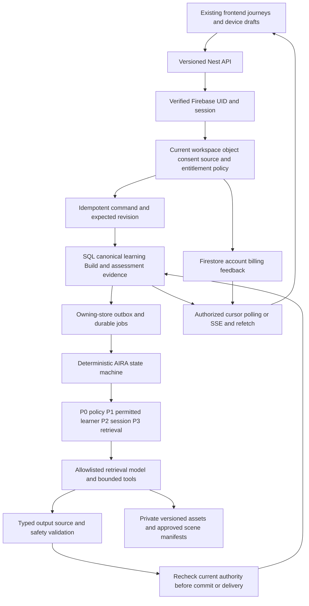

# Founder specifications: product and launch reconciliation

16 October 2026 · D-086 · Internal engineering review. [Launch checklist](../BACKEND_LAUNCH_CHECKLIST.md) · [Feature delivery](../FEATURE_DELIVERY_MATRIX.md) · [Jira tracking](../tracking/JIRA_SYNC.md).

## Decision

Improve the current product through one authorized learning-to-Build evidence path. Keep its existing frontend journeys, premium UI, five roles, source/language distinctions, Firebase UID/auth/onboarding, test billing/invoices, account/device synchronization and optional feedback. Historical company drafts supply product intent, not executable instructions or evidence that capabilities already work. No automatic adoption of old auth, cloud stacks, prices, model names, contracts, legal deadlines or launch dates.

VATS describes what the learner needs; AIRA coordinates how the system responds through deterministic, bounded state transitions and typed tools. Nineteen logical responsibilities do not require nineteen deployed services. A broad AGI ambition is distinct from integration readiness and demonstrated cognitive capability. No ticket count, generated response, model confidence or posterior establishes AGI or assessed mastery.

Reviewed **37 source files**, **35 numbered topics**, **14,441 extracted words** and **39 embedded PNGs**. Body/tables and document XML parts were extracted read-only; all extracted text and images were inspected. The two Doc03 variants were reviewed separately. The two Doc17 files have different bytes but identical extracted text. Originals remain unchanged. Some embedded diagrams have cropped labels in the original images. Cross-checked against prose; missing text is not inferred. No document layout fidelity certification, legal approval, provider benchmark or AGI proof is claimed.

The [per-file ledger](../tracking/founder-spec-review.json) retains SHA-256, extracted-text hash, text-block/image counts and decisions. Raw extracts/images stay in ignored `artifacts/research/founder-spec-review-2026-10-16/`; Jira receives derived implementation requirements, not the private source documents. The ledger and this report also contain internal requirements and should remain in the private engineering workspace.

## Current runtime and proposed connection

The active auth bootstrap connects account/onboarding/device sessions, test billing and feedback only. Imported legacy application/ML startup remains disconnected. The new learning policy is a pure module with offline tests; there are no live learning controllers, SQL transactions, new frontend facades or provider calls from this change.

This is a target design. Retain the GCP-first modular plan: public load balancer/WAF and static CDN, bounded Cloud Run API/private workers, Firestore for current identity/account/billing records, Cloud SQL/PostgreSQL with pgvector for transactional product domains, private object storage and owning-store outbox/managed jobs. Redis and richer bidirectional transport are optional after measured need; neither cache nor socket grants authority. Current frontend caches still require account-switch/invalidation tests. Cloud resource activation, live webhooks, recovery, capacity and cost evidence remain release work; the 100,000-MAU target is not a tested capacity claim. This review does not provision services or quote current prices.

Keep original backend/ML imports as provenance/reference. Add product-owned modules and adapters incrementally; retire a legacy entry point only after a reachable-import audit and accepted replacement. No bulk deletion, replacement database or model replatform was performed.

## Evidence and state ownership

One opaque Firebase UID links each user across devices. The readable account tree is a projection, not one unbounded document or a name-based key. Learning and Build records carry UID/workspace/object ownership, source and criteria versions, command/receipt identity and revision. Teacher/guardian/employer access requires separately verified, purpose-scoped relationships; Family payment is not guardian consent.

Assessment transaction → immutable scored receipt → ordered knowledge projection → separately reviewed mastery projection → next teaching/review recommendation. Commit projection, receipt deduplication and outbox in the owning SQL transaction. Firestore↔SQL handoffs reconcile durably; there is no assumed atomic distributed commit. Rebuild projections from approved evidence on model/criteria change or sequence gaps. Browser completion, a conversation, elapsed reading time, a Build artifact or a BKT posterior cannot silently create mastery.

Learning state: explain → validated check → immutable assessment → check passed, different remediation, or review suggested after at most three failed checks. A passed check is not a mastery certificate. Current-source prerequisites, approved pedagogy, due review and readiness use pinned versions; due dates and mock timers survive reconnect. The UI must explain unavailable source, insufficient evidence and pending review without fabricated metrics, ranks or history.

Context memory is scoped by purpose, relationship, source and retention policy despite the shared UID. Each observation needs provenance and correction/control. P0 policy and required source grounding cannot be dropped merely to meet a token/latency budget. No default raw conversation training, hidden chain-of-thought storage, automatic weekly fine-tuning, model promotion, contact harvesting, data purge or imported TTL was enabled.

## Implemented locally in this review

| Change | Local evidence | Remaining integration |
| --- | --- | --- |
| Product-owned knowledge/teaching policy | `backend/upstream/backend/src/learning/teaching-policy.ts`; five tests in `backend/tests/teaching-policy.test.cjs`; independent Bayes calculations, receipt conflicts, scope/replay/order/version checks and three-failure bound | Authorized SQL receipt transaction/global deduplication, criteria calibration, controllers, frontend, scoped observation and two-device acceptance remain LEARN-09/10. The pure module is not an authentication or receipt-signature verifier. |
| Shared `retrieval-binary-v2` metrics | Python and Go use unique IDs before K, unique gold IDs and log2 discount; thirteen independent shared fixture cases; zero/negative K handled; report contract version; dummy CLI requires explicit `--demo` | Requalify historical reports and run approved real retrieval on held-out source/version slices. Fixture success is not a model benchmark. |
| NLI client evidence contract | Unavailable/malformed/partial/out-of-range/mismatched responses return error and no grounded success; bounded response body and redacted failure body; short nonempty claims are included | Gateway callers still ignore some errors and streaming/cache paths lack complete current-policy guards. AI-06/08 remain open; imported gateway stays disconnected. NLI is neither factual truth nor child-safety assurance. |

No new feature is marked Done. AI-11 may enter Testing for the local metric repair; LEARN-09/10 may enter In Progress for the pure policy implementation. Durable adapters, source publication, actual browser workflows and hosted gates require their own acceptance evidence.

## Per-file decisions

### 01-doc-01 — DOCUMENT 01 — Product Strategy & Lifetime User Journey

Disposition: **adapt**. Read 28 extracted blocks and inspected 2 embedded images.

Retain: One identity and specific, truthful learning-to-Build continuity across life stages.

Correction or gate: Keep all current roles/navigation. Facts need provenance; examples are not user history. Preserve current admission and prices; no fabricated minimum observation count or AGI superiority claim.

Delivery: [AI-15 / KAN-149](https://visionary-team.atlassian.net/browse/KAN-149), [LEARN-09 / KAN-145](https://visionary-team.atlassian.net/browse/KAN-145), [SCOPE-02 / KAN-29](https://visionary-team.atlassian.net/browse/KAN-29), [BUILD-03 / KAN-77](https://visionary-team.atlassian.net/browse/KAN-77).

### 02-doc-02 — DOCUMENT 02 — Master Data Collection & Resource Guide

Disposition: **adapt**. Read 20 extracted blocks and inspected 2 embedded images.

Retain: Verified curriculum/source hierarchy, current edition and source provenance, bounded gap curation.

Correction or gate: Official school/exam sources are release inputs; approved professional/institutional material remains supported. Provisional means unverified/unavailable coverage, not invented official chapters or an unstaffed seven-day guarantee.

Delivery: [CONTENT-01 / KAN-60](https://visionary-team.atlassian.net/browse/KAN-60), [CONTENT-06 / KAN-65](https://visionary-team.atlassian.net/browse/KAN-65), [CONTENT-08 / KAN-144](https://visionary-team.atlassian.net/browse/KAN-144).

### 03-doc-03 — DOCUMENT 03 — VATS Full Technical Architecture (7 layers)

Disposition: **adapt**. Read 130 extracted blocks and inspected 2 embedded images.

Retain: Seven logical capabilities: perception, knowledge estimates, teaching policy, generation/guard, representation, memory and reviewed improvement.

Correction or gate: Implement modules over the current Nest/Firebase/GCP baseline. Resolve .70 check-pass versus .95 mastery; assessed evidence is authoritative. Old infrastructure/model/cost/latency claims need qualification. Do not auto-notify guardians about alleged abuse or expose internal chain-of-thought.

Delivery: [LEARN-09 / KAN-145](https://visionary-team.atlassian.net/browse/KAN-145), [LEARN-10 / KAN-146](https://visionary-team.atlassian.net/browse/KAN-146), [AI-14 / KAN-143](https://visionary-team.atlassian.net/browse/KAN-143), [AI-15 / KAN-149](https://visionary-team.atlassian.net/browse/KAN-149), [AI-16 / KAN-150](https://visionary-team.atlassian.net/browse/KAN-150), [SAFE-01 / KAN-151](https://visionary-team.atlassian.net/browse/KAN-151), [LATER-04 / KAN-135](https://visionary-team.atlassian.net/browse/KAN-135).

Full and summary variants inspected separately; fuller model/infra formulas remain proposals subject to these corrections.

### 04-doc-03 — DOCUMENT 03 — VATS Technical Architecture (7 layers)

Disposition: **adapt**. Read 17 extracted blocks and inspected 1 embedded images.

Retain: Seven logical capabilities: perception, knowledge estimates, teaching policy, generation/guard, representation, memory and reviewed improvement.

Correction or gate: Implement modules over the current Nest/Firebase/GCP baseline. Resolve .70 check-pass versus .95 mastery; assessed evidence is authoritative. Old infrastructure/model/cost/latency claims need qualification. Do not auto-notify guardians about alleged abuse or expose internal chain-of-thought.

Delivery: [LEARN-09 / KAN-145](https://visionary-team.atlassian.net/browse/KAN-145), [LEARN-10 / KAN-146](https://visionary-team.atlassian.net/browse/KAN-146), [AI-14 / KAN-143](https://visionary-team.atlassian.net/browse/KAN-143), [AI-15 / KAN-149](https://visionary-team.atlassian.net/browse/KAN-149), [AI-16 / KAN-150](https://visionary-team.atlassian.net/browse/KAN-150), [SAFE-01 / KAN-151](https://visionary-team.atlassian.net/browse/KAN-151), [LATER-04 / KAN-135](https://visionary-team.atlassian.net/browse/KAN-135).

Full and summary variants inspected separately; fuller model/infra formulas remain proposals subject to these corrections.

### 05-doc-04 — DOCUMENT 04 — VDS Visionary Design System

Disposition: **adapt**. Read 18 extracted blocks and inspected 1 embedded images.

Retain: Calm accessible interface, truthful observations, language identity and nonessential-motion control.

Correction or gate: Preserve current premium UI/components, colors and logo; the older orb/design tokens are not a redesign mandate. Never replace meaningful unknown state with fabricated nonzero metrics.

Delivery: [SCOPE-01 / KAN-28](https://visionary-team.atlassian.net/browse/KAN-28), [ACCEPT-05 / KAN-121](https://visionary-team.atlassian.net/browse/KAN-121), [AI-15 / KAN-149](https://visionary-team.atlassian.net/browse/KAN-149), [AI-16 / KAN-150](https://visionary-team.atlassian.net/browse/KAN-150).

### 06-doc-05 — DOCUMENT 05 — AIRA AGI Intelligence & Runtime Architecture

Disposition: **adopt with adaptation**. Read 28 extracted blocks and inspected 6 embedded images.

Retain: AIRA is deterministic and bounded; one context owner, P0–P3, typed tools, source guard, versioned outcomes and explicit role boundaries.

Correction or gate: Treat nineteen services as logical responsibilities, not nineteen deployments. Required grounding cannot be dropped for budget. Current verified UID/auth, SQL authority and measured provider choice supersede old service/auth/model tables.

Delivery: [AI-14 / KAN-143](https://visionary-team.atlassian.net/browse/KAN-143), [AI-15 / KAN-149](https://visionary-team.atlassian.net/browse/KAN-149), [AI-16 / KAN-150](https://visionary-team.atlassian.net/browse/KAN-150), [AI-06 / KAN-88](https://visionary-team.atlassian.net/browse/KAN-88), [AI-13 / KAN-142](https://visionary-team.atlassian.net/browse/KAN-142).

### 07-doc-06 — DOCUMENT 06 — Empire Architecture v2 Stakeholders, Revenue & Expansion

Disposition: **adapt**. Read 14 extracted blocks and inspected 2 embedded images.

Retain: Reuse the shared learning engine across seven audience categories and five permission roles.

Correction or gate: Categories are not roles. Keep purpose-isolated memory; posterior growth is a proxy, not the sole success metric. School/state/marketplace expansion, LoRAs and prices remain separate approved commercial/model work.

Delivery: [ROLE-07 / KAN-99](https://visionary-team.atlassian.net/browse/KAN-99), [ROLE-09 / KAN-101](https://visionary-team.atlassian.net/browse/KAN-101), [AI-13 / KAN-142](https://visionary-team.atlassian.net/browse/KAN-142), [LATER-04 / KAN-135](https://visionary-team.atlassian.net/browse/KAN-135), [SCOPE-05 / KAN-32](https://visionary-team.atlassian.net/browse/KAN-32).

### 08-doc-07 — DOCUMENT 07 — Frontend & Mobile Application Architecture

Disposition: **adapt**. Read 16 extracted blocks and inspected 1 embedded images.

Retain: Current frontend facades, exact draft/resume, accessible multilingual surfaces and offline honesty.

Correction or gate: Preserve existing web navigation and extra role tools. Client state is not SCM or permission authority; offline attempts require server validation. Native clients are unreleased until scoped under SCOPE-02/ACCEPT-05.

Delivery: [SYNC-02 / KAN-140](https://visionary-team.atlassian.net/browse/KAN-140), [LEARN-01 / KAN-67](https://visionary-team.atlassian.net/browse/KAN-67), [ACCEPT-05 / KAN-121](https://visionary-team.atlassian.net/browse/KAN-121), [SCOPE-02 / KAN-29](https://visionary-team.atlassian.net/browse/KAN-29).

### 09-doc-08 — DOCUMENT 08 — Backend Services & API Contracts

Disposition: **adapt**. Read 12 extracted blocks and inspected 1 embedded images.

Retain: Versioned bounded APIs, idempotent mutations, scoped reports and truthful errors.

Correction or gate: Keep current auth/account/billing/feedback routes. New routes use reviewed /api/v1 contracts, server-derived policy and explicit unsupported states. No OTP replatform or generated official syllabus behind a 200 response.

Delivery: [SCOPE-03 / KAN-30](https://visionary-team.atlassian.net/browse/KAN-30), [SCOPE-04 / KAN-31](https://visionary-team.atlassian.net/browse/KAN-31), [LEARN-10 / KAN-146](https://visionary-team.atlassian.net/browse/KAN-146), [AI-14 / KAN-143](https://visionary-team.atlassian.net/browse/KAN-143).

### 10-doc-09 — DOCUMENT 09 — Database Schema & Data Model

Disposition: **adapt**. Read 11 extracted blocks and inspected 1 embedded images.

Retain: Durable knowledge estimates, reviewed source graph, due review, immutable evidence and scoped reports.

Correction or gate: Use canonical Firebase UID and current store ownership; no duplicate identity or parent_id permission shortcut. SQL receipt/projection/outbox constraints and approved erasure policy precede implementation; cache is optional, not authority.

Delivery: [DATA-01 / KAN-36](https://visionary-team.atlassian.net/browse/KAN-36), [DATA-05 / KAN-40](https://visionary-team.atlassian.net/browse/KAN-40), [DATA-06 / KAN-41](https://visionary-team.atlassian.net/browse/KAN-41), [LEARN-09 / KAN-145](https://visionary-team.atlassian.net/browse/KAN-145), [LEARN-11 / KAN-147](https://visionary-team.atlassian.net/browse/KAN-147).

### 11-doc-10 — DOCUMENT 10 — ML Pipeline & Fine-tuning Playbook

Disposition: **defer training; adopt evaluation**. Read 12 extracted blocks and inspected 1 embedded images.

Retain: Versioned evidence/rights, independent evaluations, registry/canary/rollback and model comparison.

Correction or gate: No automatic raw-dialogue collection, weekly fine-tune, sample-count trigger or fixed old model. Session feedback and pseudonymous IDs do not establish training consent or anonymization; founder strategy and qualified data remain required.

Delivery: [AI-01 / KAN-83](https://visionary-team.atlassian.net/browse/KAN-83), [AI-02 / KAN-84](https://visionary-team.atlassian.net/browse/KAN-84), [AI-11 / KAN-137](https://visionary-team.atlassian.net/browse/KAN-137), [AI-12 / KAN-138](https://visionary-team.atlassian.net/browse/KAN-138), [LATER-04 / KAN-135](https://visionary-team.atlassian.net/browse/KAN-135).

### 12-doc-11 — DOCUMENT 11 — Knowledge-Graph Curation & Syllabus Mapping SOP

Disposition: **adopt with adaptation**. Read 14 extracted blocks and inspected 1 embedded images.

Retain: Canonical concepts, acyclic prerequisites, exam views and reviewed publication snapshots.

Correction or gate: Check actual current official source/edition/rights. Keep source/translation views distinct without duplicating identities; do not promise full board/exam coverage or arbitrary curation dates.

Delivery: [CONTENT-01 / KAN-60](https://visionary-team.atlassian.net/browse/KAN-60), [CONTENT-03 / KAN-62](https://visionary-team.atlassian.net/browse/KAN-62), [CONTENT-06 / KAN-65](https://visionary-team.atlassian.net/browse/KAN-65), [CONTENT-08 / KAN-144](https://visionary-team.atlassian.net/browse/KAN-144).

### 13-doc-12 — DOCUMENT 12 — Onboarding & Personalization Spec

Disposition: **adapt**. Read 12 extracted blocks and inspected 1 embedded images.

Retain: Onboarding facts initialize honest context and next-step reasons; retain unsupported-source states.

Correction or gate: Preserve the connected onboarding, identity/admission and current role fields. Label self-reported preferences; guest fallback cannot invent authenticated ownership or bypass payment auth.

Delivery: [DONE-03 / KAN-18](https://visionary-team.atlassian.net/browse/KAN-18), [DATA-03 / KAN-38](https://visionary-team.atlassian.net/browse/KAN-38), [AI-15 / KAN-149](https://visionary-team.atlassian.net/browse/KAN-149), [SCOPE-07 / KAN-34](https://visionary-team.atlassian.net/browse/KAN-34).

### 14-doc-13 — DOCUMENT 13 — LEARN App Specification

Disposition: **adopt with adaptation**. Read 16 extracted blocks and inspected 0 embedded images.

Retain: Concept teaching followed by a criterion-backed check, different remediation, bounded attempts and resume.

Correction or gate: Do not mark taught/mastered from consumption, model confidence or probability alone. Treat prerequisites and supported representations as versioned eligible content; no generated provisional syllabus or forced 3D.

Delivery: [LEARN-08 / KAN-74](https://visionary-team.atlassian.net/browse/KAN-74), [LEARN-09 / KAN-145](https://visionary-team.atlassian.net/browse/KAN-145), [LEARN-10 / KAN-146](https://visionary-team.atlassian.net/browse/KAN-146), [CONTENT-08 / KAN-144](https://visionary-team.atlassian.net/browse/KAN-144), [AI-16 / KAN-150](https://visionary-team.atlassian.net/browse/KAN-150).

### 15-doc-14 — DOCUMENT 14 — ASK App Specification

Disposition: **adapt**. Read 16 extracted blocks and inspected 1 embedded images.

Retain: Owned contextual conversations, specific suggestions, preserved drafts and honest degraded states.

Correction or gate: Discussing a topic does not raise assessed mastery. Preserve typed response adapters and source checks; no fabricated history or silent language fallback. Voice/photo remain separately qualified modalities.

Delivery: [LEARN-05 / KAN-71](https://visionary-team.atlassian.net/browse/KAN-71), [AI-04 / KAN-86](https://visionary-team.atlassian.net/browse/KAN-86), [AI-08 / KAN-90](https://visionary-team.atlassian.net/browse/KAN-90), [AI-15 / KAN-149](https://visionary-team.atlassian.net/browse/KAN-149), [AI-10 / KAN-92](https://visionary-team.atlassian.net/browse/KAN-92).

### 16-doc-15 — DOCUMENT 15 — PRACTICE App Specification

Disposition: **adopt with adaptation**. Read 11 extracted blocks and inspected 0 embedded images.

Retain: Assessed practice, meaningful debrief, bounded diagnosis/remediation and due review.

Correction or gate: Errors are reviewable hypotheses, not personal diagnoses. Validate IRT/adaptive policy before use; protect answer keys, separate self-review and enforce immutable scoring. Mocks need explicit timed-session evidence.

Delivery: [LEARN-02 / KAN-68](https://visionary-team.atlassian.net/browse/KAN-68), [LEARN-08 / KAN-74](https://visionary-team.atlassian.net/browse/KAN-74), [LEARN-10 / KAN-146](https://visionary-team.atlassian.net/browse/KAN-146), [LEARN-11 / KAN-147](https://visionary-team.atlassian.net/browse/KAN-147), [LEARN-12 / KAN-148](https://visionary-team.atlassian.net/browse/KAN-148).

### 17-doc-16 — DOCUMENT 16 — BUILD App Specification

Disposition: **adapt**. Read 15 extracted blocks and inspected 0 embedded images.

Retain: Learning evidence can suggest guided briefs; private artifacts support exact-revision review, export and explicit sharing.

Correction or gate: Keep blank projects. Example 14/3 counts are not protected live values. Completion/peer-teaching is application evidence until assessed; no automatic mastery, credential, public share or IP/marketplace transfer.

Delivery: [BUILD-03 / KAN-77](https://visionary-team.atlassian.net/browse/KAN-77), [BUILD-06 / KAN-80](https://visionary-team.atlassian.net/browse/KAN-80), [BUILD-07 / KAN-81](https://visionary-team.atlassian.net/browse/KAN-81), [LEARN-08 / KAN-74](https://visionary-team.atlassian.net/browse/KAN-74), [ROLE-05 / KAN-97](https://visionary-team.atlassian.net/browse/KAN-97).

### 18-doc-17 — DOCUMENT 17 — TEACHER Experience Specification (1)

Disposition: **adopt with adaptation**. Read 11 extracted blocks and inspected 0 embedded images.

Retain: Teacher-owned preparation/review and class evidence projections separate from personal teacher learning.

Correction or gate: No teacher default access to private doubts. No automatic quiz publication or dedicated LoRA assumption. Heatmap and teaching-efficacy estimates need calibrated criteria and suppression; live class mode requires its own accepted scope.

Delivery: [ROLE-01 / KAN-93](https://visionary-team.atlassian.net/browse/KAN-93), [ROLE-02 / KAN-94](https://visionary-team.atlassian.net/browse/KAN-94), [ROLE-03 / KAN-95](https://visionary-team.atlassian.net/browse/KAN-95), [ROLE-07 / KAN-99](https://visionary-team.atlassian.net/browse/KAN-99), [AI-13 / KAN-142](https://visionary-team.atlassian.net/browse/KAN-142), [SCOPE-02 / KAN-29](https://visionary-team.atlassian.net/browse/KAN-29).

Both files inspected; same extracted text, different DOCX bytes. One shared requirement set; originals retained.

### 19-doc-17 — DOCUMENT 17 — TEACHER Experience Specification

Disposition: **adopt with adaptation**. Read 11 extracted blocks and inspected 0 embedded images.

Retain: Teacher-owned preparation/review and class evidence projections separate from personal teacher learning.

Correction or gate: No teacher default access to private doubts. No automatic quiz publication or dedicated LoRA assumption. Heatmap and teaching-efficacy estimates need calibrated criteria and suppression; live class mode requires its own accepted scope.

Delivery: [ROLE-01 / KAN-93](https://visionary-team.atlassian.net/browse/KAN-93), [ROLE-02 / KAN-94](https://visionary-team.atlassian.net/browse/KAN-94), [ROLE-03 / KAN-95](https://visionary-team.atlassian.net/browse/KAN-95), [ROLE-07 / KAN-99](https://visionary-team.atlassian.net/browse/KAN-99), [AI-13 / KAN-142](https://visionary-team.atlassian.net/browse/KAN-142), [SCOPE-02 / KAN-29](https://visionary-team.atlassian.net/browse/KAN-29).

Both files inspected; same extracted text, different DOCX bytes. One shared requirement set; originals retained.

### 20-doc-18 — DOCUMENT 18 — PARENT Experience Specification

Disposition: **adapt**. Read 10 extracted blocks and inspected 1 embedded images.

Retain: Verified guardian relationships, fixed scoped summaries, honest billing receipts and actionable guidance.

Correction or gate: Family payment grants no learning access. No default raw SCM/chat access, cross-child comparison or parent priority override; recheck scope/expiry on delivery. Examples are never copied as real records.

Delivery: [ROLE-04 / KAN-96](https://visionary-team.atlassian.net/browse/KAN-96), [ROLE-07 / KAN-99](https://visionary-team.atlassian.net/browse/KAN-99), [DATA-05 / KAN-40](https://visionary-team.atlassian.net/browse/KAN-40), [BILL-08 / KAN-109](https://visionary-team.atlassian.net/browse/KAN-109).

### 21-doc-19 — DOCUMENT 19 — Professional & Organization Experience Spec

Disposition: **adopt with adaptation**. Read 21 extracted blocks and inspected 2 embedded images.

Retain: Professional capability/evidence vocabulary; explicit employer shares; organization least privilege and reviewed publication.

Correction or gate: No school vocabulary forced on adults, implicit employer data access or certificate from a probability. Bulk imports, external LMS and whitelabel require explicit released scope and current contract evidence.

Delivery: [ROLE-05 / KAN-97](https://visionary-team.atlassian.net/browse/KAN-97), [ROLE-06 / KAN-98](https://visionary-team.atlassian.net/browse/KAN-98), [ROLE-07 / KAN-99](https://visionary-team.atlassian.net/browse/KAN-99), [ROLE-09 / KAN-101](https://visionary-team.atlassian.net/browse/KAN-101), [LEARN-12 / KAN-148](https://visionary-team.atlassian.net/browse/KAN-148).

### 22-doc-20 — DOCUMENT 20 — Assessment & Exam-Readiness Engine

Disposition: **adapt**. Read 18 extracted blocks and inspected 0 embedded images.

Retain: Fixed mock/section timing, reproducible scoring and qualified source-weighted readiness.

Correction or gate: Missing coverage remains visible; probabilities and exam weights need calibration/provenance. No rank band without an approved reference distribution, no promised admission/credential and no timer reset on reconnect.

Delivery: [LEARN-08 / KAN-74](https://visionary-team.atlassian.net/browse/KAN-74), [LEARN-12 / KAN-148](https://visionary-team.atlassian.net/browse/KAN-148), [CONTENT-08 / KAN-144](https://visionary-team.atlassian.net/browse/KAN-144), [AI-13 / KAN-142](https://visionary-team.atlassian.net/browse/KAN-142).

### 23-doc-21 — DOCUMENT 21 — 3D Visualization Library & Scene Protocol

Disposition: **adapt**. Read 14 extracted blocks and inspected 1 embedded images.

Retain: Approved interactive representations with synchronized narration and accessible device fallbacks.

Correction or gate: Use structured allowlisted scene events, not direct raw SCENE-token execution or generated code/URLs. Keep current renderer; evaluate real released library/device coverage before 3D performance claims.

Delivery: [AI-16 / KAN-150](https://visionary-team.atlassian.net/browse/KAN-150), [AI-10 / KAN-92](https://visionary-team.atlassian.net/browse/KAN-92), [SYNC-01 / KAN-139](https://visionary-team.atlassian.net/browse/KAN-139), [ACCEPT-05 / KAN-121](https://visionary-team.atlassian.net/browse/KAN-121).

### 24-doc-22 — DOCUMENT 22 — Memory & Spaced-Repetition System Spec

Disposition: **adapt**. Read 17 extracted blocks and inspected 1 embedded images.

Retain: Inspectable purpose-scoped memory, provenance, correction/control and durable review queues.

Correction or gate: A single UID is not one globally pooled memory. Preserve records under the current instruction; no imported TTL/purge. Use a versioned baseline schedule and validate forgetting estimates instead of the unqualified exponential formula.

Delivery: [AI-04 / KAN-86](https://visionary-team.atlassian.net/browse/KAN-86), [AI-15 / KAN-149](https://visionary-team.atlassian.net/browse/KAN-149), [LEARN-11 / KAN-147](https://visionary-team.atlassian.net/browse/KAN-147), [PRIV-01 / KAN-110](https://visionary-team.atlassian.net/browse/KAN-110), [PRIV-02 / KAN-111](https://visionary-team.atlassian.net/browse/KAN-111).

### 25-doc-23 — DOCUMENT 23 — Safety, Guardrails & Child Protection Spec

Disposition: **adapt**. Read 18 extracted blocks and inspected 1 embedded images.

Retain: Separate safeguarding, age/journey eligibility, safe support and meaningful output/citation checks.

Correction or gate: Keywords/NLI are insufficient guarantees. Review contextual abuse/crisis and localized responses; no unsafe automatic guardian disclosure, fabricated contact or blanket suppression of legitimate educational topics. Existing unsupported minors remain blocked.

Delivery: [SAFE-01 / KAN-151](https://visionary-team.atlassian.net/browse/KAN-151), [DATA-09 / KAN-44](https://visionary-team.atlassian.net/browse/KAN-44), [AI-06 / KAN-88](https://visionary-team.atlassian.net/browse/KAN-88), [PRIV-05 / KAN-114](https://visionary-team.atlassian.net/browse/KAN-114).

### 26-doc-24 — DOCUMENT 24 — Privacy, DPDP Compliance & Data Governance

Disposition: **adapt; legal qualification open**. Read 17 extracted blocks and inspected 1 embedded images.

Retain: Purpose minimization, consent/revocation, owner controls, audited support and recovery-safe data workflows.

Correction or gate: Old legal timelines, AWS-only geography, anonymization and backup-erasure claims are not current legal approval. Validate requirements with accountable review; preserve current data and no automatic training/purge.

Delivery: [PRIV-01 / KAN-110](https://visionary-team.atlassian.net/browse/KAN-110), [PRIV-02 / KAN-111](https://visionary-team.atlassian.net/browse/KAN-111), [PRIV-03 / KAN-112](https://visionary-team.atlassian.net/browse/KAN-112), [PRIV-07 / KAN-116](https://visionary-team.atlassian.net/browse/KAN-116), [AI-02 / KAN-84](https://visionary-team.atlassian.net/browse/KAN-84).

### 27-doc-25 — DOCUMENT 25 — Security Architecture & Threat Model

Disposition: **adopt with adaptation**. Read 10 extracted blocks and inspected 1 embedded images.

Retain: Server authority, least privilege, scoped service identity, artifact integrity, rate limits and recovery tests.

Correction or gate: OTP/email/role claims alone do not authorize relationships. Keep current session/device/Origin/CSRF boundary. Test actual hosting/service routes; diagrams, encryption labels and an NLI check do not prove security.

Delivery: [AI-03 / KAN-85](https://visionary-team.atlassian.net/browse/KAN-85), [DATA-08 / KAN-43](https://visionary-team.atlassian.net/browse/KAN-43), [PLAT-03 / KAN-47](https://visionary-team.atlassian.net/browse/KAN-47), [RELEASE-06 / KAN-129](https://visionary-team.atlassian.net/browse/KAN-129).

### 28-doc-26 — DOCUMENT 26 — Performance & Device Optimization

Disposition: **adapt**. Read 11 extracted blocks and inspected 1 embedded images.

Retain: Low-end device and accessible fallback profiling, bounded streaming/cancellation and honest offline behavior.

Correction or gate: Treat old TTFT/fps/memory numbers as proposed measurement targets, not observed service guarantees. Foreground bounded observation and background suspension/consented notifications differ; do not add busy polling.

Delivery: [SYNC-01 / KAN-139](https://visionary-team.atlassian.net/browse/KAN-139), [SYNC-02 / KAN-140](https://visionary-team.atlassian.net/browse/KAN-140), [ACCEPT-05 / KAN-121](https://visionary-team.atlassian.net/browse/KAN-121), [RELEASE-01 / KAN-124](https://visionary-team.atlassian.net/browse/KAN-124), [RELEASE-04 / KAN-127](https://visionary-team.atlassian.net/browse/KAN-127).

### 29-doc-27 — DOCUMENT 27 — Analytics, Metrics & OKF Dashboard

Disposition: **adapt**. Read 17 extracted blocks and inspected 1 embedded images.

Retain: Observed learning/task outcomes, minimized versioned event schemas, quality/latency/cost and scoped aggregates.

Correction or gate: Do not turn every interaction into raw training data or optimize a model posterior alone. Separate durable business evidence from optional analytics and protected security audit; suppress small groups and validate metric math.

Delivery: [AI-11 / KAN-137](https://visionary-team.atlassian.net/browse/KAN-137), [AI-12 / KAN-138](https://visionary-team.atlassian.net/browse/KAN-138), [AI-13 / KAN-142](https://visionary-team.atlassian.net/browse/KAN-142), [PLAT-07 / KAN-51](https://visionary-team.atlassian.net/browse/KAN-51), [ROLE-07 / KAN-99](https://visionary-team.atlassian.net/browse/KAN-99).

### 30-doc-28 — DOCUMENT 28 — A B Testing & Experimentation Framework

Disposition: **defer online experiments**. Read 16 extracted blocks and inspected 1 embedded images.

Retain: Reviewed flags, control cohorts, declared outcomes, guardrail stops and human promotion.

Correction or gate: No automatic p-value/posterior winner or experimentation on safety/consent. Initial launch can use a pinned approved policy; online experiments require explicit eligibility/purpose and statistical review.

Delivery: [LATER-06 / KAN-152](https://visionary-team.atlassian.net/browse/KAN-152), [PLAT-06 / KAN-50](https://visionary-team.atlassian.net/browse/KAN-50), [AI-13 / KAN-142](https://visionary-team.atlassian.net/browse/KAN-142), [RELEASE-07 / KAN-130](https://visionary-team.atlassian.net/browse/KAN-130).

### 31-doc-29 — DOCUMENT 29 — Growth, Referral & Word-of-Mouth Engine

Disposition: **defer growth expansion**. Read 13 extracted blocks and inspected 1 embedded images.

Retain: Outcome-based, non-spam referrals and explicitly approved sharing can be considered later.

Correction or gate: No contact harvesting, device fingerprinting, assumed waitlist/CAC or old launch date. Decide scope under existing public-control/privacy/commercial gates; do not advertise rewards before fraud/ledger/rights work is separately accepted.

Delivery: [SCOPE-01 / KAN-28](https://visionary-team.atlassian.net/browse/KAN-28), [SCOPE-05 / KAN-32](https://visionary-team.atlassian.net/browse/KAN-32), [PRIV-07 / KAN-116](https://visionary-team.atlassian.net/browse/KAN-116), [BILL-04 / KAN-105](https://visionary-team.atlassian.net/browse/KAN-105).

### 32-doc-30 — DOCUMENT 30 — Monetization & Billing Implementation

Disposition: **adapt**. Read 13 extracted blocks and inspected 1 embedded images.

Retain: Server billing/entitlement authority, immutable receipts, reconciliation and no learning-data loss on lapse.

Correction or gate: Keep current test prices/plans/auth, Family boundaries and invoices. No automatic live money, new refund/proration/GST policy, unbounded unlimited model usage or copied old commercial promises.

Delivery: [BILL-04 / KAN-105](https://visionary-team.atlassian.net/browse/KAN-105), [BILL-05 / KAN-106](https://visionary-team.atlassian.net/browse/KAN-106), [BILL-06 / KAN-107](https://visionary-team.atlassian.net/browse/KAN-107), [BILL-07 / KAN-108](https://visionary-team.atlassian.net/browse/KAN-108), [BILL-08 / KAN-109](https://visionary-team.atlassian.net/browse/KAN-109).

### 33-doc-31 — DOCUMENT 31 — Marketplace & Creator Economy Spec

Disposition: **defer marketplace expansion**. Read 15 extracted blocks and inspected 0 embedded images.

Retain: Any future creator distribution needs rights, moderation, explicit approval and reconciled payouts.

Correction or gate: No automatic public publish/IP transfer or launch dependency. Contract/KYC/tax/refund and dedicated implementation scope must be approved before enabling a marketplace; current private teacher library remains.

Delivery: [SCOPE-01 / KAN-28](https://visionary-team.atlassian.net/browse/KAN-28), [SCOPE-05 / KAN-32](https://visionary-team.atlassian.net/browse/KAN-32), [ROLE-09 / KAN-101](https://visionary-team.atlassian.net/browse/KAN-101), [BILL-06 / KAN-107](https://visionary-team.atlassian.net/browse/KAN-107), [CONTENT-03 / KAN-62](https://visionary-team.atlassian.net/browse/KAN-62).

### 34-doc-32 — DOCUMENT 32 — Government (B2G) & Institutional Playbook

Disposition: **defer institutional expansion**. Read 17 extracted blocks and inspected 0 embedded images.

Retain: Tenant isolation, actual pilot outcome evidence and approved integrations/aggregates.

Correction or gate: No claim of school/state contracts, registry integration or a fixed AWS region as compliance proof. Existing organization features remain; procurement, residency, offline/native and whitelabel need reviewed future scope.

Delivery: [ROLE-09 / KAN-101](https://visionary-team.atlassian.net/browse/KAN-101), [SCOPE-02 / KAN-29](https://visionary-team.atlassian.net/browse/KAN-29), [PLAT-01 / KAN-45](https://visionary-team.atlassian.net/browse/KAN-45), [RELEASE-07 / KAN-130](https://visionary-team.atlassian.net/browse/KAN-130).

### 35-doc-33 — DOCUMENT 33 — 22-Language Expansion & Localization Spec

Disposition: **adapt; expand only after qualification**. Read 18 extracted blocks and inspected 1 embedded images.

Retain: Keep language/source/output identity distinct, avoid silent fallback and test scripts/modalities.

Correction or gate: Preserve current released locales. Six/22-language and ASR/TTS coverage are not implied by translated UI or model names; inspect actual source/teacher/device cases per released slice.

Delivery: [SCOPE-02 / KAN-29](https://visionary-team.atlassian.net/browse/KAN-29), [CONTENT-06 / KAN-65](https://visionary-team.atlassian.net/browse/KAN-65), [AI-01 / KAN-83](https://visionary-team.atlassian.net/browse/KAN-83), [AI-10 / KAN-92](https://visionary-team.atlassian.net/browse/KAN-92), [ACCEPT-05 / KAN-121](https://visionary-team.atlassian.net/browse/KAN-121).

### 36-doc-34 — DOCUMENT 34 — QA, Testing & Release Engineering

Disposition: **adopt with adaptation**. Read 16 extracted blocks and inspected 1 embedded images.

Retain: Cross-role deny tests, model/prompt/source regression, device evidence and state-preserving rollback.

Correction or gate: Coverage percentages, a 500-case benchmark or unit pass alone are insufficient. Require held-out outcome evidence, reproducible environments and real released-device acceptance; keep safety independent of experiment arms.

Delivery: [PLAT-06 / KAN-50](https://visionary-team.atlassian.net/browse/KAN-50), [ACCEPT-03 / KAN-119](https://visionary-team.atlassian.net/browse/KAN-119), [ACCEPT-05 / KAN-121](https://visionary-team.atlassian.net/browse/KAN-121), [AI-13 / KAN-142](https://visionary-team.atlassian.net/browse/KAN-142), [RELEASE-05 / KAN-128](https://visionary-team.atlassian.net/browse/KAN-128).

### 37-doc-35 — DOCUMENT 35 — Launch Runbook (September 1 Beta)

Disposition: **adapt; replace dated schedule**. Read 20 extracted blocks and inspected 1 embedded images.

Retain: Controlled cohorts, measured capacity/provider/quality/recovery and honest degraded operation.

Correction or gate: September date, waitlist, retention and event-count targets are historical assumptions. Launch only against measured gates; no automatic training threshold or invented fallback explanation, safety result or unlimited autoscaling.

Delivery: [RELEASE-01 / KAN-124](https://visionary-team.atlassian.net/browse/KAN-124), [RELEASE-02 / KAN-125](https://visionary-team.atlassian.net/browse/KAN-125), [RELEASE-03 / KAN-126](https://visionary-team.atlassian.net/browse/KAN-126), [RELEASE-04 / KAN-127](https://visionary-team.atlassian.net/browse/KAN-127), [RELEASE-07 / KAN-130](https://visionary-team.atlassian.net/browse/KAN-130), [RELEASE-08 / KAN-131](https://visionary-team.atlassian.net/browse/KAN-131).

## Ordered launch work

1. Finish the existing Now queue: route/control and released audience inventory, API/schema/error contracts, current source admission and relationship/consent authority, canonical domain database/outbox, and bounded API admission. Founder documents do not bypass those decisions.
2. Publish one approved source/concept/criteria snapshot. Connect assessed practice to the durable receipt and learner projection, then bounded teaching, due review and exact resume. Demonstrate the same authorized committed state on two devices; retry never double-scores or double-charges.
3. Add purpose-scoped context and the deterministic AIRA workflow over an evaluated API/model adapter. Required citations, typed scenes, safety, cancellation, usage settlement and invalidation cover batch/stream/cache alike. Keep own-model training later until founder strategy, rights and held-out evidence qualify it.
4. Complete teacher/guardian/professional/organization privacy projections and Build exact-revision artifact workflows with their linked acceptance. The current UI may remain broader than the first released slice only when unavailable actions explain their status truthfully.
5. Test actual released UI→API→store→job/model→committed outcome, denial/revocation, disconnect/retry, source/model change, provider outage, account switch, payment reconciliation, accessible device/language fallback and optional simple feedback. Measure outcome quality, cost, load and restore/rollback before controlled hosting.

The updated backlog has 137 source tasks: 12 historical local Done, 119 open launch items and 6 Later. Nine added tasks are CONTENT-08, LEARN-09/10/11/12, AI-15/16, SAFE-01 and LATER-06. The target prerequisite graph has 75 task edges plus 30 phase edges, with no task cycles. Final Jira read-back and actual statuses are recorded in JIRA_SYNC; this paragraph states scope rather than claiming hosted readiness.

Marketplace/B2G/referrals/native expansion/22-language coverage remain subject to explicit released scope, privacy, rights, commercial and device/provider acceptance. No new launch promise, dated schedule or commercial policy follows from the old drafts. Keep a small work-in-progress queue and use verified outcomes, not quantity of generated features, as completion evidence.
