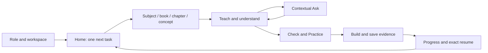
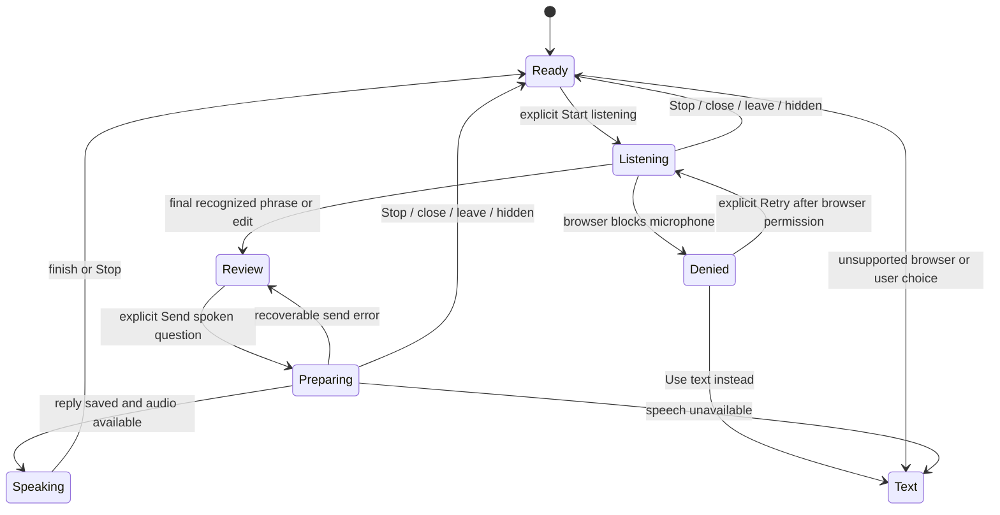

# Internal product: responsive design, interaction, sound and motion

Design handoff for the continuation on 2026-10-12. The implementation is a React browser product across five roles. Its existing service and authored-content boundaries remain the basis for backend integration. This document supplements the operative v2.2 contract, D-051, the category flow ledger and the principal review; it does not replace the three living logs or declare launch acceptance.

The founder's current request governs scope: internal product only, responsive across devices, familiar controls, calm premium visuals and usable recovery paths. The attached `Senior Apple Icon Enginner.txt` targets a public StudentPage. Its icon discipline is useful reference material; its landing-specific edit instructions are outside this request. No Apple proprietary assets are imported.

## Roles and implemented ownership

| Design role | Continuation result | Implementation boundary |
| --- | --- | --- |
| UX engineer | Adaptive shell, comfortable targets, visible focus, route/main focus, offline notice, scalable shared controls, system dark/high-contrast/reduced-motion treatment | Browser UI; Android native APIs are future work |
| Interaction designer | Navigation disclosures/return focus, explicit microphone start, review before sending, recoverable saved text, role-specific task/state contract below | Existing local services and permissions remain authoritative |
| Visual designer | Shared semantic surfaces, quiet type hierarchy, currentColor icon family, selected/disabled/error/success affordances and responsive grouping | Existing internal design system; public output excluded |
| Motion designer | Short control transitions; still Guide when idle, hidden or reduced motion; live drawing only for actual listening/speaking | No navigation celebration or decorative startup loop |
| Sound designer | Silent opening/navigation/mutations; speech only from an explicitly submitted voice question; persistent visual/text alternative | Browser speech synthesis; no notification audio or custom sound asset |

Final command, browser, screenshot and device evidence belongs in the current QA/STATUS entry produced by the coordinating agent. The code changes described here are implemented behavior, not claims of physical-device or human-user verification.

## Keep / enhance inventory

| Surface | Classification | Scope of this continuation |
| --- | --- | --- |
| All five role entry screens | Keep content/task hierarchy; enhance shared presentation | Semantic system colors, dark theme inheritance, text scaling and control states |
| Learn, Ask, Build, Progress | Keep services and connected flow; enhance shared controls | Readable surfaces, wrapping rows/grids, selected states, focus and larger targets |
| Settings and saved updates | Keep existing local preference/mutation contracts | Accessible theme/field states; no new delivery or permission capability |
| Shell and search | Enhance existing navigation pattern | Localized single skip link, keyboard results, IME-safe activation, explicit offline state, overlay closure/focus |
| Guide voice panel | Enhance interaction and reduce work | Silent opening, explicit capture/review/send, stop capture before edits, saved-reply feedback, still idle/hidden/reduced motion |
| Shared illustrations | Repair missing runtime helper | Restore the referenced face-volume primitive that previously crashed importing screens; no new illustration family or landing-page layout |

No role's source/consent/persistence policy is replaced. Historical design captures remain in the previous principal-review handoff; current isolated fixtures and verification are indexed in `baseline/internal-design-2026-10-12/README.md`.

## Content priority and annotated layouts

The screen's role task leads: continue learning, prepare/review teaching, support the selected child, advance a professional goal or administer a scoped organization. Setup, account controls, detailed evidence and secondary actions are progressively disclosed. A personal workspace and an organization workspace carry their own labels, navigation and permission boundary.

```text
Wide window
┌────────────────── app bar: workspace / contextual search / account ───────────────┐
│ labelled         │ page title + concise purpose                                 │
│ navigation       │ primary task                supporting evidence / next steps  │
│                  │ content rows / cards       optional setup or detail           │
└──────────────────┴──────────────────────────────────────────────────────────────┘
Compact window
┌──── workspace / search / menu ────┐
│ title + purpose                  │  A: content precedes optional setup
│ primary task                     │  B: controls wrap; no clipped essential label
│ content rows / stacked detail    │  C: sheets scroll within available height
│ optional setup disclosure        │  D: safe-area space above bottom destinations
├── primary destinations / More ───┤
└──────────────────────────────────┘
```

Wide navigation expands at 1200 CSS pixels, with a rail at intermediate widths. Compact navigation applies below 768 CSS pixels and uses the stage/role's primary destinations plus More. These are available-window breakpoints, not device detection. Content grids use flexible minimum card widths and container-based stacking so an embedded pane can adapt independently of the screen. Landscape uses the same available-space rules. A foldable browser receives responsive layout from its viewport; hinge-aware native spanning is not implemented.

Compact destination count responds to available width and root text size: normal phone text shows up to four primary links plus More; large text reduces that first set to two primary links plus More. All role destinations stay available in the labelled navigation sheet, and More indicates a current page displaced from the compact bar. Type is not shrunk to force five labels into a small window.

At large text sizes, labels may wrap, rows may stack and panels scroll. Essential content must remain reachable at 200% text/zoom and in short landscape windows; this is a manual acceptance requirement, not inferred from rem units. Preserve DOM reading order when changing columns. Phone controls use at least 48 CSS-pixel targets where normalized; this is a web design target, distinct from native Android dp.

## Visual system and asset rules

Runtime values are in `src/components/dashboard/workspace-design.css`; use its `--v-*` roles rather than new page-specific colors. System appearance chooses the dark palette. The existing account accent remains a supported account choice; the browser cannot read Android wallpaper colors, so this is not a claim of native Material dynamic color.

| Role | Light | Dark | Contrast on associated surface |
| --- | --- | --- | --- |
| Canvas | `#f7f8fa` | `#111318` | Background role |
| Surface | `#ffffff` | `#191c22` | Content/portal role |
| Body text | `#1d1d1f` | `#eef0f5` | 16.83:1 / 14.97:1 on surface |
| Secondary text | `#60646c` | `#b6bdca` | 5.94:1 / 9.04:1 on surface |
| Primary action / on-action | `#0b57d2` / `#ffffff` | `#aac7ff` / `#092b61` | 6.35:1 / 8.06:1 |
| Subtle selected surface | `#edf3ff` | `#25354f` | Supplement text/outline/selected semantics |
| Border | `#e2e5eb` | `#3c4350` | Structural separators; use outline role for necessary control boundaries |

Ratios are computed from opaque sRGB token pairs. They do not certify text over images, all existing utilities, disabled opacity or every semantic state. Required text targets remain 4.5:1, essential icons/control boundaries 3:1. Stronger borders respond to high-contrast preference; forced-color mode preserves system colors and selected/focus outlines. Never rely on color alone: use labels, icons where helpful, `aria-current`, `aria-selected` or `aria-pressed`.

System font stack uses the host's familiar sans-serif. Shared body/control text uses relative sizes with readable line height; headings express hierarchy rather than repeated bright accents. Keep script-appropriate fonts and Indic line height at least 1.6. A native translation must use platform text scaling rather than translating CSS pixels literally into dp/points.

Spacing follows the existing 4-pixel base, with 8/12/16/24/32/48 intervals and responsive page padding. Controls use 12-pixel corner radius, panels use the current 20-pixel token, and pill shapes remain only where inherited. Elevation identifies an overlay or sticky layer; content hierarchy comes from type, spacing and subtle borders.

| Icon role | Size and treatment | Semantics / usage |
| --- | --- | --- |
| Navigation | Lucide 18–20px, 1.8 stroke, currentColor | Visible text label and current destination; never emoji |
| Button action | 16–20px, consistent grid/stroke | Text supplies meaning; SVG is hidden from screen readers |
| Icon-only control | 18–20px glyph inside 48px target | Real button, explicit accessible name, visible focus and pressed state |
| Status / information | 18–20px plus readable label | Status always understandable without color/icon |
| Chevron / disclosure | 16–18px, quiet, aligned with text | Action or disclosure remains semantic; no gesture-only affordance |
| Illustration | Existing Visionary code-native artwork | Hidden from accessibility if decorative; explanatory content needs equivalent text |

Use one Lucide family; do not blend SF Symbols files or multiple icon libraries. Keep icon/text gaps 8–12px and use only tiny optical corrections. Native builds can reuse legally permitted vector sources with each platform's semantic controls and asset pipeline; native @1x/@2x/@3x and Android density exports are not generated for this web-only pass.

Use reserved aspect-ratio boxes for imagery, contain explanatory diagrams, and avoid cropping meaningful diagram labels. Optional art can disappear on narrow screens; lesson information cannot. Future raster content must provide optimized responsive sizes, a neutral placeholder and a labelled text alternative if loading fails. Store compositions should capture one genuine role task with readable type and fictional fixtures, disclose preview limitations and never imply connected AI, notifications or services that do not exist.

## Task flows and state map



Teacher: Prepare → sourced lesson → class/assignment → submission → review/return/revision → teaching insights. Parent: active child connection → selected-child report → permitted support action/Ask. Professional: personal/company boundary → goal/capability → learning/practice/project → evidence → explicit sharing. Organization: authorized setup → people/cohorts/content → delivery → authorized insights/audit. These paths use the existing category ledger for exhaustive scope and fixtures; an empty role is not evidence for a populated role task.



Finalized speech stops capture before review. Editing an interim question also stops capture, preventing later recognition from replacing the user's correction. Transcript delivery alone never submits a question. A successful returned text clears the sent review field and announces that the reply is saved in Ask. A send error retains the review text and attempts to save it as an Ask draft. Stopping or closing cancels pending local work; a late result is ignored through revision/abort checks.

| Situation | Required response and current design rule |
| --- | --- |
| First launch / logged out | Existing sign-in/onboarding route; microphone is not requested on opening the product |
| Returning / logged in | Resume current workspace/task through owned saved context; no reset or repeated onboarding |
| Empty account | Explain what will appear and offer a relevant first action; filtered-empty offers clearing the filter |
| Loading / slow network | Label the operation, reserve content space, prevent duplicate send; allow stop/cancel when supported |
| Partial data | Show available content plus explicit unavailable section/recovery; do not silently invent missing evidence |
| Offline / app switch | Visible offline notice; browser-local saved work remains usable where implemented. Voice stops when hidden and requires explicit restart |
| Permission granted | Start only the requested voice task; browser permission remains the authority |
| Permission denied | “Microphone access is blocked. Allow it in the browser and retry, or use text.” Retry and Use text instead remain discoverable |
| Unsupported audio | Disable unavailable input with a readable explanation; text action remains enabled |
| Error / mistake | Preserve editable input and state what to do next; no audio-only warning |
| Success | Readable saved/reply/status text; specify local-device scope rather than cloud success |
| Destructive action | Existing explicit confirmation names what is removed and its scope; offer Cancel. Undo only where service supports actual restoration |
| User cancels / returns | Focus returns to the trigger or destination main region; capture and pending voice response stop on route/workspace/language change |
| Disabled / selected / focused / pressed | Actual disabled semantics; text plus selection semantics; visible focus outline; quiet pressed background |

Voice permission explanation: “Start listening uses your microphone to turn speech into an editable question. Your browser may use its speech service. You can stop at any time or use text without microphone access.” Browser recognition may depend on its provider/network even while workspace storage is local; the app does not claim on-device private recognition. The extra meter stream is released when listening ends, fails or the panel closes.

## Gestures, controls and accessibility

Use native HTML buttons, links, inputs, selects and textareas plus the established Radix dialog/menu/sheet primitives. The current web stack is not a native Material or UIKit component implementation. Existing patterns supply keyboard semantics, Escape/outside dismissal and focus handling; retain their behavior while styling.

| Input | Control map |
| --- | --- |
| Touch / pointer | Tap labelled action, tap destination, scroll content/panel; no required hidden swipe or long press |
| Keyboard | Tab through DOM order, Enter/Space activate appropriate controls, Escape dismiss overlay, native arrows adjust select/range |
| Screen reader | Landmarks/skip link → main heading → primary task; labelled controls and selected states; status/error messages announce results |
| Back / return | Browser history and explicit breadcrumbs/return actions preserve existing owned context; no custom browser edge gesture |
| Cancel voice | Stop voice session, close panel, switch route/workspace/language or hide page releases capture/cancels speech and pending turn |

Guide opening is silent and its canvas is `aria-hidden`; its button name conveys purpose and short state. The open panel has a heading, labelled review textarea and named close control. It announces listening/preparing/review/results rather than continuously announcing each interim transcript, so assistive speech is not flooded by recognition updates. Focus and speech are separate: moving focus never starts a microphone or speaks a greeting.

Android TalkBack and iOS VoiceOver browser task walkthroughs are acceptance tasks. They are not verified simply by JSX attributes. Test new-user and returning-user flows, keyboard-only completion, dark/high-contrast mode, denied permission and long Hindi/Bengali text at large scaling. Error recovery must be reachable without seeing the color or hearing sound. A child's safe task/consent boundary remains distinct from independent adult interaction; no claim of usability for toddlers is made.

## Sound event contract

No interface earcon is necessary for this product at present. Quiet repeated behavior is a deliberate implementation choice: opening Guide, navigating, switching visual presence, saving, completing a task and encountering an error all provide visual/text feedback without an audio effect.

| Trigger | Purpose / duration / loudness target | Repeat rule / mute rule | Equal information alternative |
| --- | --- | --- | --- |
| Guide open / screen change / visual-style selection | No sound; 0ms; silent | Never autoplay or repeat | Label, selected state, visible greeting/status |
| Start / stop microphone | No confirmation sound; 0ms; silent | Only explicit capture start; stop always available | Listening/idle text, microphone icon and browser capture indicator |
| Explicit Send spoken question, returned reply | Browser speech synthesis reads the saved reply; content-dependent duration; system/browser output level, no app volume boost | One returned reply per submitted turn, no loop; Turn audio off, Stop, close, route/context change or page hide cancels | Saved reply in Ask, visible outcome and recovery link |
| Saved draft / completion / recoverable error | No sound; 0ms; silent | No repetition | Saved-on-device status, labelled error and next action |
| Current notification record | No sound; 0ms; silent | No push/email/scheduled delivery connected | In-app saved update, unread/read label and Open update |

No haptics are implemented in the browser. Text and visual states are the complete alternative; a future native build may add a brief system haptic only where it communicates a meaningful confirmed action and respects system settings. No distinct haptic for failure is necessary when a clear correction is already shown.

No custom audio file export is shipped: runtime speech uses the browser's voices. If future user-requested narration is authored, proposed source specs are mono 48kHz/24-bit PCM WAV masters, normalized speech around -18 LUFS integrated with true peak at or below -1dBTP, and compact AAC/Opus delivery chosen by supported platform. These are asset production targets, not an absolute speaker loudness guarantee. Transcripts, user-initiated playback, pause/replay controls and locale/pronunciation review are required before enabling such assets. Optional future short feedback must be at most 150–250ms, never repeat, and require an actual need beyond visual/text feedback.

Review Hindi/Bengali/English pronunciation, numerals, abbreviations and local names with native speakers. Avoid culturally coded celebration/error tones or voice personas implying age, gender or authority. The two inherited Vision Boy/Girl names refer to appearance; they share conversation and model behavior. Unsupported locale voices fall back through the browser; readable text remains authoritative.

The browser does not expose reliable access to iOS silent switch, Focus, Android Do Not Disturb, notification channels or per-stream audio routing. Silence interface effects by design and provide an explicit audio-off control; do not claim those native settings have been implemented. Future iOS audio sessions must be chosen per user-initiated media versus nonessential feedback and preserve system volume/interruption rules. [Apple's audio guidance](https://developer.apple.com/design/human-interface-guidelines/playing-audio?changes=_8) describes those platform distinctions.

## Motion specification

| Trigger / transition | Start → end; duration / curve | Interruption / fallback | Cost / risk |
| --- | --- | --- | --- |
| Pointer hover / pressed control | Rest → state surface; shared 160ms transition; existing ease/default CSS timing | New input retargets state; immediate state with reduced motion | Background/border paint, no layout motion; small control area |
| Navigation destination | Existing screen → destination/main heading; no added route animation | Browser Back/forward or new destination changes immediately | Route loading remains labelled, not disguised by animation |
| Dialog / sheet / popover | Existing Radix short fade/slide/scale treatment → open content | Escape/close interrupts; reduced motion removes animation; focus remains functional | Prefer opacity/transform; avoid animating layout dimensions |
| Cube adjustment | Current transform → selected transform; existing 160ms ease-out | Repeated input retargets; text representation/immediate state in reduced motion | Small transform; avoid adding blur or large composited surfaces |
| Guide listening / speaking | Still glyph → live meter/speech cadence; live requestAnimationFrame while active | Final transcript, Stop, close/context/visibility change ends; reduced motion draws a still frame | Tiny canvas, DPR capped at 2, reused 512/256 byte buffers; analyser/AudioContext released on stop |
| Idle Guide / hidden tab | Still glyph → still glyph; no continuous animation | Resize repaints one still frame | No idle animation frame loop or background capture |
| Loading | Existing labelled pending state; no new perpetual decorative effect | Completion/error/cancel replaces state immediately | Reserved layout; accessible message persists when motion is disabled |

Panel preview animation is paused unless listening or speaking and `useCanAnimate` permits motion. Canvas animation is decorative state accompaniment, never proof of an active AI service. Mic-state text remains the factual indicator. A simple confirmation should not wait for animation; it must remain interruptible and ordinarily complete within 300ms. Part H's established 150/250/400ms curve vocabulary remains appropriate for an actual transition that requires it; this pass does not add a new gesture-physics implementation.

Correct: a short opacity/transform panel opening that immediately exposes a task; a selected lesson representation that follows user input; a still status when reduced motion is enabled. Wrong: an idle Guide loop, bouncing error, success confetti, full-screen blur/particle animation, or spinner that hides an unlabelled network request.

Target 60fps for necessary gestures/scrolling on representative mid-range hardware, with no long task exceeding 50ms from these enhancements; measure rather than assume it. The canvas has a tiny footprint but gradient repaint still costs CPU, so idle/hidden work is eliminated. Layout reflow animation, unbounded DPR and per-frame buffer allocation are disallowed. There is no device frame-rate, battery or memory measurement in this subtask.

## Web and future native responsibilities

| Capability | Current web scope | Native implementation acceptance |
| --- | --- | --- |
| Material / Apple familiarity | Calm semantic controls, adaptive navigation and platform font stack | Platform-specific component/navigation implementations; avoid combining iOS/Android controls in one native build |
| Predictive Back / iOS back swipe | Browser-managed history/edge gestures, explicit in-product returns | Use native navigation and cancellation/progress support; do not fake it with web touch handlers. [Android predictive-back guidance](https://developer.android.com/guide/navigation/custom-back/predictive-back-gesture) |
| TalkBack / VoiceOver / scaling | DOM names, focus states, landmarks, live results, relative type | Real device/browser task walkthrough now; native semantic tree and font scaling later. [Android accessibility guidance](https://developer.android.com/guide/topics/ui/accessibility/apps) |
| Dynamic color / appearance | System dark scheme and existing account accent choice | Native system palette and platform appearance APIs; contrast validation per palette |
| Notifications | Saved in-app records/frequency preference; delivery explicitly unavailable | Consent after value explanation; separate summary/reminder/necessary account categories, quiet summaries, group by account/workspace, respect user channel/DND choices. [Android channels](https://developer.android.com/develop/ui/views/notifications/channels) |
| Permissions | Microphone only after Start listening; denial/unsupported text fallback | Minimal runtime permission request at point of need; privacy/Play data-safety review against actual data processing before distribution |
| Widgets / shortcuts | No implementation in this browser pass | Optional quick resume/assigned task deep link only after authorized content, account scope and denial/offline behavior are specified |
| Vitals / startup / energy | Existing route splitting; no background sound or idle animation; no new heavy dependency | Web performance measurements now; Android Vitals/crash/ANR/startup monitoring and native energy measurement after native app exists |

The notification channel proposal is a future implementation contract: summaries default quiet/low importance, learning reminders require opt-in and ordinary/default importance, and account/access updates are visible without alarm behavior. Never elevate routine education reminders to alarm streams or bypass Do Not Disturb. Users control channel behavior; the current browser preview does not create channels or schedule delivery.

## Backend handoff acceptance criteria

1. Preserve current person/workspace/role/stage/source selection across navigation and service refresh; backend data cannot cross personal, child, class or employer boundaries. Tests include denied/expired/revoked scope and late responses after switching.
2. Expose each data page's loading, populated, new-empty, filtered-empty, partial, recoverable error, denied/terminal, offline-available, feature-unavailable and mutation-result state through the service adapter. Provide precise retry/action labels, not generic false success.
3. Student source/book/chapter/topic lineage survives Teach → Ask → check → Practice → Build → original-content return, including refresh and several same-label books. Teacher review/return/revision, selected-child reports and professional employer boundaries require populated fixture rehearsal.
4. Every primary task completes with keyboard and actual TalkBack/VoiceOver browser use; focus returns after overlays, route heading is discoverable and intermediate status does not flood announcements.
5. Phone/tablet/desktop and short landscape windows retain readable actions at 200% scaling, long en/hi/bn copy and system dark/high-contrast/reduced-motion modes. No essential horizontal page overflow or hidden primary action; a foldable's posture/hinge requires physical acceptance later.
6. Voice permission is requested only from explicit Start; denial/unsupported/slow-provider states retain text. Final speech is reviewable, never sent automatically; edits cannot be overwritten by later recognition. Stop, close, audio-off, hidden tab and context changes cancel/release resources and ignore late turns.
7. Media remains user initiated and optional. Saved transcript/status provides equal information when audio is muted, unavailable or unintelligible. Runtime services disclose actual providers/data retention before handling real user speech.
8. Mutations communicate confirmed persistence scope/version, handle conflict/retry, preserve unsent drafts and support genuine undo where offered. Native or web notification delivery cannot be declared successful from a local preference save.
9. Validate existing regression checks, production build, route/state/browser console evidence, public preservation and representative hardware startup/scroll/energy measurements. Build success does not substitute for owner, native-language, child-usability or physical accessibility acceptance.
10. Replace local adapters only after the overall category/state ledger and owner review are accepted. Authentication, cloud persistence, actual AI/model behavior, payments, notification delivery, native apps and arbitrary content breadth remain separate integration work.

Open acceptance items stay in CURRENT_PRODUCT_STATUS.md, CATEGORY_FLOW_ACCEPTANCE_2026_10_09.md and the current QA/STATUS entry. This handoff defines a concrete design contract for integration; it does not retrospectively certify those items.
