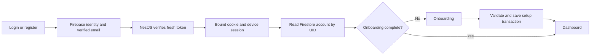

# Firebase auth and account routing — D-063

This implements the local auth/profile slice authorized on 14 October 2026, with D-064 frontend recovery/error hardening and D-065 [connected onboarding and introduction](ONBOARDING_CONTRACT.md). It supersedes browser storage for real authentication when `VITE_AUTH_MODE=firebase`. The original preview adapter remains for fictional offline development. It is not a complete production auth release.

> **Project switch (20 October 2026, D-102/D-103):** the product now uses Firebase project `visionary-research`. The environment notes below dated 14 October 2026 describe the former `visionary-fd6d2` project and are retained as history. The new project is on Blaze and has one Web app, Native Firestore database `default` in `asia-south1` with deployed client rules denying all reads/writes, and Email/Password, Phone, Google and Apple providers enabled. A bounded read-only Admin check on 20 October 2026 confirms Auth access with an empty Users list and access to `default`; no test identity, profile or document is created. The public Web configuration is committed at `infrastructure/gcp/firebase-web-config.json`; the private Admin credential remains in ignored local configuration and is not used by the hosted GCP runtime. Deployment source now targets `visionary-research`; the owner-run foundation and identity were applied on 20 October 2026, while the product image, canonical baseline, edge/DNS/TLS and hosted product deployment remain open. See `infrastructure/gcp/README.md` for the owner-run first-release sequence.

## Verified environment

Project `visionary-fd6d2` (former project; verification retained as 14 October 2026 history); Firestore Native database ID `default` (not `(default)`), location `asia-south1` (Mumbai), independently read from the control plane. Admin Authentication and the named Firestore database are readable. No production test identity/profile is created. The credential stays outside the repository; public Web configuration and private server configuration are ignored.

The config API reports `FIREBASE_AUTH`, contrary to the earlier owner-reported Identity Platform upgrade. Google and Apple provider configurations are enabled. Microsoft is not configured in that inventory; organization SAML/OIDC needs its upgrade/provider and tenant/domain routing contract. Phone, linking, guardian admission, recovery/reauthentication UX and full provider/device acceptance remain release gates. The owner-selected Firebase verification-link flow replaces the six-digit email code only in Firebase mode. Password recovery uses Firebase's email handler; `/reset-password` also accepts Firebase `oobCode`.

Live mutations are adding `localhost` to authorized domains while retaining the three existing domains, and a native transaction write/read of the retained `visionary_system_checks/auth-database-write` health record (purpose/schemaVersion/checkedAt only). No provider, password policy, billing, account, learning or model data is changed. TTL policy inspection returns403 and no TTL mutation succeeds. The founder subsequently explicitly requests keeping data and declines deletion. No TTL policy is enabled or requested further. Accounts, onboarding, auth-event history and session records are retained. Security expiry only ends access; logout marks the device session revoked. Automatic Firestore indexes support queries and do not implement retention/deletion; see [Firestore indexing](https://firebase.google.com/docs/firestore/query-data/indexing). Storage growth, future export/archive policies and any owner-authorized deletion remain later design work.

## Routes and authority

All routes live under `/api/auth` on the standalone `main-auth` application. No imported legacy JWT controller, Prisma, Redis or model provider is bootstrapped there. The old complete application is not certified for Firebase identities; protected business APIs must adopt the same authority before connecting them. Backend credentials never go to the Web SDK.

| Route | Behavior |
| --- | --- |
| GET `/csrf` | No-store token response and host-only HttpOnly SameSite Strict cookie |
| POST `/session` | Exact Origin/CSRF check; verify Firebase ID token with revocation; require verified email and auth_time within5 minutes; atomically retain/create profile, session and sign-in event |
| GET `/me` | Verify Firebase session cookie with revocation, device-cookie binding, UID,8-hour absolute expiry and30-minute inactivity expiry; load persisted profile |
| POST `/onboarding` | Authenticated UID only; bounded allowlist, adult admission, supported role/stage/name validation; first completion wins transactionally |
| POST `/onboarding/introduction` | Bound UID, Origin/CSRF and profile budget; empty acknowledgement only; completed setup required; introduction acknowledgement is idempotent and retained on the same account |
| PATCH `/profile` | Display name/account accent only; expected-name/accent conflicts return409; no claimed UID, consent, membership or onboarding completion |
| POST `/logout` | Exact Origin/CSRF; revoke device session and clear cookies, retaining account/profile/security history |

Session cookies are HttpOnly, host-only and SameSite Strict; HTTPS uses Secure `__Host-` names. HTTP is permitted only for explicit loopback development. The exact public origin is required; production runtime rejects HTTP. Firebase SDK identity persistence is memory-only, following [Firebase's session-cookie pattern](https://firebase.google.com/docs/auth/admin/manage-cookies). An opaque random device cookie indexes a SHA256-hashed session document; its Firebase-cookie fingerprint binds both cookies. Firebase Auth outage returns503; recognised invalid/expired/revoked identity returns401. Expired or revoked server sessions are rejected immediately; their records remain retained.

Profile response is an allowlisted product projection, not an Admin user record. Onboarding/profile mutations compare the expected account header with server authority, rejecting a stale tab/account with409. Logout checks a supplied UID; without cached identity, both bound cookies must match the retained device record. Canonical account ID is the verified UID. Missing profile/database outage is an error, not first-time onboarding. Completing setup is idempotent across devices. Repeated login preserves setup. Browser caches are cleared on account/workspace changes; stale responses cannot restore a signed-out account. Tabs notify each other with a noncredential epoch; focus rechecks server authority. Safe return paths apply only after onboarding completes.

## Persisted records and boundaries

| Collection | Contents | Lifetime / boundary |
| --- | --- | --- |
| `visionary_accounts/{uid}` | UID/storageVersion2, verified identity metadata, email/name, validated role preferences, onboarding state/version, creation/latest sign-in | Canonical retained account; no passwords, ID/session tokens or private keys |
| `visionary_accounts/{uid}/devices/{deviceHash}` | First/last seen, provider, observed IP/User-Agent and expiry/revocation for one browser session | Atomically synchronized with its server-only session lookup; no cookie hash/raw credentials |
| `visionary_accounts/{uid}/authEvents/{eventId}` | Owned retained sign-in/out history | Same transaction as the global security index; no token/cookie data |
| `visionary_auth_sessions/{deviceHash}` | UID, cookie hash, last activity, absolute expiry/revocation timestamp |8-hour access; retained history, revoked on logout |
| `visionary_auth_events/{randomId}` | UID, session hash, sign-in provider, server-observed IP, bounded User-Agent, timestamp |Retained security index; same event also lives beneath the UID |
| `visionary_auth_limits/{hmac}` | Counter and expiresAt; subject/window keyed with persistent server secret |2-minute logical counter expiry, retained records; atomic20/minute observed-IP session budget,10/minute UID session budget,20/minute profile-command budget |

Those budgets cover owned session/profile endpoints, not direct Firebase Web SDK signup/password/OAuth traffic. Firebase quotas, enumeration protection, password policy, reCAPTCHA/App Check where applicable, edge controls and cost alerts need console/deployment verification. Do not claim a comprehensive DDoS defense or a configurable Firebase password-attempt lockout.

In local development, the observed IP is normally loopback. The Express app does not trust arbitrary X-Forwarded-For. GCP ingress/proxy trust must be narrowly configured and tested before reporting public client IPs. IP/browser text is never proof of a person, guardian or organization, or a reason to merge/delete accounts. No Analytics, precise location, browser history, MAC address or covert fingerprinting is collected. The profile discards child name and organization contact fields that belong in later consent/organization services.

Under18 setup cannot activate a production learning workspace until verified guardian admission is implemented. This does not enforce guardian-first identity creation on Firebase's direct endpoints: blocking-function/provider policy and actual assurance/consent work are still required before a child-inclusive release. Adult age declaration is a statement, not verified identity.

Learning entities, workspaces, membership previews, content, subscription state and preferences beyond the account accent remain local preview services. Firebase account entities use a separate UID-scoped local namespace; legacy records and invitations are not automatically imported by matching email. The introduction/privacy UI describes the current sync boundary. D-067 removes the temporary status paragraph immediately below the dashboard app bar at the founder's request. Server role preferences never grant organizational permissions. No ML integration or curriculum publication is activated.

## D-067: Frontend/server handoff reliability (15 October 2026)

The auth transport bounds each request to one20-second deadline, including queued writes, Web Lock acquisition, CSRF fetch and CSRF recovery. Only safe GET requests retry once on a network failure or502/503/504;401/403/429 and arbitrary mutations do not retry. The existing known-CSRF403 recovery rechecks account-generation guards before sending either token refresh or mutation. Cookie mutations remain serialized across supported tabs and within the current tab. A timeout does not prove a server write was rolled back; setup/introduction retain their server-side idempotency.

Concurrent account reads share one in-flight request. A confirmed mutation invalidates older reads. Login, verification, onboarding, introduction and profile updates adopt their authenticated canonical response in AuthContext directly instead of making a second confirmation read. Expected UID and account-epoch checks reject stale account transitions; query caches clear on account changes. Normal error mapping and retry affordances remain in place.

Visible, trusted pointer/keyboard activity quietly revalidates server authority at most once per five minutes, while no account command is active. Capture listeners include keyboard controls that stop bubbling. Focus also revalidates. There is no background keepalive interval; the existing30-minute idle and8-hour absolute limits remain server-owned. Inactive sessions still expire. Connection/loading/recovery states use the product font surface and accessible status text.

Rendered fictional browser checks verify actual custom Google Sans glyphs from local Regular/Medium font files on login, registration, onboarding, dashboard and account-service recovery. No Google Fonts CDN is requested in these fixtures. Public-site typography remains a separate existing surface. Nine role/learner scenarios also assert zero redundant profile GETs after confirmed setup/introduction; four routing fixtures and eleven real Auth Emulator workflows pass. See [QA](../docs/visionary/QA.md) for precise evidence and remaining production gates, and [the payment auth handoff](PAYMENTS_AUTH_HANDOFF.md) for the next design boundary.

## Local operation and checks

1. Use Node22/24 LTS. Copy the environment templates into ignored component config when setting up another machine. Keep service-account JSON outside source. Set the correct project/database, `AUTH_PUBLIC_ORIGIN=http://localhost:5173` and a persistent random `AUTH_RATE_LIMIT_KEY` with at least32 characters.
2. `npm run backend:build`, then `npm run backend:auth:dev` starts the standalone auth server on127.0.0.1:3001. The development command watches source, so rebuilding the disposable dist output does not stop it. Compiled production output is dist/src/main-auth.js; deployment remains separate. The old `backend:dev` application is a different startup path.
3. `npm run dev -- --host 127.0.0.1 --port 5173 --strictPort`; visit `http://localhost:5173`. Vite proxies `/api` to the auth server. Using127.0.0.1 in the browser or preview4173 requires matching origin configuration and authorized-domain review.
4. After building, `npm run backend:firebase-check -- --firestore` performs bounded read-only identity and named-database probes without displaying accounts or writing records.
5. `node --test backend/tests/firebase-admin.test.cjs backend/tests/firebase-product.test.cjs`, root `npm run check`, and `node frontend/scripts/firebase-auth-review.mjs` cover configuration isolation, offline service/HTTP contracts and rendered routing. Browser fixtures never create live accounts or prove real OAuth/SMTP/provider acceptance.

The named database's deployed rules are independently read and deny all client reads/writes. A bounded anonymous read probe returns403. [Matching prepared rules](../infrastructure/firebase/firestore.rules) retain that server-only boundary as source; no rules deployment is performed. The Admin SDK uses IAM and bypasses client rules. Protect security metadata with narrow runtime IAM and operational access. Deployment, real provider/verification delivery, concurrency/load/cost tests, region/service placement, full deletion/export policy, guardian-first admission and retention/export/archive policy remain separately tracked.

## D-064 frontend lifecycle and recovery

Auth screens render allowlisted recovery messages rather than Firebase codes, API bodies, stack traces or private values. Wrong credentials, offline/timeouts, service outages, throttling, provider conflicts, cancelled/blocked popups, expired/used email actions and changed sessions are distinguished. Database/service failures are not mislabeled as incorrect passwords. Duplicate registration offers sign-in/reset without overwriting credentials, deleting data or merging accounts by IP/email. An unimplemented forgot-user-ID service no longer claims to send recovery messages; the page gives truthful inbox/provider guidance.

Repeated submissions are guarded at UI and identity-operation boundaries. Delayed sign-in checks its generation before session exchange and again after entering the network queue, so logout cancels obsolete work. Malformed profiles cannot authenticate the UI. Web Locks serialize cookie mutations across supported browser tabs; per-tab serialization, CSRF and server UID binding remain the fallback. Profile and ephemeral query caches are invalidated on auth changes; persisted account/onboarding/learning data is retained.

Registration/reset validate the live Firebase password policy and display unmet requirements. The demo-only Auth Emulator does not implement getPasswordPolicy: isolated tests use its native default admission; live policy is never bypassed. Verification has visible resend cooldowns, recovery from mail-delivery failure without repeated identity creation, and a fresh-sign-in path. Reset validates an action before enabling password entry. Success is distinct from subsequent device-cleanup failure, so an already-consumed reset action is not retried as if no password change occurred. Completion revokes the current device session, clears cookies and transient identity, and resumes sign-in without changing saved onboarding. Firebase also [revokes existing tokens after password resets](https://firebase.google.com/docs/auth/admin/manage-sessions).

The /auth/action page handles verifyEmail and resetPassword using the fixed configured project. Incoming apiKey/continueUrl values cannot switch project or redirect to another site. Default Firebase-hosted email handlers remain unchanged in the live project; configure the custom handler only after trusted hosting/domain deployment. Inputs have real label associations and status/error descriptions; auth cards can scroll on short screens. Onboarding language/choice/chip buttons have explicit button types to prevent accidental form submission.

Repeated same-UID sign-in rotates only a proven current-device session and retains its revoked history. Sign-in events also mark first product-account sign-in; sign-out events store observed IP/browser/timestamp. An existing production sign-in event is read once with IP/browser projection: the check confirms fields exist and that the current local IP is loopback, without printing user details or modifying the record. Device IP is security context, not an account-sync identifier. Passwords, action codes, SDK refresh/ID tokens and failed unverified identifiers are not persisted. Direct Firebase verification/reset events are not fabricated as trusted application audit records.

### Isolated workflow review

Firebase CLI15.33.0 Auth Emulator runs only for demo-visionary-auth on127.0.0.1:9099. No Java/Firestore emulator is needed: backend/tests/auth-browser-server.cjs verifies real emulator ID/session tokens with Firebase Admin and uses a transactional memory profile repository on127.0.0.1:3035. It never loads the production .env/key or contacts live Firestore. Test Vite5175 uses a guarded loopback proxy and explicit demo Web configuration; a missing/remote/production emulator setting fails closed. Actual local product5173/3001 remains separate.

After backend build and starting the Auth Emulator/harness/test Vite, node frontend/scripts/auth-emulator-review.mjs covers registration, native email action verification, first onboarding, persisted dashboard reload, forgot/reset actions, used-link rejection, old-password rejection, new-password return to the same profile, duplicate registration, truthful recovery and mobile layout. Test identities/actions are fictional; no live emails/SMS or production accounts/passwords are used. Firebase emulator SDK and server token verification are real; the product database is simulated in that harness. Source/configuration/error/unit checks remain separate from actual Apple/Google/Microsoft/SAML/phone/provider/browser/cloud acceptance.
