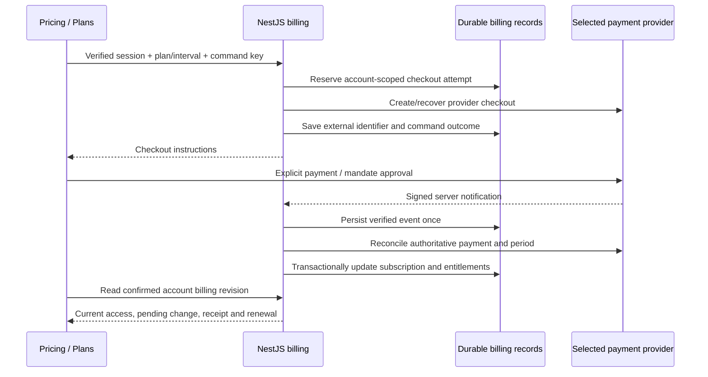

# Proposed connected billing design

15 October 2026. Historical proposal from the [payment study](../research/PAYMENTS_STUDY_2026_10_15.md). D-069 implements the bounded Razorpay test slice in [PAYMENTS_CONTRACT.md](PAYMENTS_CONTRACT.md); that contract distinguishes implemented behavior from remaining release work. Auth/onboarding is the connected foundation described in [PAYMENTS_AUTH_HANDOFF.md](PAYMENTS_AUTH_HANDOFF.md). This proposal alone does not establish implementation of every endpoint, policy or acceptance case below.

## Ownership and first slice

Start with adult Personal web checkout, verified payment, plan/usage readback, cancellation at period end and reconciliation. Then connect Family benefits and verified organization billing as separate slices. Keep the existing public pricing and internal journeys; replace their billing service boundary and preserve accurate pending/recovery states.

NestJS owns catalog, payer authority, checkout commands, provider verification, billing records, access and usage. Reuse the current Firebase Admin/named Firestore setup through a dedicated repository rather than silently starting the imported Prisma/JWT app. Confirm transactional/index/worker deployment support before runtime cutover. Browser storage remains preview data and cannot establish paid access. ML receives a bounded server-authorized usage decision and never decides billing ownership.

A browser success callback only changes the UI to checking payment. It does not activate access. A server verification operation may reconcile immediately for responsiveness; webhook processing and scheduled reconciliation must converge through the same state transition.

## Catalog and identifiers

Use stable `start`, `personal`, `family`, `institution` identifiers across public pricing, reviewed server catalog and internal live views. A preview-only adapter can map Free→start and Premium→personal without rewriting retained browser records. Version the production catalog; snapshot price/terms on each attempt and invoice. Public copy and server catalog must be checked for drift. Server prices are authoritative and browser-supplied amounts are rejected.

| Plan | Monthly base amount (INR minor units) | Annual base amount (INR minor units) | Boundary |
| --- | --- | --- | --- |
| Start | 0 | 0 | Free entitlement; no provider subscription |
| Personal | 29900 | 299000 | One person; yearly charge is ₹2,990 |
| Family | 49900 | 499000 | Provisional until confirmed; six including owner |
| Institution | No self-service amount | No self-service amount | Contract/contact-led |

These are existing displayed prices expressed precisely, not confirmed tax totals. Do not enable paid offers until tax treatment and checkout disclosures are configured. Display annual equivalent as approximately ₹249.17/₹415.83 per month or retain rounded marketing text alongside the exact annual charge. Use provider/calendar period timestamps, never the demo's 30-day approximation. Educator discounts require a defined server-owned offer and verified eligibility; they cannot follow an email suffix alone.

## Durable records and authority

| Record | Minimum responsibilities |
| --- | --- |
| Billing account | Stable ID, verified owner UID, provider customer mappings scoped by merchant/environment; organization ownership only through verified membership permissions |
| Checkout attempt / command | Owner, catalog version, plan/interval, request hash, idempotency key, status, provider IDs, timestamps, expiry, recovery state |
| Subscription | Billing account, provider/channel/environment, plan/interval, exact period, paid-through, renewal state, scheduled change, provider version/evidence, revision |
| Payment / invoice / adjustment | Immutable financial references and amount/currency/status; distinguish payment, invoice, refund, partial refund, dispute and reversal |
| Verified event inbox | Provider/merchant/environment/event identity, payload digest, verification metadata, received/processed state and durable retry information |
| Entitlement projection | Beneficiary UID, source subscription/seat, capabilities, validity interval and monotonic account revision |
| Family / institution allocation | Explicit accepted beneficiary/seat, grant source, revocation, capacity and billing authority; separate from guardian/report permissions |
| Usage reservation | UID, operation ID, meter/version, UTC window, reserved/committed/released state; atomically enforce allowance across devices |

Do not store card, CVV, UPI PIN or banking credentials. Provider checkout handles payment entry. Scope provider IDs and deduplication by test/live environment and merchant as well as provider. Use unique account/command and provider-mapping records with transactional creation. A browser role, email, local family, arbitrary organization ID or supplied UID is never authority. Existing underage/unknown-age admission restrictions remain; this slice does not invent guardian purchasing.

## State, failures and synchronization

Checkout attempt state (`created`, `awaiting_customer`, `processing`, `succeeded`, `failed`, `expired`, `reconciling`) is separate from subscription state (`active`, `past_due`, `suspended`, `ended`) and renewal preference. Initial unpaid attempts grant no paid access. Mandate authorization by itself does not prove a paid service period. Paid access derives from verified payment/period and explicit grace policy. An ambiguous or failed new checkout does not revoke an already-paid subscription.

Cancellation schedules non-renewal; access lasts through the verified paid-through timestamp unless a separately verified refund/revocation policy applies. Confirm the provider accepted cancellation before presenting it as complete. Failed cancellation leaves the previous renewal status visible with recovery. Resume is allowed only where the provider supports it; otherwise explain the new purchase needed after expiry. Downgrades use a scheduled effective date. Upgrades need a disclosed provider quote and proration rule before any immediate-charge path. No silent trial, refund rule, grace extension or automatic second purchase.

Persist an account-scoped command before external creation. Use provider idempotency only where the selected API supports it. Where creation times out and recovery cannot prove whether a subscription was created, retain `reconciling` and recover by trusted identifiers/provider lookup or operator review; never blindly create another. External calls cannot be made atomic with a Firestore transaction. A durable command/outbox workflow must account for a crash before or after provider creation. Reusing a command key with different inputs returns conflict.

Webhook processing verifies the original bounded raw bytes and provider signature before parsing or trusting an event ID. The webhook route uses provider authentication rather than browser cookies/CSRF. Validate merchant/environment, catalog, currency, customer/subscription mapping and expected beneficiary scope. Unknown mappings remain quarantined without granting access. Invalid signatures fail; storage failures request provider retry. Acknowledge success only after durable acceptance or confirmed deduplication, then let a durable worker process the inbox. In-memory work after sending 2xx is insufficient.

Provider events can repeat or arrive late. Deduplicate verified event identity transactionally, serialize work per subscription and reconcile provider state outside the database transaction. Apply with a revision/lease check so an older worker cannot overwrite a newer result. Do not assume delivery order, event ID ordering or receipt time defines the current state. Reconcile ambiguous, missed and pending events periodically; use provider status/history APIs as supported. A refund/reversal affects only its matching payment/period and must not erase unrelated later renewals. Test unknown payment states and concurrent reconciliation explicitly.

Compute effective entitlements for the verified UID on the server across personal, accepted Family and assigned institution sources. Switching role/workspace does not create another personal subscription or reset usage. A beneficiary may have overlapping grants; ending one must retain another valid source. Show who manages each benefit. Family changes enforce capacity atomically, count outstanding reservations where policy requires, and never imply report/conversation access. Institution seats cannot be activated from the existing local acknowledgement action.

Return `revision`, `asOf`, `validUntil`, current source, renewal status, exact charge/currency, scheduled changes, payment state and bounded next actions. Authenticated billing reads use no-store. Clear client billing cache on logout/account change; bind queries/commands to the expected UID and discard obsolete responses. Revalidate on checkout return, foreground return and confirmed commands. Use bounded visible polling/backoff only while reconciliation is pending, then show a recoverable status. Offline/unknown billing may show the last-confirmed view with its timestamp; it must not authorize paid server operations. Never retry a charge command automatically after a network error.

## Proposed API boundary

Route names are proposals, to be finalized with the provider adapter:

| Operation | Authority / response |
| --- | --- |
| `GET /api/billing/catalog` | Published server catalog, version, available offers/intervals and terms; never secret price configuration |
| `GET /api/billing/account` | Verified session/device; payer and beneficiary view with revision, grants, usage and renewal |
| `POST /api/billing/checkouts` | Shared exact-Origin/CSRF/session/device/expected-UID guard, adult payer, strict DTO, rate limit and command key |
| `GET /api/billing/checkouts/:id` | Owner-scoped pending/confirmed outcome; opaque ID is not authorization |
| `POST /api/billing/subscriptions/:id/cancel-renewal` | Verified billing owner, expected revision and idempotent command |
| `POST /api/billing/subscriptions/:id/resume-renewal` | Same checks plus provider-supported lifecycle |
| `POST /api/billing/management-session` | Owner-scoped short-lived provider management session; fixed allowlisted return destination |
| `GET /api/billing/invoices` | Owner-scoped verified financial history; beneficiaries do not inherit payer invoice access |
| `POST /api/billing/webhooks/:provider` | Raw-body provider authentication, durable inbox; no browser authority |

Reuse existing auth transport account/deadline behavior. First extract and regression-test the controller-private authority helpers, preserving cookie names, expiry, Origin/CSRF handling and expected-account conflict behavior. Keep authentication profile DTO separate from payment ledger and entitlement responses. Strict return-URL allowlists prevent an arbitrary checkout or portal redirect destination.

Public plan selection is non-authoritative intent. Persist only allowlisted plan/interval across registration/onboarding; after verified setup show the signed-in payer and exact reviewed server offer. Returning users can reach the same review directly. Losing an intent recovers to Plans rather than automatically charging. Existing completed onboarding and saved introduction are never reset by billing.

## Required verification for implementation

| Scenario | Observable acceptance |
| --- | --- |
| Catalog and annual choice | Correct INR minor units and annual total; invalid/unpublished/provisional offers rejected; rounding never changes charge |
| Wrong account/device/Origin/CSRF/owner | Request refused before provider side effect; no cross-account response or invoice leakage |
| Initial success / false browser success | Only verified paid evidence grants access; reloading another device reads the same revision |
| Duplicate submit / timeout / crash | One recoverable command, no second charge/subscription; mismatched key input conflicts |
| Mandate pending / checkout failed | No new grant; existing paid plan and saved learning retained |
| Duplicate/out-of-order/missed event | Inbox deduplicates, workers converge, stale reconciliation cannot roll state back |
| Tampered body/signature or wrong merchant/environment | Rejected before grant; raw-body handling proven over native HTTP |
| Database outage / worker crash | No premature webhook acknowledgement; durably accepted work resumes after restart |
| Cancellation/resume/expiry | Provider-confirmed renewal state, exact paid-through boundary, correct calendar/leap/month-end behavior |
| Refund/dispute/late renewal | Correct scoped adjustment, no accidental removal of a later paid period or another grant |
| Account switch/logout/offline | Obsolete responses discarded, cache scoped/cleared, no local entitlement escalation |
| Family concurrency/privacy | Six-member limit enforced atomically; removed grant reconciles across devices; reports/conversations still require separate permission |
| Organization access | Verified owner/billing administrator only; seats and contract terms enforced independently of onboarding role |
| Usage concurrency/retry/failure | Atomic server reservation, one operation counted once; failed/cancelled model requests follow explicit metering policy |
| UI and accessibility | Existing desktop/mobile Plans and pricing journeys, visible focus, announced pending/errors, explicit renewal review and reachable recovery |

Unit and emulator fixtures prove our logic; provider sandbox native HTTP tests prove actual signatures, payment lifecycle and recovery integration. Real recurring-method eligibility, signed webhook delivery to the reviewed public endpoint, Firestore transaction/concurrency behavior and deployment/load/operational recovery need their own acceptance. No production certification follows from local fixtures.

## Implementation sequence and open inputs

1. Confirm merchant account/countries/methods, final catalog/tax/Family/usage policy and test-webhook host. Define invoice/refund/grace/proration and retention policies.
2. Extract shared request authority; add billing repository/catalog, strict DTOs and provider adapter with meaningful state/concurrency tests.
3. Connect Personal sandbox checkout and durable verified-event reconciliation; prove crash/timeout recovery before enabling a purchase button.
4. Connect the routed Plans page and auth intent, preserve existing visual journeys, add renewal/receipts/recovery and test cross-device/account switching.
5. Add accepted Family allocations, then institution contracts/seats after their server membership authority exists; connect server usage enforcement at the actual ML request boundary.
6. Review deployment/raw-body ingress, secrets, workers, alerts, reconciliation and restore procedures; perform sandbox and real-method acceptance before live enablement.

This sequence deliberately leaves paid features disabled until the provider-specific service can verify them. The current work supplies the investigation and reviewable design requested before implementation.
